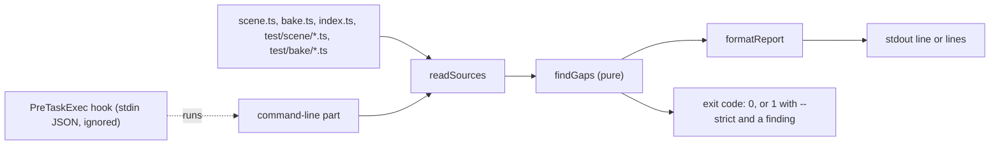
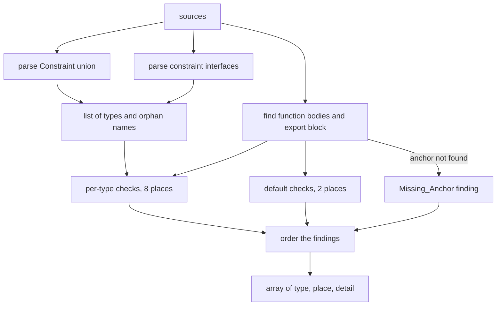

# Design Document

## Overview

constraint-checklist adds a report-only script, `scripts/check-constraints.mjs`, and a hook that runs it before every spec task. The script reads `scene.ts`, `bake.ts`, `index.ts` and the test folders `test/scene/` and `test/bake/` under `packages/pathkit` as plain text. For every constraint type it reports which places forget it. It reads files and prints text. It never writes, never blocks and never calls a model.

Everything is one `.mjs` file with Node built-in modules only (`node:fs`, `node:path`, `node:url`). The logic that decides is a pure function, `findGaps(sources)`. File reading, formatting and the command-line part are separate small functions, so tests can feed fixture strings to the pure part and run the whole program in a temporary folder.

Design decisions:

- **Report only.** In the middle of a spec the code is meant to be inconsistent. The hook runs `node scripts/check-constraints.mjs` without `--strict` and the script exits 0 in that mode, whatever it finds. `--strict` is for a person at the end of a spec. (Requirements 8, 9)
- **Text matching, not parsing.** The script does not parse TypeScript. It uses a few regular expressions and brace counting. This is enough for the shapes in `scene.ts`, `bake.ts` and `index.ts` and needs no dependency. The cost is that unusual formatting can fool it. A fooled script shows up as a gap or a "cannot find" line, never as a crash. (Requirements 4, 8.5)
- **Types come from the text.** There is no list of `followPath`, `aimAt` or `orbitAround` in the script. A fourth type is found the moment it is added to the union or declared as an interface. (Requirement 1.5)
- **Skip a parameter list before counting braces.** The brief says to find `function name(` and count braces. The design first counts parentheses to get past the parameter list, then counts braces from the next `{`. A parameter type written as `{ a: number }` therefore cannot start the count early. None of the three functions has one today. The extra step costs a few lines.
- **Whole-word matching for the two test checks and for `validate-message`.** A name counts when the characters directly before and after it are not letters, digits or underscores, and the match is case-sensitive. Reasons: the real `orbitAround` scene tests build constraints through a helper and mention the name only in titles and messages, so a quoted-name check would report a false gap. A whole-word check also stops `orbit` matching inside `orbitAround`. **Limit, stated in the script header too:** the check shows that a test file mentions the type, not that the type is tested well, and a name in a comment also counts. (Requirements 2.3, 2.7 to 2.10)
- **An unlisted interface is a gap. A listed name without an interface is also a gap, but without a guessed type.** For a name in the union that no interface declares there is no `type:` literal, so the script does not derive one from the name. It reports one `union` gap with the interface name where the type would go and skips the other per-type checks for it. (Requirement 1.4)
- **A missing anchor is a finding.** If the union, a function or the export block cannot be found, the script reports `cannot find ...` and skips only the checks that need it. (Requirement 4)
- **No stack trace, ever.** The whole run sits in one `try`. Any error becomes one line, `constraint-checklist: cannot run (<reason>)`. (Requirement 8.5)
- **Standard input is never read.** The hook sends JSON on standard input. The script does not touch `process.stdin`, so the content cannot matter. (Requirement 8.4)
- **Tests run the real program.** Beyond fixture strings, the test file copies the script into a temporary folder with a small fake `packages/pathkit` tree and runs it as a separate process. This tests file reading, path handling, output and exit codes without editing any repository file and without an environment switch in the script.

## Architecture



Inside `findGaps`:



Files:

| File | Change |
| --- | --- |
| `scripts/check-constraints.mjs` | New. The Checker. |
| `scripts/check-constraints.test.mjs` | New. Tests, run with `node --test`. |
| `.kiro/hooks/constraint-checklist.json` | New. The hook. |
| `.kiro/specs/constraint-checklist/requirements.md`, `design.md`, `tasks.md` | New. |
| `docs/adding-a-constraint.md` | One line added at the end of the checklist. |
| `.kiro/probe/checklist-received.txt` | Temporary. Created once by a sub-agent, deleted by the user after reading. |
| Everything under `packages/pathkit`, every `package.json`, `scripts/guard-*`, `.kiro/hooks/guard-*` | None. |

## Components and Interfaces

### Exports of `scripts/check-constraints.mjs`

```js
export function findTypes(sceneText)        // { types, orphans, unionFound } (pure)
export function findGaps(sources)           // Finding[] (pure)
export function formatReport(sceneText, findings)   // the text to print (pure)
export function readSources()               // Sources, reads the real files
export function runChecker(strict, load = readSources)  // { text, code }, never throws
```

`runChecker` takes the loader as a parameter only so that a test can make it throw. The command-line part does not use the parameter.

Types used below (shown as comments, the file is plain JavaScript):

```js
// Sources  = { scene, bake, index, sceneTests: [{name, text}], bakeTests: [{name, text}] }
// Finding  = { type, place, detail }   type is '' for a default place and for a missing anchor
```

### Constants

Paths are written as arrays of segments and joined with `node:path`, so no slash is typed anywhere. For messages the repository paths are shown with forward slashes, built by joining the same segments with `'/'`.

```js
const SRC = ['packages', 'pathkit', 'src'];
const SCENE_FILE = 'packages/pathkit/src/scene.ts';   // text shown in messages only
const BAKE_FILE  = 'packages/pathkit/src/bake.ts';
const INDEX_FILE = 'packages/pathkit/src/index.ts';
const CHECKLIST  = 'docs/adding-a-constraint.md';
const TYPE_PLACES = ['union', 'validate-case', 'validate-message', 'bake-case', 'rotation-case', 'export', 'scene-test', 'bake-test'];
```

The path strings in messages are display text. File reading uses `path.join` with the segment arrays.

### Helper functions (all pure, each with one comment line above it)

| Function | What it does |
| --- | --- |
| `escapeRegExp(text)` | Escapes a string for use inside a regular expression. |
| `hasWord(text, word)` | `true` when `word` appears as a Whole_Word_Match: `new RegExp('(?<![A-Za-z0-9_])' + escapeRegExp(word) + '(?![A-Za-z0-9_])').test(text)`. |
| `hasCase(body, type)` | `true` when the body contains `case 'type'` (single or double quotes, optional spaces before the colon). |
| `functionBody(text, name)` | Returns the text from the first `{` after the parameter list to its matching `}`, or `null`. |
| `defaultBranch(body)` | Returns the text from the first `default` followed by `:` to the end of the body, or `null`. |
| `exportedNames(indexText)` | Returns the names in every `export type { ... } from './scene.js'` block, or `null` when there is none. |

`functionBody` in steps:

1. Find `\bfunction\s+<name>\s*\(`. No match: return `null`.
2. From that `(`, count `(` and `)` until they balance. This skips the parameter list.
3. Find the next `{`. From there count `{` and `}` until they balance. Return the text between them (including the outer braces). If the text ends first, return `null`.

Strings, template literals and comments are not treated specially. The brief states that braces in these functions balance. If a comment inside one of the three functions ever contains an unbalanced brace, the count is wrong and a gap or a "cannot find" line appears. That limit is stated in the header comment.

### Parsing the types (`findTypes`)

1. **Union.** Match `/export\s+type\s+Constraint\s*=\s*([^;]+);/`. Split the capture on `|`, trim each part, drop empty parts. The result is the list of interface names in union order. It works for one line or several lines. No match: `unionFound = false` and the list is empty.
2. **Interfaces.** Match every `/export\s+interface\s+(\w*Constraint)\s*\{([^}]*)\}/g`. For each, look in the body for `/\btype\s*:\s*['"]([^'"]+)['"]/`. An interface with no such literal is ignored. This gives `{ iface, type }` in file order.
3. **Types.** For each union name, in order: if an interface has that name, the entry is `{ iface, type, listed: true }`. If none has it, the name goes to `orphans` (Requirement 1.4). Then every interface not named in the union is added after them, in file order, as `{ iface, type, listed: false }`. When the union was not found, every interface is added this way and no `union` check runs for them (the anchor is missing).

The `[^}]*` in step 2 works because an interface in `scene.ts` has no braces inside its fields. A field with an inline object type would end the match early. The header comment says so.

### The checks (`findGaps`)

Anchors are looked up once: `scene.checkConstraintOfType`, `bake.bakeEntity`, `bake.drivesRotation`, the export block. Each lookup that returns `null` adds one Missing_Anchor finding and marks that anchor unavailable.

For each entry in `types`, in order, the checks run in `TYPE_PLACES` order. A check that needs an unavailable anchor is skipped. A gap's `detail` is fixed text, so tests can compare exact strings:

| Place | Gap when | `detail` |
| --- | --- | --- |
| `union` (only when the union was found, and `listed` is false) | the interface is not in the union | `<Iface> is not in the Constraint union in packages/pathkit/src/scene.ts` |
| `validate-case` | `hasCase(checkConstraintOfType body, t)` is false | `no case '<t>' in checkConstraintOfType, packages/pathkit/src/scene.ts` |
| `validate-message` | the default branch of that body is missing, or `hasWord(defaultBranch, t)` is false | `the default message in checkConstraintOfType does not mention <t>, packages/pathkit/src/scene.ts` |
| `bake-case` | `hasCase(bakeEntity body, t)` is false | `no case '<t>' in bakeEntity, packages/pathkit/src/bake.ts` |
| `rotation-case` | `hasCase(drivesRotation body, t)` is false | `no case '<t>' in drivesRotation, packages/pathkit/src/bake.ts` |
| `export` | `<Iface>` is not in `exportedNames(index)` | `<Iface> is not exported from packages/pathkit/src/index.ts` |
| `scene-test` | no file in `sceneTests` has `hasWord(text, t)` | `no file in packages/pathkit/test/scene mentions <t>` |
| `bake-test` | no file in `bakeTests` has `hasWord(text, t)` | `no file in packages/pathkit/test/bake mentions <t>` |

For each name in `orphans` the Gap is `{ type: <Iface>, place: 'union', detail: '<Iface> is listed in the Constraint union but no interface declares it' }`. No other check runs for it.

After the per-type checks, the two default checks run once:

| Place | Gap when | `detail` |
| --- | --- | --- |
| `bake-default` | the `bakeEntity` body has no `default` branch, or that branch does not contain `unknownConstraintType(` | `bakeEntity has no default branch calling unknownConstraintType, packages/pathkit/src/bake.ts` |
| `rotation-default` | the same for `drivesRotation` | `drivesRotation has no default branch calling unknownConstraintType, packages/pathkit/src/bake.ts` |

Missing anchors use `place: 'anchor'` and these details:

| Anchor | `detail` |
| --- | --- |
| union | `cannot find the Constraint union in packages/pathkit/src/scene.ts` |
| function | `cannot find checkConstraintOfType in packages/pathkit/src/scene.ts` (or `bakeEntity` or `drivesRotation` in `packages/pathkit/src/bake.ts`) |
| export block | `cannot find the export type block in packages/pathkit/src/index.ts` |

**Order of the result** (Requirement 7.5): for each entry in `types` and each orphan, in union order (orphans at their union position, unlisted interfaces last), the per-type gaps in `TYPE_PLACES` order. Then `bake-default`, `rotation-default`. Then the Missing_Anchors, in the order union, `checkConstraintOfType`, `bakeEntity`, `drivesRotation`, export block.

`findGaps` builds new arrays and strings and never writes to `sources`.

### Output (`formatReport`)

Let `names` be the `type` values from `findTypes` (orphans excluded) and `n = names.length`. Let `k = findings.length`.

- `k = 0`: `constraint-checklist: <n> constraint types (<names joined with ", ">), every place covered.`
- `k > 0`: the header `constraint-checklist: <k> gaps for <n> constraint types.`, then one line per finding, then `Checklist: docs/adding-a-constraint.md`. A finding with a non-empty `type` prints `  - <type>: <place> (<detail>)`. A finding with an empty `type` prints `  - <place> (<detail>)`. The lines are joined with `\n`.

Decision: orphans are not counted in `n`, because they have no constraint type. `k` counts every finding, Missing_Anchors included (Requirement 7.4). The header says "gaps" for all findings, as the brief's example does.

### Reading the files (`readSources`)

```js
const root = path.resolve(path.dirname(fileURLToPath(import.meta.url)), '..');
```

`readSources` reads `scene.ts`, `bake.ts` and `index.ts` from `path.join(root, ...SRC)`. For each of `test/scene` and `test/bake` under `packages/pathkit` it lists the directory with `readdirSync`, keeps names that end in `.ts`, sorts them, and reads each as UTF-8 into `{ name, text }`. The listing is not recursive. A file or folder that cannot be read throws, and `runChecker` turns the error into the "cannot run" line. The function only reads.

### The command-line part

```js
function isMain() {
  return process.argv[1] !== undefined &&
    import.meta.url === pathToFileURL(path.resolve(process.argv[1])).href;
}
if (isMain()) {
  const result = runChecker(process.argv.slice(2).includes('--strict'));
  process.stdout.write(result.text + '\n');
  process.exitCode = result.code;
}
```

`runChecker(strict, load)`:

1. `try`: `sources = load()`, `findings = findGaps(sources)`, `text = formatReport(sources.scene, findings)`, `code = strict && findings.length > 0 ? 1 : 0`.
2. `catch (error)`: `text = 'constraint-checklist: cannot run (' + reason + ')'`, where `reason` is the first line of `error.message`, or `String(error)` when there is no message. `code = strict ? 1 : 0`.

The file sets `process.exitCode` and does not call `process.exit`, so the output is flushed. `isMain` compares file URLs, which works for Windows drive letters and for paths with spaces. When the test file imports the module, `process.argv[1]` is the test file, so the command-line part does not run.

### The hook

`.kiro/hooks/constraint-checklist.json`, exactly as in the brief:

```json
{
  "version": "v1",
  "hooks": [
    {
      "name": "Constraint checklist",
      "trigger": "PreTaskExec",
      "matcher": ".*",
      "action": { "type": "command", "command": "node scripts/check-constraints.mjs" }
    }
  ]
}
```

It has no `--strict`, no id and no file name that starts with `guard-`, and no field for a model. Facts measured on 22 November 2026 and not re-tested: the hook runs from the repository root, goes live immediately, receives `session_id`, `hook_event_name`, `cwd`, `spec_name` and `task_name`, and exit 0 does not interrupt the task. What is **not** established: that the agent doing a task receives the text. The earlier test rests on a sub-agent's report, and the main agent did not see the output. The last task tests it with a file the sub-agent writes (see Testing Strategy).

### The docs line

One line is added at the end of the checklist in `docs/adding-a-constraint.md`, after `- [ ] Flag file deleted.`, in the same style:

```
- [ ] `node scripts/check-constraints.mjs --strict` run before declaring the constraint finished. It prints one line and every place is covered.
```

No other line of that file changes.

## Data Models

- **Sources**: `{ scene, bake, index, sceneTests, bakeTests }`. The first three are strings. The last two are arrays of `{ name, text }`.
- **Finding**: `{ type, place, detail }`, all strings. `type` is the constraint type for a per-type gap, the interface name for an orphan, and `''` for a default place or a missing anchor. `place` is a Place_Id or `anchor`.
- **Types entry** (internal): `{ iface, type, listed }`.
- **Result of `runChecker`**: `{ text, code }`.

The functions create new strings and arrays and no module-level state. Nothing depends on history, the clock or randomness.

## Error Handling

| Situation | Result |
| --- | --- |
| Union, function or export block not found | A `cannot find ...` finding. Dependent checks skipped. Other checks run. |
| A function exists but has no `default` branch | A gap for the default place (and `validate-message` gaps for every type, for `checkConstraintOfType`). |
| A source file or test folder cannot be read | One line `constraint-checklist: cannot run (<reason>)`. Exit 0, or 1 with `--strict`. |
| Any other thrown error | The same line. No stack trace. |
| Standard input holds anything | Ignored. Never read. |
| Windows line endings (`\r\n`) in the sources | Handled: every pattern uses `\s` or no line-bound anchors. |
| A name in a test comment | Counts as a mention. Stated limit. |
| A brace inside a comment or string in one of the three functions | Brace counting can be wrong. The result is a gap or a `cannot find` line. Stated limit. |

## Testing Strategy

The tests use `node --test` and `node:assert/strict`, in `scripts/check-constraints.test.mjs`. They do not run with `npm.cmd test`. The command is `node --test scripts/check-constraints.test.mjs`, from the repository root. The property-based library is not used: the only dev dependencies are `vitest` and `fast-check`, and they belong to the Vitest setup. The checks below are example tests with hand-written expected values.

**Fixtures.** A helper `makeSources(types)` builds a small, complete `Sources` from a list of type names, for example `['alpha', 'beta', 'gamma']`. For each type `t` it writes an interface `<T>Constraint { type: 't'; }`, a union entry, a `case 't'` in `checkConstraintOfType`, `bakeEntity` and `drivesRotation`, a mention in the default message `(use alpha, beta or gamma)`, a name in the `export type { ... } from './scene.js'` block and one test file text per folder that contains each name. Both `default` branches call `unknownConstraintType(`. Individual tests remove or add one piece with `String.prototype.replace` on a known substring, and every expected finding is written out by hand in the test. The fixture names differ from the real types so a test cannot pass by reading the real repository.

**Temporary tree for process tests.** A helper builds a folder under `os.tmpdir()` with `scripts/check-constraints.mjs` (a copy of the real script), and `packages/pathkit/src/*.ts` and `packages/pathkit/test/{scene,bake}/*.ts` written from fixtures. The tests run `process.execPath` on the copy with `spawnSync`, and remove the folder afterwards. The script finds its root from `import.meta.url`, so the copy reads the fake tree. No repository file is written.

| # | Test | Requirements |
| --- | --- | --- |
| T1 | Complete fixture with three types gives `[]` | 12.3, 5.5 |
| T2 | A fourth type added only to the union and interface gives exactly seven gaps for it, in `TYPE_PLACES` order, and none for the other three | 12.4 |
| T3 | For each of the ten place ids, remove only that place from the complete fixture (for a per-type place, only for the second type) and expect exactly one gap, written by hand | 12.5, 2.1 to 2.8, 3.1, 3.2 |
| T4 | A `default` branch that does not call `unknownConstraintType(` gives the default gap. A missing `default` gives it too. For both functions. A fourth type gives still only one default gap per function, not one per type | 12.6, 3.3 |
| T5 | An interface with a `type:` literal that is not in the union gives a `union` gap and the other places are still checked for it | 12.7, 1.3 |
| T6 | A union written over several lines gives the same result as the one-line union | 12.8, 1.1 |
| T7 | A name in the union with no interface gives exactly one `union` gap with the interface name in the `type` position and the detail of 1.4, and no other gap | 12.17, 1.4 |
| T8 | For each of the four anchors, remove it: the `cannot find` finding appears, `findGaps` does not throw, and the checks that do not need that anchor still run | 12.9, 4.1 to 4.5 |
| T9 | Whole word: a test text with only `alphaExtra` does not satisfy `scene-test` for `alpha`, and a text with `alpha` does. A message that mentions only `alphaExtra` does not satisfy `validate-message` | 12.10, 2.3, 2.7 |
| T10 | `findGaps` on a deeply frozen `Sources` does not throw and returns equal arrays on two calls | 12.11, 5.3, 5.4 |
| T11 | Findings come in the order of Requirement 7.5, checked with a fixture that has gaps in several places | 7.5 |
| T12 | Report text: the exact OK line for three fixture types, the exact header, gap lines and `Checklist:` line for a fixture with gaps, the line form for a default place and a missing anchor | 7.1 to 7.4 |
| T13 | The real repository: `findGaps(readSources())` is `[]`, and `runChecker(false).text` equals `constraint-checklist: 3 constraint types (followPath, aimAt, orbitAround), every place covered.` | 12.12, 7.2 |
| T14 | Process, real repository: the OK line is printed and the exit code is 0, with and without `--strict`, from the repository root and from another folder (`cwd: os.tmpdir()`) | 12.13, 6.3, 8.1, 8.3 |
| T15 | Process, temporary tree with a gap: output has the gap lines, exit code is 0 without `--strict` and 1 with it | 12.13, 8.1, 8.2 |
| T16 | Process, temporary tree with no `packages` folder: one line starting `constraint-checklist: cannot run (`, no `at ` stack lines, exit 0, and 1 with `--strict` | 8.5 |
| T17 | Process, real repository, standard input given as unreadable text (`\u0000{{not json`): same OK line, exit 0 | 12.13, 8.4 |
| T18 | `runChecker(true, () => { throw new Error('boom') })` returns the cannot-run line with code 1, and with `false` code 0 | 8.5 |
| T19 | Importing the module in the test does not print anything or set an exit code | 8.6 |
| T20 | The hook file parses as JSON and equals the object in the brief, contains no `--strict`, and its file name and `name` do not start with `guard-` | 9.2, 9.3, 10.1 to 10.3 |

T1 to T12 call `findGaps`, `formatReport` and `findTypes` with fixture strings. T13 reads the real files. T14 to T17 start a separate process.

The reviewer, not Kiro, checks the file footprint (Requirement 11) from the pushed commit. The final report says Kiro did not check it.

**Hook delivery check.** The last task runs a real spec task whose text asks the sub-agent to write the exact text it received from the hook into `.kiro/probe/checklist-received.txt`. The user opens the file and compares it with the output of `node scripts/check-constraints.mjs --strict` (the text is the same, and `--strict` is a command the project rules allow). A match proves the sub-agent received the output. It does not prove that the main agent does. If the file is missing or does not contain the output, the report says the delivery is not proven. The user then deletes the file and `.kiro/probe/`.

### Which source line each test should catch

Each task names one of these for the user to break once.

| Test | Break this line in the Checker, and the test should fail |
| --- | --- |
| T1 | `hasCase` regex changed so it needs a different quote, making every `case` check fail |
| T2 | the `validate-message` check removed from the per-type loop (six gaps instead of seven) |
| T3 | in `functionBody`, `bakeEntity` looked up as `bakeEntry` |
| T4 | the default check changed to test only for `default`, not for `unknownConstraintType(` |
| T5 | the code that adds unlisted interfaces to `types` removed |
| T6 | `[^;]+` in the union regex changed to `[^;\n]+` |
| T7 | the orphan branch changed to guess `type` as the lower-cased interface name without the `Constraint` suffix |
| T8 | `functionBody` changed to `throw` when the function is not found |
| T9 | `hasWord` changed to a plain `text.includes(word)` |
| T10 | `findGaps` changed to call `sources.sceneTests.sort()` |
| T11 | the Missing_Anchors moved before the default checks |
| T12 | `Checklist:` line removed, or the header text changed from `gaps for` to `gap for` |
| T13 | the `export` check changed to look in `scene` instead of `index` |
| T14 | `readSources` changed to build a path with `process.cwd()` instead of `import.meta.url` |
| T15 | `runChecker` changed to return code 1 without `--strict` |
| T16 | the `try` and `catch` in `runChecker` removed |
| T17 | a `process.stdin.read()` added |
| T18 | the `catch` branch changed to ignore `strict` |
| T19 | `isMain()` changed to always return `true` |
| T20 | `--strict` added to the hook command |

## Decisions on the open points

1. **Orphan names are not counted in the number of types.** They have no type literal. They are one gap each. The header number `<n>` counts only types with a `type:` literal.
2. **`validate-message` uses the whole-word rule**, which the brief did not state. A substring check would let `orbit` pass because of `orbitAround`.
3. **Missing anchors print as `  - anchor (cannot find ...)`.** The brief says `cannot find <anchor> in <file>` and does not give the line form. The form follows Requirement 7.3.
4. **The test folders are listed without recursion.** The requirement says "every `.ts` file in" the folder. If a real test sits in a subfolder, T13 will show a false gap and the design changes before any workaround.
5. **The hook-delivery comparison uses the `--strict` output.** Requirement 13.2 says to compare with the output of `node scripts/check-constraints.mjs`. The project rule allows `node scripts/check-constraints.mjs --strict` and not that form. On the real repository both print the same single line, so the comparison is the same.
6. **The Checker has a `findTypes` and a `formatReport` export in addition to `findGaps`.** The brief names only `findGaps` and a file-reading function. The extra two are small and pure and let the report be tested without a process.
7. **The six helpers are exported for testing.** `escapeRegExp`, `hasWord`, `hasCase`, `functionBody`, `defaultBranch` and `exportedNames` are exported so tests can call them directly. They are pure and add no behaviour. The five exports listed under Components and Interfaces are the public ones.
8. **T8 covers five anchors, not four.** The anchors are the union, `checkConstraintOfType`, `bakeEntity`, `drivesRotation` and the export block.
9. **A real test in the brief, number 9, becomes T12 to T19.** The exit-code and output checks need a gap, and the real repository has none. The temporary tree gives a real gap without editing any repository file.
