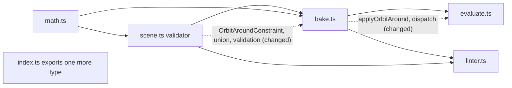
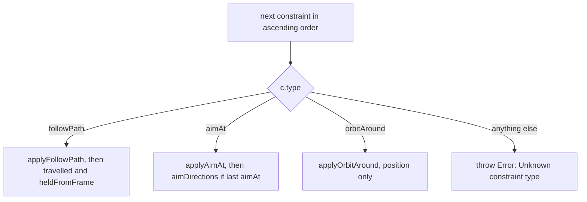
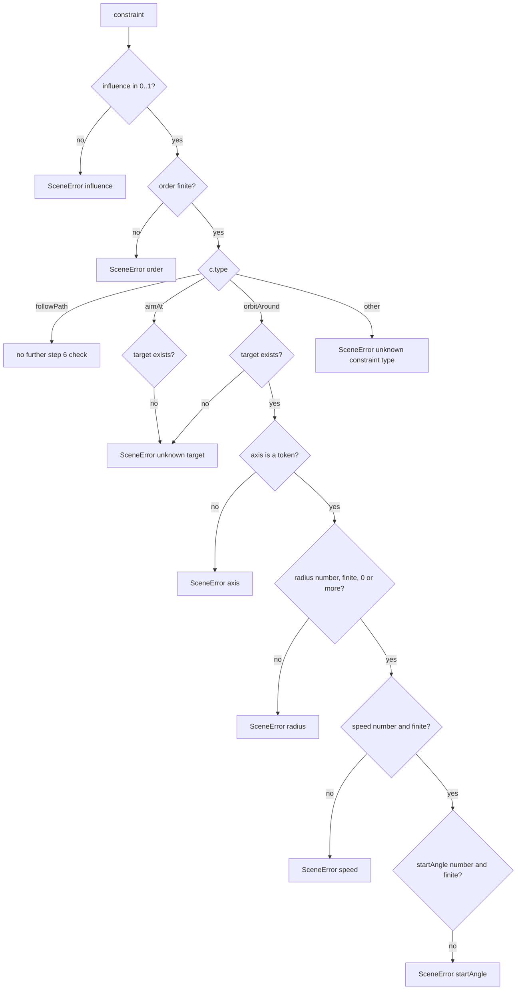

# Design Document

## Overview

orbit-around adds a third constraint, `orbitAround`, to the frozen core in `packages/pathkit`. An Entity with this constraint moves on an exact circle around a centre point given by a named Target. The constraint sets position only. Facing stays the job of `aimAt`.

The change touches three source files: `src/scene.ts` (interface, union, validation), `src/bake.ts` (the constraint step and explicit dispatch) and `src/index.ts` (one added type export). `src/linter.ts` and every other source file stay byte-identical. All new code is written to the rules in `coordinate-conventions.md`, `testing-conventions.md` and `typescript-imports.md`. Every relative import ends in `.js`.

Design decisions:

- **Explicit dispatch, with a compile-time exhaustiveness check.** Today `bakeEntity` and `drivesRotation` treat "not `aimAt`" as `followPath`. Both become a `switch (c.type)` with one case per type. The `default` branch passes `c` (which TypeScript narrows to `never`) to one shared helper, `unknownConstraintType(c: never): Error`. Adding a fourth type later makes `c` no longer `never` in those two places, so the reviewer's type check fails there. At run time the same branch throws a plain `Error` that names the type. (Requirement 5)
- **The validator and the baker both reject unknown types.** `validateScene` rejects them first with a `SceneError`. The baker's branch is a second line of defence that a normal Scene cannot reach. (5.5, 5.8, 5.12)
- **Per-type validation inside the existing per-constraint step.** Step 6 of `validateScene` keeps its order (influence, then order) and then calls one helper that switches on the type. `aimAt` and `followPath` behave exactly as today. (4.1, 5.6)
- **Side vectors are derived from the axis vector, not looked up by token.** The brief suggests a table indexed by axis token. An existing test, `test/project/unit.test.ts` ("has no hard-coded axis tokens or axis defaults outside scene.ts"), scans every `src` file except `scene.ts` for quoted axis tokens such as `'+X'` and fails on a match. A token-keyed table in `bake.ts` would break that test, and existing tests must not be edited. So `applyOrbitAround` reads the axis through `axisVector` (the single place where a token becomes a vector) and computes the side vectors by a cyclic rule on the vector components. The result is identical to the table in the Glossary. The six hand-computed unit tests are what prove that. This is also why the rule "never hard-code a forward or up axis" stays satisfied: the orbit axis is read from the constraint.
- **Degrees only at the boundary.** `speed` and `startAngle` are degrees. The angle is converted to radians in one expression, immediately before `Math.cos` and `Math.sin`. The conversion divides by 180 before multiplying by `Math.PI`, so a finite angle cannot overflow during the conversion.
- **Position only.** `blendCandidate(work, c.influence, false)` blends the candidate position into the stack and leaves the rotation alone. The constraint writes none of `travelled`, `heldFromFrame` or `aimDirections`, and it is not a Rotation_Driver.
- **Order trap.** `aimAt` reads the Entity position at the moment it runs. An `aimAt` that should face the Orbit_Centre needs a higher `order` than the `orbitAround`. The same trap already exists for `followPath` followed by `aimAt`. Equal orders run in list order, because `sortedCopy` uses a stable sort. (3.6, 3.7, 3.13)
- **Tests use independent oracles.** Properties check invariants (distance, perpendicularity, angular step, direction, blend geometry) using plain arithmetic written in the test files. Positions are never recomputed with the baker's formula. Hand-computed numbers cover the six axes. (8.1)

### New guard that is not in requirements.md (for the reviewer to accept or reject)

`followPath` throws a `SceneError` through `checkTravelled` when the travelled distance is not finite. The orbit angle can overflow in the same way: `speed * frame / fps` becomes `Infinity` for a finite but huge `speed` (for example `speed = 1e308` at frame 2), and `Math.cos(Infinity)` is `NaN`. That would break the no-NaN rule of path-core Requirement 7.14.

**NEW, not in requirements.md:** `applyOrbitAround` calls `checkOrbitAngle`, which throws

`SceneError`: `Entity "<id>": orbitAround angle at frame <f> must be a finite number, got <value>`

when the Orbit_Angle in degrees is not finite. This guard, this message, and the unit test for them (listed in the Testing Strategy) are additions. If the reviewer rejects them, remove `checkOrbitAngle`, its call, and the test; nothing else depends on them.

Position overflow (radius or centre near 1e308) is **accepted, not guarded**. `followPath` has the same exposure with huge path points, the validator already requires finite inputs, and a position can only overflow with magnitudes above about 1e300. The finite-angle guard is the one that matters, because a finite `speed` below the validator's limit is an ordinary-looking input.

## Architecture



Constraint dispatch in `bakeEntity` after the change:



Validation of one constraint in step 6 of `validateScene`:



Files under `packages/pathkit`:

| File | Change |
| --- | --- |
| `src/scene.ts` | New interface, union member, per-type step 6 |
| `src/bake.ts` | `applyOrbitAround`, `checkOrbitAngle`, `unknownConstraintType`, two switches, one extra `EntityWork` field |
| `src/index.ts` | One added name in the existing `export type { ... } from './scene.js'` block |
| `src/linter.ts` and all other `src` files | None |
| `test/bake/orbit-unit.test.ts`, `test/bake/orbit-property-1.test.ts` to `orbit-property-13.test.ts`, `test/scene/orbit-unit.test.ts` | New |
| `test/bake/orbit-defensive.test.ts`, `test/helpers/orbit-generators.ts` | New. Not named in Requirement 8.3. Permitted by 5.12 for the first, needed for reuse for the second. Flagged for the reviewer. |

No existing test file is edited. No dev dependency is added.

## Components and Interfaces

### scene.ts

```ts
export interface OrbitAroundConstraint {
  type: 'orbitAround';
  order: number;
  influence: number;
  target: string;      // name of the centre Target, static or keyframed
  radius: number;      // metres, 0 or more
  axis: AxisToken;     // the line the Entity circles around
  speed: number;       // degrees per second, negative turns the other way
  startAngle: number;  // degrees at frame 0
}

export type Constraint = FollowPathConstraint | AimAtConstraint | OrbitAroundConstraint;
```

Step 6 of `validateScene` becomes:

```ts
// 6. per constraint: influence, then order, then the checks of the constraint's own type
for (const entity of entities) {
  for (const c of entity.constraints) {
    if (!(c.influence >= 0 && c.influence <= 1)) {
      throw new SceneError(`Entity "${entity.id}": influence ${c.influence} is outside [0,1]`);
    }
    if (!Number.isFinite(c.order)) {
      throw new SceneError(`Entity "${entity.id}": order must be a finite number, got ${c.order}`);
    }
    checkConstraintOfType(scene, entity.id, c);
  }
}
```

The first two checks and their messages are unchanged. The helpers sit above `validateScene`:

```ts
function hasTarget(scene: Scene, name: string): boolean {
  return Object.prototype.hasOwnProperty.call(scene.targets, name);
}

function checkConstraintOfType(scene: Scene, entityId: string, c: Constraint): void {
  switch (c.type) {
    case 'followPath':
      return; // speed and startOffset are checked in steps 10 and 11, unchanged
    case 'aimAt':
      if (!hasTarget(scene, c.target)) {
        throw new SceneError(`Entity "${entityId}": unknown target "${c.target}"`);
      }
      return;
    case 'orbitAround':
      checkOrbitAround(scene, entityId, c);
      return;
    default: {
      const value = (c as unknown as { type?: unknown }).type; // c is never here
      throw new SceneError(
        `Entity "${entityId}": unknown constraint type "${String(value)}" (use followPath, aimAt or orbitAround)`,
      );
    }
  }
}

function checkOrbitAround(scene: Scene, entityId: string, c: OrbitAroundConstraint): void {
  if (!hasTarget(scene, c.target)) {
    throw new SceneError(`Entity "${entityId}": unknown target "${c.target}"`);
  }
  if (!isAxisToken(c.axis)) {
    throw new SceneError(
      `Entity "${entityId}": orbitAround axis "${String(c.axis)}" is not an axis token (use +X, -X, +Y, -Y, +Z or -Z)`,
    );
  }
  // typeof first: "5" >= 0 is true in JavaScript, and the global isFinite("5") is true.
  if (typeof c.radius !== 'number' || !Number.isFinite(c.radius) || c.radius < 0) {
    throw new SceneError(
      `Entity "${entityId}": orbitAround radius must be a finite number of 0 or more, got ${String(c.radius)}`,
    );
  }
  if (typeof c.speed !== 'number' || !Number.isFinite(c.speed)) {
    throw new SceneError(`Entity "${entityId}": orbitAround speed must be a finite number, got ${String(c.speed)}`);
  }
  if (typeof c.startAngle !== 'number' || !Number.isFinite(c.startAngle)) {
    throw new SceneError(`Entity "${entityId}": orbitAround startAngle must be a finite number, got ${String(c.startAngle)}`);
  }
}
```

Decisions:

- **The string `"5"` trap.** `"5" >= 0` is `true` and `"5" < 0` is `false`, so a radius check that only compares against 0 would accept a string. The check therefore tests `typeof c.radius !== 'number'` first, then `Number.isFinite` (the global `isFinite("5")` is also `true`, so it is not used), then `< 0`. A string `"5"` is rejected with a message ending `got 5`. Speed and startAngle use the same `typeof` plus `Number.isFinite` pair. (4.5 to 4.7, 8.25)
- **`String(...)` in messages.** `String(v)` gives the same text as a template placeholder for numbers and strings and does not throw for a symbol. `-0` is a number, is finite and is not `< 0`, so a radius of `-0` is accepted and places the Entity on the centre. This is noted in Error Handling.
- **Unknown types.** In the `default` branch `c` is `never`, so `.type` cannot be read without a cast. The cast goes through `unknown`. The unknown-type check runs last, after influence and order, as Requirement 5.7 says. A constraint with a missing `type` reports `"undefined"`.
- **Behaviour of the existing types.** The `aimAt` message and the check order are unchanged. Steps 7 to 14, including the `followPath` speed and startOffset checks (steps 10 and 11), are not touched. A Scene with an invalid keyframed Target still reports its Target error at steps 7 to 9 or 14, after step 6, as today.
- **Input is never modified.** The new code only reads.

### bake.ts

New imports: `OrbitAroundConstraint` joins the type import from `./scene.js`. `axisVector` and `SceneError` are already imported.

`EntityWork` gains one field, so the axis can be read without allocating:

```ts
interface EntityWork {
  // ...existing fields...
  readonly axis: Vec3; // unit vector of the orbit axis, written by applyOrbitAround
}
// createEntityWork(): axis: { x: 0, y: 0, z: 0 },
```

No `isOrbitAround` type guard is added. The brief lists one, but the `switch (c.type)` narrows the union by itself, and a guard with no caller is dead code. `isFollowPath` and `isAimAt` stay because `sceneNeedsFrames` and `lastAimIndexOf` still use them. Flagged as a small deviation from the brief.

Shared helper for both defensive branches:

```ts
/** Builds the error for a constraint type that the explicit switches do not handle. */
function unknownConstraintType(c: never): Error {
  const value = (c as unknown as { type?: unknown }).type;
  return new Error(`Unknown constraint type "${String(value)}"`);
}
```

Angle guard (the NEW guard described in the Overview):

```ts
function checkOrbitAngle(entityId: string, frame: number, angleDeg: number): void {
  if (!Number.isFinite(angleDeg)) {
    throw new SceneError(
      `Entity "${entityId}": orbitAround angle at frame ${frame} must be a finite number, got ${angleDeg}`,
    );
  }
}
```

The constraint step:

```ts
function applyOrbitAround(
  entity: Entity,
  c: OrbitAroundConstraint,
  target: Target,
  frame: number,
  fps: number,
  work: EntityWork,
): void {
  const angleDeg = c.startAngle + (c.speed * frame) / fps;
  checkOrbitAngle(entity.id, frame, angleDeg);
  const angle = (angleDeg / 180) * Math.PI; // the only degree-to-radian conversion
  const cos = Math.cos(angle);
  const sin = Math.sin(angle);

  const a = axisVector(c.axis, work.axis);
  const centre = targetPositionAt(target, frame, work.targetPosition);
  const p = work.candidatePosition;
  const r = c.radius;
  if (a.x + a.y + a.z > 0) {
    // positive axis: side1 = (az, ax, ay), side2 = (ay, az, ax)
    p.x = centre.x + r * (cos * a.z + sin * a.y);
    p.y = centre.y + r * (cos * a.x + sin * a.z);
    p.z = centre.z + r * (cos * a.y + sin * a.x);
  } else {
    // negative axis: side1 = (-ay, -az, -ax), side2 = (-az, -ax, -ay)
    p.x = centre.x + r * (-cos * a.y - sin * a.z);
    p.y = centre.y + r * (-cos * a.z - sin * a.x);
    p.z = centre.z + r * (-cos * a.x - sin * a.y);
  }
  blendCandidate(work, c.influence, false);
}
```

**The side-vector rule.** `axisVector` gives `a = s * e_i` where `e_i` is a unit coordinate vector and `s` is +1 or -1. With the indexes taken cyclically (X, Y, Z, X, ...):

- `s = +1`: `side1 = e(i+1)`, `side2 = e(i+2)`. In components this is `side1 = (az, ax, ay)` and `side2 = (ay, az, ax)`.
- `s = -1`: `side1 = e(i+2)`, `side2 = e(i+1)`. In components this is `side1 = (-ay, -az, -ax)` and `side2 = (-az, -ax, -ay)`.

In both cases `side1 x side2 = a`. Checked against the Glossary table:

| Axis | a | side1 | side2 |
| --- | --- | --- | --- |
| +X | (1,0,0) | (0,1,0) = +Y | (0,0,1) = +Z |
| -X | (-1,0,0) | (0,0,1) = +Z | (0,1,0) = +Y |
| +Y | (0,1,0) | (0,0,1) = +Z | (1,0,0) = +X |
| -Y | (0,-1,0) | (1,0,0) = +X | (0,0,1) = +Z |
| +Z | (0,0,1) | (1,0,0) = +X | (0,1,0) = +Y |
| -Z | (0,0,-1) | (0,1,0) = +Y | (1,0,0) = +X |

The sign test `a.x + a.y + a.z > 0` reads a number, not a token, so `bake.ts` contains no quoted axis token. `axisVector` is the same function that `localAxesOf` already uses. Because `-ay` can be `-0`, hand-computed tests compare with a tolerance, never with `Object.is`.

**What allocates.** `axisVector` writes into `work.axis`. `targetPositionAt` writes into `work.targetPosition`. The result goes into `work.candidatePosition`. No object, array, closure or vector is created per frame. A `SceneError` is created only on the failure path inside `checkOrbitAngle`.

**Dispatch in `bakeEntity`.** The frame loop body becomes:

```ts
for (let i = 0; i < constraints.length; i++) {
  const c = constraints[i];
  switch (c.type) {
    case 'aimAt': {
      applyAimAt(c, targets[c.target], frame, axes, prevUp, prevAimRotations[i], work);
      if (i === lastAimIndex) writeAimDirection(output.aimDirections, frame, work.aim);
      break;
    }
    case 'followPath': {
      const travelled = applyFollowPath(entity, c, frame, axes, path, work);
      if (i === firstFollowIndex) {
        output.travelled[frame] = travelled;
        if (output.heldFromFrame < 0 && isHeld(travelled, path)) {
          output.heldFromFrame = frame;
        }
      }
      break;
    }
    case 'orbitAround': {
      applyOrbitAround(entity, c, targets[c.target], frame, path.fps, work);
      break;
    }
    default:
      throw unknownConstraintType(c);
  }
}
```

The `aimAt` and `followPath` bodies are the existing statements moved into cases, with no change in behaviour. `travelled`, `heldFromFrame` and `aimDirections` are written only in those two cases. `lastAimIndexOf` and the `firstFollowIndex` loop use guards, and an unknown type matches neither, so setup code never throws for it. The throw therefore happens on frame 0, in the loop.

**`drivesRotation`:**

```ts
function drivesRotation(c: Constraint): boolean {
  switch (c.type) {
    case 'aimAt': return true;
    case 'followPath': return alignsToPath(c);
    case 'orbitAround': return false;
    default: throw unknownConstraintType(c);
  }
}
```

**`sceneNeedsFrames`** needs no code change. It already tests `isFollowPath(c) && alignsToPath(c)`, so an `orbitAround` is never counted. A unit test pins this (5.9, 8.23).

### Order and equal-order behaviour

`bakeEntity` sorts a copy with `sortedCopy` (stable). A lower `order` runs first. For an `aimAt` to face the Orbit_Centre, give the `aimAt` a higher `order` than the `orbitAround`. With a lower `order`, the `aimAt` sees the position set so far (the Rest_Pose origin if nothing ran before it). Equal orders keep list order.

### index.ts

The existing block gains one name. The runtime export list does not change.

```ts
export type {
  AxisToken, FollowPathConstraint, AimAtConstraint, OrbitAroundConstraint, Constraint,
  Entity, Keyframe, Target, Scene,
} from './scene.js';
```

### linter.ts (unchanged) and what it reports for an orbit

`motionLinter` reads `heldFromFrame`, `rotationDrivers`, `aimDirections`, `transforms` and `fps`. It never reads a constraint type. For an Entity whose only constraint is `orbitAround`:

| Code | Reads | Value for an orbit-only Entity | Result |
| --- | --- | --- | --- |
| `path-end-reached` | `heldFromFrame` | -1, because only `followPath` writes it | none |
| `rotation-conflict` | `rotationDrivers` | 0, needs at least 2 | none |
| `aim-vertical` | `aimDirections` | all zero, and zero vectors are skipped (`length(aim) <= 0`) | none |
| `speed-spike` | chord length times `fps` per frame, against 3 times the median | on a static centre every chord has the same length, so no speed exceeds 3 times the median. If the median is 0 the function returns before emitting anything. | none |
| `roll-change` | rotation only | exact identity at every frame (`resetToRestPose` writes it and the constraint never touches it). The forward and up axes rotate to themselves, the up projection is non-zero, and the angle is `atan2(0, 1) = 0`, which is not above any non-negative threshold. | none |

The two linter tests (Requirement 6.2 and 6.3) use one Entity `orbiter` with `forwardAxis '+Z'`, `upAxis '+Y'`, one `orbitAround` with influence 1, order 0, axis `+Y`, radius 4, startAngle 0, target `centre` at the static position (10, 2, -3), fps 30, frameCount 60 and the usual valid open path.

| Test | speed | Per frame | Why it fits |
| --- | --- | --- | --- |
| very fast | 3000 | 100 degrees | at least 90, and 100 is not a multiple of 360 |
| gentle | 30 | 1 degree | at most 1 |

Each test bakes, then calls `motionLinter(scene, baked)` with default options and again with `{ rollThresholdDegPerFrame: 0 }`, and expects `[]` both times. The threshold 0 call shows that the roll angle is exactly 0, not merely below 15. The expected Finding list is empty because of the table above.

**If a Finding appears:** the test does not weaken its expectation. It fails with a message that lists every Finding (frame, entityId, code, message). Work stops, the result is reported, and `src/linter.ts` is not edited (6.6, 6.7).

## Data Models

- `OrbitAroundConstraint` is a plain object. Its fields are listed above.
- Baked output is unchanged: per Entity a `Float64Array` of `frameCount * 7` values (px, py, pz, qx, qy, qz, qw), plus `travelled`, `heldFromFrame`, `rotationDrivers` and `aimDirections`. An orbit-only Entity has rotation (0, 0, 0, 1) at every frame, `travelled` all zero, `heldFromFrame` -1, `rotationDrivers` 0 and `aimDirections` all zero.
- Units: `radius` in metres, `speed` in degrees per second, `startAngle` in degrees, frames are integers, internal angle in radians.
- Orbit_Angle at frame `f` is `startAngle + speed * f / fps`. For a given Scene it depends only on the Scene numbers and the integer frame, so no value depends on history.

## Correctness Properties

*A property is a characteristic or behavior that should hold true across all valid executions of a system-essentially, a formal statement about what the system should do. Properties serve as the bridge between human-readable specifications and machine-verifiable correctness guarantees.*

Property-based testing applies: `bake` and `validateScene` are pure functions of a Scene. Properties are named O1 to O13 because path-core already uses 1 to 45.

**Reflection.** The distance (O1) and perpendicularity (O2) invariants are separate, because each catches a different broken line and neither implies the other (a wrong side vector can keep the distance right and break perpendicularity). O3 (step size) does not subsume O4 (direction): O3 proves the angle equals `speed / fps`, and O4 pins the handedness with the cross product the requirements ask for, so a mirrored table still fails O4 explicitly. The influence cases (3.1 to 3.5) merge into O7. The aim cases (3.7, 3.8) are O8. The no-write bookkeeping (3.9 to 3.11) is O9. 3.6 and 3.13 merge into O13. Criteria that are structural, compile-time or process rules have no property and are in the coverage table.

### Property O1: Distance from the centre equals the radius

For any orbit case (axis from all six tokens, radius from 0 to 30 m, any speed, any startAngle, influence 1, a static centre or a linearly keyframed centre, fps from 24, 30 and 60, frameCount from 1 to 120), at every frame the distance between the baked position and the centre taken from the Scene numbers equals `radius` within 1e-9 times (1 + radius + largest centre coordinate magnitude). With radius 0 the baked position equals the centre.

**Validates: Requirements 2.1, 2.3, 2.5, 2.6, 2.13, 8.4**

### Property O2: The offset is perpendicular to the axis

For any orbit case as in O1, at every frame the dot product of the offset (baked position minus centre) with the unit vector of the axis, taken from the test's own table, is 0 within the O1 tolerance.

**Validates: Requirements 2.3, 2.4, 2.14, 8.5**

### Property O3: Consecutive frames differ by speed / fps degrees

For any orbit case with radius from 0.1 to 30 and `speed` chosen so that `|speed / fps| <= 179` degrees per frame, for every pair of consecutive frames the signed angle about the axis from the offset at frame f to the offset at frame f+1 equals `speed / fps` degrees, within 1e-9 radians. The signed angle is `atan2(dot(cross(a, b), axis), dot(a, b))` with test-local helpers.

**Validates: Requirements 2.1, 2.15, 8.8**

### Property O4: The sign of speed gives the turning direction

For any orbit case with radius from 0.1 to 30, non-zero `speed` and `|speed / fps| <= 179` degrees per frame, for every pair of consecutive frames the dot product of `cross(offset at f, offset at f+1)` with the axis vector is positive when `speed` is positive and negative when `speed` is negative (right-hand rule). For the same case with the sign of `speed` reversed, the sign is reversed.

**Validates: Requirements 2.4, 2.7, 2.17, 8.7**

### Property O5: A full lap returns to the start

For any axis, fps, startAngle, whole number of laps L from 1 to 3, direction and frame number N that divides 360 and is at most 119, with `speed = +/- L * 360 * fps / N`, the baked position at frame N equals the baked position at frame 0 within the O1 tolerance. The case with `frameCount = N + 1` (N is the last frame) is forced.

**Validates: Requirements 2.16, 8.9**

### Property O6: A moving centre carries the offset with it

For any orbit case with a linearly keyframed centre (keyframes at frame 0 and at `frameCount`), at every frame the offset from the Scene-number centre (`c0 + frame * step`) equals, within the O1 tolerance, the offset produced at the same frame by the same constraint with a static centre at the origin.

This compares two bakes. It is a metamorphic check, valid because O1 to O4 and the hand-computed unit tests pin the static case independently.

**Validates: Requirements 2.5, 2.18, 8.10**

### Property O7: Influence blends the position

For any orbit case with radius from 0.1 to 30, anchor position T (a static Target named `anchor`), and influence lambda from {0, 0.25, 0.5, 0.75, 1}, an Entity with a radius-0 `orbitAround` at the anchor (order 0, influence 1) followed by the orbit constraint (order 1, influence lambda) has, at every frame, a baked position R with `|R - ((1 - lambda) T + lambda C)| = lambda * radius` and `dot(R - ((1 - lambda) T + lambda C), axis) = 0`, within the O1 tolerance. For lambda 0 the position equals T. For lambda 1 the distance from C is `radius`. The rotation is the identity at every frame.

**Validates: Requirements 3.1, 3.2, 3.3, 3.4, 3.5, 8.11**

### Property O8: An aimAt with a higher order faces the centre

For any orbit case with radius from 0.1 to 30, influence 1 and an `aimAt` on the same Target with a higher `order`, at every frame the stored aim direction equals the unit vector from the baked position to the centre within 1e-9.

**Validates: Requirements 3.7, 3.8, 8.12**

### Property O9: An orbit changes no rotation or bookkeeping

For any orbit case, an Entity whose only constraint is the `orbitAround` has the identity rotation (exact equality) at every frame, `travelled` all 0, `heldFromFrame` -1, `aimDirections` all 0 and `rotationDrivers` 0. An Entity with the `orbitAround` plus an `aimAt` has `rotationDrivers` 1, `travelled` all 0 and `heldFromFrame` -1. An Entity with the `orbitAround`, an `aimAt` and an aligned `followPath` has `rotationDrivers` 2.

**Validates: Requirements 3.9, 3.10, 3.11, 5.3, 5.9, 8.13**

### Property O10: Baking and validating do not modify the scene, and baking is repeatable

For any valid orbit scene (one to three Entities, orbit with optional `aimAt` and `followPath`), a deep copy of the Scene taken before `validateScene` and `bake` is deeply equal to the Scene afterwards, and two calls to `bake` return transforms, `travelled`, `aimDirections`, `heldFromFrame` and `rotationDrivers` that are equal element by element with exact equality.

**Validates: Requirements 4.10, 7.1, 7.2, 8.15**

### Property O11: The first defect wins

For any `orbitAround` constraint with at least two defects chosen from {unknown target, bad axis, bad radius, bad speed, bad startAngle}, `validateScene` throws a `SceneError` whose message is the message of the first defect in the order target, axis, radius, speed, startAngle, and no other message. Valid influence and order are always used, so only the type-specific order is tested.

**Validates: Requirements 4.1, 4.2, 4.8, 8.14**

### Property O12: Every invalid value is rejected with its exact message

For any valid orbit scene and any single bad value in one field (an unknown target name including the inherited name `toString`, an axis that is not a token, a radius that is NaN, positive or negative infinity, negative, or not a number such as the string `"5"`, a speed or startAngle that is NaN, infinite or not a number), `validateScene` and `bake` throw a `SceneError` equal to the exact message of that field's template with the bad value shown. A radius of exactly 0 is accepted.

**Validates: Requirements 4.3, 4.4, 4.5, 4.6, 4.7, 4.9, 4.11, 8.14, 8.25**

### Property O13: Equal orders run in list order, and list order is irrelevant otherwise

For any two orbit constraints A (radius 0 at a static Target T, influence 1) and B (radius r above 0 at centre C, influence 0.5), with equal `order`, the list [A, B] gives a position at distance `r / 2` from `(T + C) / 2` at every frame, and the list [B, A] gives exactly T at every frame. With distinct orders (A lower), the lists [A, B] and [B, A] give transforms that are equal element by element.

**Validates: Requirements 3.6, 3.13, 8.22**

### Which line each property should catch (testing-conventions rule 4)

| Property | Break this line in `applyOrbitAround` or its helpers, and the property should fail |
| --- | --- |
| O1 | `cos * a.z + sin * a.y` changed to `cos * a.z + cos * a.y`, or `r *` removed |
| O2 | A side vector wrong, for example `p.z = ... (cos * a.y + sin * a.x)` changed to use `a.z`, so the offset gains a component along the axis |
| O3 | `(c.speed * frame) / fps` changed to `c.speed * frame`, or the `/ 180` removed |
| O4 | The negative branch changed to swap side1 and side2 (mirror), or the sign of `sin` flipped |
| O5 | `c.startAngle +` dropped from the angle in a way that depends on frame, or `frame` replaced by `frame - 1` |
| O6 | `targetPositionAt(target, frame, ...)` changed to `targetPositionAt(target, 0, ...)` |
| O7 | `blendCandidate(work, c.influence, false)` changed to write the candidate straight into `work.position` |
| O8 | The `orbitAround` case moved after the `aimAt` case in order handling, or the position written to a buffer `aimAt` does not read |
| O9 | `blendCandidate(work, c.influence, true)` (rotation blended), or the `orbitAround` case writing `output.travelled` |
| O10 | `constraints.sort(...)` on `entity.constraints` instead of the copy, or any use of `Math.random` |
| O11 | In `checkOrbitAround`, moving the radius check above the axis check |
| O12 | `typeof c.radius !== 'number' \|\|` removed, or `Number.isFinite` replaced by the global `isFinite` |
| O13 | The comparator in `sortedCopy` changed so equal orders reverse, or the sort made unstable |

## Error Handling

| Condition | Where | Error | Message |
| --- | --- | --- | --- |
| Influence outside [0,1] | `validateScene` step 6 | `SceneError` | `Entity "<id>": influence <value> is outside [0,1]` (unchanged) |
| Order not finite | `validateScene` step 6 | `SceneError` | `Entity "<id>": order must be a finite number, got <value>` (unchanged) |
| Orbit target not in targets (own property) | `validateScene` step 6 | `SceneError` | `Entity "<id>": unknown target "<name>"` |
| Orbit axis not a token | `validateScene` step 6 | `SceneError` | `Entity "<id>": orbitAround axis "<value>" is not an axis token (use +X, -X, +Y, -Y, +Z or -Z)` |
| Radius not a number, not finite, or negative | `validateScene` step 6 | `SceneError` | `Entity "<id>": orbitAround radius must be a finite number of 0 or more, got <value>` |
| Speed not a number or not finite | `validateScene` step 6 | `SceneError` | `Entity "<id>": orbitAround speed must be a finite number, got <value>` |
| startAngle not a number or not finite | `validateScene` step 6 | `SceneError` | `Entity "<id>": orbitAround startAngle must be a finite number, got <value>` |
| Constraint type is none of the three | `validateScene` step 6, after influence and order | `SceneError` | `Entity "<id>": unknown constraint type "<value>" (use followPath, aimAt or orbitAround)` |
| Invalid orbit or unknown-type Scene passed to `bake` | `bake` calls `validateScene` first | the same `SceneError` | as above |
| Orbit angle not finite at a frame (NEW, not in requirements.md) | `applyOrbitAround` through `checkOrbitAngle` | `SceneError` | `Entity "<id>": orbitAround angle at frame <f> must be a finite number, got <value>` |
| Unknown type reaches `bakeEntity` (defensive) | `bakeEntity` default branch | `Error` | `Unknown constraint type "<value>"` |
| Unknown type reaches `drivesRotation` (defensive) | `drivesRotation` default branch | `Error` | `Unknown constraint type "<value>"` (same helper) |

Notes:

- The first defect wins. One validation run throws exactly one error. For a constraint the order of checks is influence, order, then the type-specific checks, and for an unknown type the type error comes last (5.7).
- `-0` as a radius is accepted (it is a finite number and `-0 < 0` is false). The Entity sits on the centre.
- Position overflow from absurd radius or centre magnitudes is accepted and not guarded (see the Overview).
- Numerical guards: `Math.cos` and `Math.sin` of a finite angle are finite. The angle guard keeps a non-finite angle out of them.

## Testing Strategy

### Approach

- Property tests (fast-check, `fc.assert` with `numRuns: 100` or more) for Properties O1 to O13, one test per property, one file per property: `test/bake/orbit-property-<N>.test.ts` with N from 1 to 13 (O<N> maps to file N). Properties O1 to O10 and O13 call `bake`. O11 and O12 call `validateScene` (and `bake` for the 4.11 part of O12).
- Every property test carries the tag comment `Feature: orbit-around, Property O<N>: <title>` and the `Validates` line from the Correctness Properties section.
- Unit tests for examples, structure and process rules: `test/bake/orbit-unit.test.ts`, `test/scene/orbit-unit.test.ts`.
- `test/bake/orbit-defensive.test.ts` for the defensive branches (see below).
- Typed arrays are never frozen. Contents are compared as copies.
- Everything is imported through `.js` relative paths. Production code under test is imported from `../../src/index.js` where possible, and from `../../src/scene.js` only where a name is not public.

### Oracle design (Requirement 8.1)

No test calls the baker's own maths to produce an expected value. Expected values come from the Scene numbers, from hand calculation, or from an invariant stated in plain arithmetic in the test file:

- Distance: `Math.sqrt(dx*dx + dy*dy + dz*dz)`.
- Perpendicularity: dot product with the axis unit vector taken from the test's own table (`AXIS_UNIT` in the helper).
- Signed angle about the axis: `Math.atan2(dot(cross(a, b), axis), dot(a, b))`.
- Centre at a frame: static, or `c0 + frame * step` for the linear case (keyframes at frame 0 and frame `frameCount`, so the centre at every integer frame is known from the Scene numbers without re-implementing the target lookup).
- The influence and order properties use a radius-0 anchor constraint, whose position is exactly a Scene number, instead of a second formula.

The signed angle about an axis is unique only below 180 degrees per frame. O3 and O4 therefore limit `|speed / fps|` to at most 179. Requirement 2.15 does not state this limit (see Open points).

### Generators

All numbers come from `fc.integer` mapped onto a range. No `fc.double` is used for geometry or scalars (testing-conventions rule 2). `coord` from `test/helpers/basic-generators.ts` is itself integer based and may be reused. One new helper file, `test/helpers/orbit-generators.ts`, is added. It exports:

| Export | Content |
| --- | --- |
| `AXIS_UNIT` | the six tokens mapped to plain `[x, y, z]` unit vectors, written independently of `src` |
| `dot3`, `cross3`, `sub3`, `len3` | plain triple helpers for tests |
| `arbOrbitCase(opts)` | `fc.Arbitrary<OrbitCase>`. `opts` selects: radius range, a cap on `|speed / fps|` in degrees per frame, and whether the centre may be keyframed |
| `FORCED_ORBIT_CASES` | the forced special cases listed below |
| `buildOrbitScene(c, extra?)` | builds a `Scene` with Entity `orbiter` (`forwardAxis '+Z'`, `upAxis '+Y'`), a fixed valid open path, the targets and the constraints |
| `centreAt(c, frame)` | the centre from the Scene numbers |
| `scaleOf(c)` | `1 + radius + largest centre coordinate magnitude`, used to scale tolerances |
| `bakedPosition(baked, entityIndex, frame, out)` | reads three numbers from `transforms[e]` at `frame * 7` |

`OrbitCase` fields: `fps` (from 24, 30, 60), `frameCount` (1 to 120), `axis` (six tokens), `radius` (integer 0 to 300, divided by 10, or 1 to 300 when radius must be above 0), `speed` (an integer; for the unrestricted cases between `-720 * fps` and `720 * fps`; for O3 and O4 between `-179 * fps` and `179 * fps`), `startAngle` (integer -720 to 720), and `centre` (`static` with coordinates from integers -1000 to 1000 divided by 10, or `linear` with a start `c0` from the same range and a per-frame step of an integer -20 to 20 divided by 10).

### Tolerances and why

- **Positions and distances: `1e-9 * scaleOf(c)`.** Floating-point error in one position is about `1e-15 * scaleOf(c)` (a few operations on numbers of that size). 1e-9 leaves about six orders of magnitude of headroom, and a real mistake is far above it: a one-degree phase error at radius 0.1 moves the position by about 1.7e-3.
- **Angles: 1e-9 radians.** The angle argument is a double of size up to about 400 radians in O3 (error about 6e-14) and the position error divided by the smallest radius 0.1 is about 1e-12 radians. 1e-9 leaves more than two orders of headroom. A degree-versus-radian slip is off by a factor of 57.
- **Hand-computed positions: 1e-12 absolute** (numbers of size up to 5, error about 1e-15). `Math.cos(Math.PI / 2)` is 6e-17, not 0, and `-0` may appear, so these tests never use `Object.is`.
- **Identity rotation and zero bookkeeping: exact equality**, because nothing computes them.

### Forced special cases (Requirement 8.21)

Each property file passes `examples` to `fc.assert` (fast-check runs them in addition to the random runs). The helper exports the cases:

| Case | Where forced |
| --- | --- |
| radius 0 | O1, O2, O6, O7 (radius 0 is a valid radius in these) and the unit test for 2.6 |
| startAngle 0 | every property that uses `arbOrbitCase`, and the hand-computed unit tests |
| a turn of exactly 90 degrees (`speed = 90 * fps`, startAngle 0, so frame 1 is at 90) | O3, O4, and the unit tests |
| a turn of exactly 360 degrees (O5 with N = 1 and `speed = 360 * fps`) | O5 |
| first frame and last frame | every per-frame loop covers frame 0 and frame `frameCount - 1`; `frameCount = 1` and the N = last-frame case are forced examples |
| all six axes | `fc.constantFrom` over the six tokens, plus one forced example per token in O1, O2, O4 |

### Per-frame checks (Requirement 8.19)

Inside a loop over frames or over consecutive frame pairs, a failed check throws `new Error(...)` with a message that names the property, the frame, and the values compared. `expect` is called once per run, at the end, for example `expect(framesChecked).toBe(frameCount)`.

### Property and unit split

| Item | Kind | Reason |
| --- | --- | --- |
| Distance, perpendicularity, angular step, direction, lap, keyframed centre, blend, aim direction, bookkeeping, no mutation, validation order, bad values, equal order (O1 to O13) | property | They hold for a large input space (axis, radius, speed, angle, fps, centre) and 100 runs find more defects than 3 |
| Hand-computed positions for six axes at 0 and 90 degrees, including the four examples in the brief | unit | Concrete numbers computed by hand are the oracle for the side-vector table; the table has only six rows |
| Radius 0 puts the Entity on the centre; negative speed reverses by hand example | unit | One concrete case each, in addition to the forced property examples |
| Per-type dispatch evidence (5.10) | unit | One case per type |
| Unknown type rejected through `bake` (5.11) | unit | One case |
| `sceneNeedsFrames` ignores `orbitAround` (5.9, 8.23) | unit | Two concrete Scenes |
| `aimAt` with a lower `order` aims from the origin (order trap) | unit | One concrete Scene |
| Linter tests (6.2 to 6.5) | unit | Two concrete Scenes |
| Each validation message and the check order against influence and order (4.x, 5.5 to 5.7) | unit, in addition to O11 and O12 | The exact strings are written out once for the reviewer |
| Angle guard (NEW) | unit | `speed 1e308`, fps 30, frameCount 3, frame 2 throws `Entity "<id>": orbitAround angle at frame 2 must be a finite number, got Infinity` |
| Allocation check of `applyOrbitAround` (7.3) | unit (structural) | Source text check |
| Export surface (1.3) | unit (structural) | One text check of `src/index.ts` |

### Dispatch evidence tests (5.10)

- `followPath`: an Entity with only a `followPath` (influence 1, speed 0, startOffset 0, alignToPath false) on a path starting at (1, 2, 3) is at (1, 2, 3) and `travelled[0] = 0`. Only `followPath` can place it on the path.
- `aimAt`: an Entity with only an `aimAt` at target (0, 0, 5) stores `aimDirections` (0, 0, 1) at frame 0. Only `aimAt` writes this.
- `orbitAround`: an Entity with only an `orbitAround` (+Y, radius 5, centre origin, startAngle 90) is at (5, 0, 0) and the path point is not (5, 0, 0). Only `orbitAround` can put it on the circle. Under the old dispatch it would have run as `followPath` and ended at a path point or thrown.

### Defensive branches (Requirements 5.2, 5.4, 5.12)

`bake()` validates first, so a normal Scene cannot reach the `default` branches. To reach one, `test/bake/orbit-defensive.test.ts` mocks the validator:

```ts
import { describe, expect, it, vi } from 'vitest';
import type { Constraint, Scene } from '../../src/index.js';

vi.mock('../../src/scene.js', async (importOriginal) => {
  const actual = await importOriginal<typeof import('../../src/scene.js')>();
  return { ...actual, validateScene: () => {} };
});

import { bake } from '../../src/index.js';
```

`importOriginal` keeps every real export (`SceneError`, `axisVector`, the types) and replaces only `validateScene` with a no-op. `vi.mock` is hoisted and applies to the whole file, so this file holds only these tests. No source file gets a new export. The Unknown_Type constraint is built with `{ type: 'mystery', order: 0, influence: 1 } as unknown as Constraint`, in the same way existing tests build bad axis tokens. The test expects `toThrow(new Error('Unknown constraint type "mystery"'))`.

**Finding for review.** In `bake()` the loop calls `bakeEntity` first and `countRotationDrivers` (which calls `drivesRotation`) after it. `bakeEntity` visits every constraint of the Entity on frame 0. Even with `validateScene` mocked, the Unknown_Type error therefore always comes from `bakeEntity`. The throw inside `drivesRotation` cannot be reached through `bake()`, and `drivesRotation` is not exported.

| Option | What it does | Trade-off |
| --- | --- | --- |
| (a) Keep both throws, test only the `bakeEntity` one through the mock | Smallest change | The `drivesRotation` branch has no run-time test at all. 5.4 is verified only by reading the code. |
| (b) In `bake()`, call `countRotationDrivers` before `bakeEntity` | `drivesRotation`'s throw becomes the one reached | The problem moves: now the `bakeEntity` branch is unreachable. It also changes the order of work in `bake()` for no functional gain. |
| (c) Both branches call one helper, `unknownConstraintType(c: never)`, which builds the error with one message | The message and the error class are tested once, through the branch that is reached. Each `default` is one line, `throw unknownConstraintType(c)`. | The `drivesRotation` call site is still not run by any test. It is covered by a structural source check and by the compile-time `never` check. |

**Recommendation: (c).** It keeps `bake()` unchanged, keeps the message in one place so 5.2 and 5.4 cannot drift, and adds the type-level exhaustiveness check. Requirement 5.4 can then be verified only by the structural check in the unit file: the text of `drivesRotation` in `src/bake.ts` contains `case 'aimAt'`, `case 'followPath'`, `case 'orbitAround'` and a `default:` that contains `unknownConstraintType(`. The same check is applied to the `bakeEntity` switch. This is an open point for the reviewer. Choosing (a) or (b) instead needs no other change to this design.

### Allocation check (Requirement 7.3)

Verified by code review of `applyOrbitAround` and by a structural unit test in `test/bake/orbit-unit.test.ts`, in the style of the path-core check for `evaluateEntity`:

1. Read `src/bake.ts` with `readFileSync` (the same way `test/project/unit.test.ts` reads source).
2. Find the index of `function applyOrbitAround(`. Walk forward counting parentheses to the `)` that closes the parameter list, then take the first `{` after it, then walk counting braces to the matching `}`. The body contains no string or template literal, because the failing path lives in `checkOrbitAngle`, so a plain brace count is exact.
3. Remove `//` comments and `/* */` comments from the body.
4. Fail, naming the offending text, when the body matches any of:
   - `\bnew\s` (object creation)
   - `=>` or `\bfunction\b` (closure)
   - `` ` `` (template literal)
   - `\.\.\.` (spread)
   - `\.(map|filter|slice|concat|reduce|forEach)\(` (allocating or closure-taking array methods)
   - an array literal used as a value: `[` that follows `=`, `(`, `,`, `:`, `?`, `return` or an operator, ignoring whitespace. A `[` that follows an identifier, `)` or `]` is index access and is allowed.
   - an object literal used as a value: `{` that follows `=`, `(`, `,`, `:`, `?` or `return`, ignoring whitespace. A `{` that follows `)`, `else` or `{` is a code block and is allowed.
5. The checker is tested against itself on small known-bad strings (`new Foo()`, `[1, 2]`, `{ x: 1 }`, `() => 1`) and known-good strings (`t[i]`, `if (a) { b = 1; }`). This protects against a checker that never fires.
6. Also assert that the body contains exactly one `Math.PI`, that `Math.cos(` and `Math.sin(` are both applied to `angle`, and that `Math.PI` appears nowhere else in `applyOrbitAround`'s argument computation. This pins "degrees to radians only at that point" (2.2, 7.8).

The structural check cannot see allocation inside called functions. `axisVector`, `targetPositionAt` and `blendCandidate` already follow the no-allocation rule and have path-core tests. The module level code builds nothing for orbit (there is no table), so there is nothing to exempt.

### Other process and project checks

- **Export surface (1.3 to 1.6):** the existing `test/bake/property-37.test.ts` runs unchanged. A unit test reads `src/index.ts` and checks that `OrbitAroundConstraint` appears once, inside the `export type { ... } from './scene.js'` block, and that the block is the only place. If property-37 fails, work stops and the user gets the test name and output. No edit is made to it.
- **Types (1.1, 1.2):** a typed literal `const c: OrbitAroundConstraint = {...}` in the unit test and a `Constraint[]` that holds it. Vitest does not type-check these. The reviewer's type check does, and Kiro cannot run it.
- **No mention of the forbidden word and no axis token literal in `src` (7.4):** the existing `test/project/unit.test.ts` scans every `src` file. It also covers the new code in `bake.ts` (no quoted axis token appears there, by design).
- **Dependencies (7.5):** the same existing test pins `dependencies` and `devDependencies`.
- **Files changed (7.6, 7.9, 6.1):** a `git diff --stat` review by the user (Kiro cannot run it). Expected: `src/scene.ts`, `src/bake.ts`, `src/index.ts` and new test files only.
- **Suite (7.7):** the full `npm.cmd test` run from `packages/pathkit` shows the 348 existing tests passing plus the new tests. Counts are reported only from pasted output.
- **Timing (8.18):** each new file should run in under 5 seconds. Property loops are plain comparisons, generators are cheap integers, and frameCount is at most 120.

### Requirements to design coverage

U = `test/bake/orbit-unit.test.ts`. S = `test/scene/orbit-unit.test.ts`. D = `test/bake/orbit-defensive.test.ts`. P-N = `test/bake/orbit-property-N.test.ts`. "Review" means the user's `git diff` or type check.

| Criterion | Component | Test |
| --- | --- | --- |
| 1.1, 1.2 | `scene.ts` interface and union | Type check (review); typed literal in U |
| 1.3 | `index.ts` export block | U text check |
| 1.4, 1.5 | `index.ts` | Existing property-37, unedited |
| 1.6 | Process | Stop rule when property-37 fails |
| 2.1 | `applyOrbitAround` angle | P-3, P-1; U angle example (speed 90, fps 30, frame 30) |
| 2.2 | Radian conversion | U structural check; U 90-degree examples |
| 2.3 | `applyOrbitAround` position | P-1, P-2; U six-axis cases |
| 2.4 | Side-vector rule | U six-axis cases; P-2; P-4 |
| 2.5 | `targetPositionAt` | P-1, P-6; U keyframed example |
| 2.6 | radius 0 | P-1 forced; U |
| 2.7 | Direction | P-4; U negative speed example |
| 2.8, 2.9, 2.10, 2.11 | Hand examples | U |
| 2.12 | Six axes at 0 and 90 degrees | U |
| 2.13 | Distance | P-1 |
| 2.14 | Perpendicular offset | P-2 |
| 2.15 | Angular step | P-3 |
| 2.16 | Full lap | P-5 |
| 2.17 | Right-hand direction | P-4 |
| 2.18 | Keyframed centre | P-6 |
| 3.1, 3.2, 3.3, 3.4, 3.5 | `blendCandidate(..., false)` | P-7; U hand examples for influence 0, 1, 0.5 |
| 3.6 | Sorted order | P-13 (distinct orders) |
| 3.7 | Order trap | P-8; U lower-order example |
| 3.8 | Aim direction | P-8 |
| 3.9 | No writes to `travelled`, `heldFromFrame`, `aimDirections` | P-9 |
| 3.10 | Rotation untouched | P-9, P-7 |
| 3.11 | `drivesRotation` returns false | P-9 |
| 3.12 | Validator accepts a Scene with no follower | S |
| 3.13 | Stable sort | P-13 |
| 4.1 | `checkConstraintOfType` after influence and order | P-11; S (bad influence plus bad axis reports influence) |
| 4.2 | Check order | P-11 |
| 4.3 | Target message | P-12; S exact string |
| 4.4 | Axis message | P-12; S exact string |
| 4.5 | Radius message | P-12; S exact string; S string `"5"` |
| 4.6 | Speed message | P-12; S exact string |
| 4.7 | startAngle message | P-12; S exact string |
| 4.8 | First defect only | P-11 |
| 4.9 | Radius 0 accepted | P-12 forced; S |
| 4.10 | No mutation | P-10; S (invalid Scene deep-equal after throw) |
| 4.11 | `bake` rejects | P-12; S |
| 5.1 | `bakeEntity` switch | U per-type tests; U structural check |
| 5.2 | `unknownConstraintType` in `bakeEntity` | D |
| 5.3 | `drivesRotation` switch | P-9; U structural check |
| 5.4 | `drivesRotation` default | U structural check (open point, option c) |
| 5.5 | Validator unknown-type message | S exact string |
| 5.6 | Check order in step 6 | S |
| 5.7 | Influence, then order, then type | S (three Scenes, one error each) |
| 5.8 | `bake` rejects unknown type | S through `bake`; no Baked_Data |
| 5.9 | `sceneNeedsFrames` | U (orbit-only bakes; orbit plus aligned `followPath` keeps the rotation); P-9 |
| 5.10 | Per-type evidence | U |
| 5.11 | Unknown type through `bake` | S |
| 5.12 | Defensive branches | D |
| 6.1 | `linter.ts` unchanged | Review; U linter tests |
| 6.2 | Very fast orbit | U |
| 6.3 | Gentle orbit | U |
| 6.4 | No path-end, conflict, aim-vertical, roll finding | U |
| 6.5 | No speed-spike finding | U |
| 6.6, 6.7 | Linter result procedure | U failure message lists Findings; stop and report |
| 7.1 | No mutation | P-10; S |
| 7.2 | Determinism | P-10 |
| 7.3 | No allocation | U structural check; review |
| 7.4 | No forbidden word | Existing project test; review |
| 7.5 | Dependencies | Existing project test |
| 7.6 | Only three `src` files changed | Review (`git diff --stat`) |
| 7.7 | 348 existing tests pass | Full test run |
| 7.8 | Units and conversion point | U structural check; hand examples |
| 7.9 | path-core spec unchanged | Review |
| 8.1 | Oracle policy | All tests |
| 8.2 | Conventions | All tests |
| 8.3 | File names | Files table (plus D and the helper, flagged) |
| 8.4 | Distance | P-1 |
| 8.5 | Perpendicular | P-2 |
| 8.6 | Six axes | U |
| 8.7 | Direction | P-4 |
| 8.8 | Angular step | P-3 |
| 8.9 | Full lap | P-5 |
| 8.10 | Keyframed centre | P-6 |
| 8.11 | Influence 0, 1, 0.5 | P-7; U |
| 8.12 | Aim at centre | P-8 |
| 8.13 | Identity rotation, driver count | P-9 |
| 8.14 | Validation errors and order | P-11, P-12; S |
| 8.15 | No mutation, repeatable | P-10 |
| 8.16 | Dispatch tests | U, S, D |
| 8.17 | Linter tests | U |
| 8.18 | Speed | Reported by the user from the run |
| 8.19 | Plain checks in loops | All property files |
| 8.20 | `fc.integer` generators | Helper |
| 8.21 | Forced special cases | `examples` in each property file |
| 8.22 | Equal order | P-13 |
| 8.23 | `sceneNeedsFrames` | U |
| 8.24 | Casts for unknown types | S, D, U |
| 8.25 | String radius `"5"` | S; P-12 forced |

## Open points for the reviewer

1. **New angle guard (NEW, not in requirements.md).** `checkOrbitAngle`, its message and its unit test. Accept or reject. Position overflow is accepted without a guard.
2. **Defensive branch of `drivesRotation` is not reachable through `bake()`.** Option (c) is recommended, and 5.4 is then verified by a structural check only. Options (a) and (b) are described above.
3. **Extra test files.** `orbit-defensive.test.ts` and `test/helpers/orbit-generators.ts` are additions to the three files named in 8.3. 5.12 permits the first.
4. **Token table replaced by a derived rule.** The existing project test forbids quoted axis tokens outside `scene.ts`, so the brief's token-indexed table cannot be used in `bake.ts`. Behaviour is identical and is pinned by the six hand-computed tests.
5. **No `isOrbitAround` guard.** The brief lists one. The `switch` narrows by itself and a guard with no caller would be dead code.
6. **Requirement 2.15 limit.** The angular step is only unique below 180 degrees per frame. The properties limit the step to at most 179 degrees per frame. The requirement text has no such limit.
