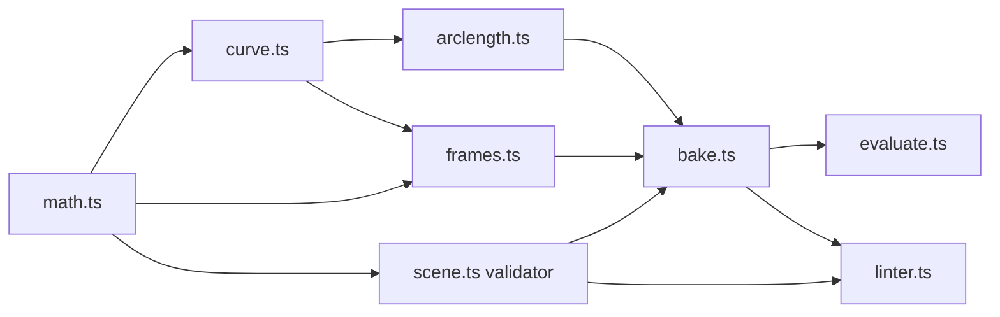

# Design Document

## Overview

path-core is a dependency-free TypeScript library (Node 24, ESM, strict) in `spikes/path-core`. It moves generic entities along a 3D path and orients them. The pipeline has two stages:

1. `bake(scene)` validates the scene, then computes position and rotation for every entity on every frame. Rules that depend on history run only here.
2. `evaluateEntity(baked, entityId, frame, out)` reads the baked arrays and writes into a caller-provided buffer. It allocates nothing.

`motionLinter(scene, baked)` is a separate pure pass over the baked data that returns findings.

Design decisions:

- **Baked storage is flat typed arrays.** Each entity gets one `Float64Array` of length `frameCount * 7` (px, py, pz, qx, qy, qz, qw). Evaluation is an index computation plus 7 reads. This makes allocation-free evaluation straightforward.
- **Math functions take an optional `out` argument.** When given, the result is written into it and returned. When omitted, a new object is allocated (setup and bake code only). The evaluation path always passes `out`.
- **Rotation from entity axes.** For an entity with local `forwardAxis` f and `upAxis` u, and a desired world forward F and world up U, the rotation is `R = quatFromBasis(F, U, F×U) * inverse(quatFromBasis(f, u, f×u))`. This is the only place axes are used, and both are read from the entity. No axis is hard-coded.
- **Arc-length table.** The table always has exactly 1024 entries in total, including the entry at t = 0 (`t_i = i / 1023`, `entryCount = 1024` whatever the point count). Accuracy degrades for paths with more than about 100 points (fewer than about 10 samples per segment). Cumulative chord lengths give a monotone distance table. Lookups binary-search the table and evaluate a monotone cubic Hermite interpolation of the parameter `t` as a function of distance `s`. Node slopes `dt/ds` are precomputed at setup (Fritsch-Butland weighted harmonic mean, adjacent secant at the end nodes, 0 where a secant is 0 or the signs differ, then limited so `(mA/δ)² + (mB/δ)² <= 9`); a zero-length interval gives its adjacent node slopes the value 0 and returns its lower parameter. The table is built in setup, never during evaluation.
- **Frames at a distance.** For `alignToPath`, the forward direction is the exact `tangentAtDistance` of the arc-length table at the entity's distance. Bake builds an RMF table of 1024 samples once and uses it only for the normal: for each frame it maps distance to parameter `t`, takes the nearest lower and upper RMF samples, and interpolates the normal. The interpolated normal is then re-orthogonalised against the exact tangent (remove the tangent component and normalise; if the remainder is shorter than 1e-9, use the existing guarded fallback of any unit vector perpendicular to the tangent). Binormal is `tangent × normal`.
- **Degrees only at the boundary.** The linter threshold for roll is accepted in degrees per frame and converted once on entry. `Vertical_Threshold` is stored as `3 * Math.PI / 180` radians.
- **Core never names a specific entity kind.** All identifiers use "entity", "target" and "path".

## Architecture



Files under `spikes/path-core/src`:

| File | Responsibility |
| --- | --- |
| `math.ts` | Vec3 and Quaternion helpers |
| `curve.ts` | Centripetal Catmull-Rom curve |
| `arclength.ts` | Distance to parameter table |
| `frames.ts` | RMF and Frenet frames |
| `scene.ts` | Scene types, `validateScene`, axis helpers |
| `bake.ts` | `bake`, constraint application, `BakedData` |
| `evaluate.ts` | `evaluateEntity` |
| `linter.ts` | `motionLinter` |
| `index.ts` | Public exports |

Tests live in `spikes/path-core/test`, one file per module, using `vitest` and `fast-check`.

## Components and Interfaces

### math.ts

```ts
export interface Vec3 { x: number; y: number; z: number }
export interface Quat { x: number; y: number; z: number; w: number }

export function add(a: Vec3, b: Vec3, out?: Vec3): Vec3;
export function sub(a: Vec3, b: Vec3, out?: Vec3): Vec3;
export function scale(a: Vec3, s: number, out?: Vec3): Vec3;
export function dot(a: Vec3, b: Vec3): number;
export function cross(a: Vec3, b: Vec3, out?: Vec3): Vec3;
export function length(a: Vec3): number;
export function normalize(a: Vec3, out?: Vec3): Vec3;   // length < 1e-12 -> (0,0,0)
export function lerp(a: Vec3, b: Vec3, t: number, out?: Vec3): Vec3;

export function quatFromBasis(x: Vec3, y: Vec3, z: Vec3, out?: Quat): Quat;
export function quatMul(a: Quat, b: Quat, out?: Quat): Quat;
export function quatInverse(a: Quat, out?: Quat): Quat;
export function rotateVec(q: Quat, v: Vec3, out?: Vec3): Vec3;
export function slerp(a: Quat, b: Quat, t: number, out?: Quat): Quat;  // flips b if dot < 0
export function quatAngle(a: Quat, b: Quat): number;                  // radians in [0, pi]
```

Every function must be safe when `out` aliases an input (compute into locals, then assign). Inputs are never mutated unless they are the explicit `out`.

### curve.ts

```ts
export interface Curve {
  readonly closed: boolean;
  readonly pointCount: number;
  pointAt(t: number, out?: Vec3): Vec3;
  tangentAt(t: number, out?: Vec3): Vec3;   // unit length
}
export function createCurve(points: readonly Vec3[], closed: boolean): Curve;
```

- Centripetal parameterisation uses knot spacing `|Pi+1 - Pi|^0.5`. Open curves duplicate endpoints by reflection (`2*P0 - P1`) to create phantom control points. Closed curves wrap indices.
- Parameter `t` spans the whole curve. Segment index is `floor(t * segmentCount)` and local parameter is the remainder, so `t = 1` on an open curve maps to the last segment's end.
- `t` is clamped for open curves and wrapped (`t - floor(t)`) for closed curves. Wrapping at `t = 1` yields `t = 0`, which for a closed curve is the same point.
- Errors: `createCurve` throws `Curve needs at least 2 points, got N` (checked first, open or closed), `Closed curve needs at least 3 points, got N` (closed curves with exactly 2 points) and `Coincident points at indexes i and i+1`. For closed curves it also checks the last-to-first pair, naming `n-1` and `0`.
- Tangent is the normalised analytic derivative of the segment. If the derivative is below 1e-12 (should not happen after the coincidence check), the chord direction of the segment is used so the output is never NaN.

### arclength.ts

```ts
export interface ArcLengthTable {
  readonly length: number;          // metres
  readonly entryCount: number;      // <= 1024
  pointAtDistance(d: number, out: Vec3): Vec3;
  tangentAtDistance(d: number, out: Vec3): Vec3;
  parameterAtDistance(d: number): number;
}
export function createArcLengthTable(curve: Curve): ArcLengthTable;
```

- Distance is normalised first: open `d' = clamp(d, 0, length)`, closed `d' = d - length * floor(d / length)`, giving `[0, length)`.
- `parameterAtDistance` binary-searches preallocated `Float64Array`s (distances, parameters and node slopes) and evaluates the monotone cubic Hermite interpolation. It allocates nothing. `d = 0` gives exactly `t = 0`, and on open curves `d = length` gives exactly `t = 1` (on closed curves `d = length` wraps to 0, so `t = 0`). `pointAtDistance` and `tangentAtDistance` call the curve with `out` and return `out`. To meet the no-allocation rule, Curve implementations must reuse private scratch variables and never create objects in `pointAt` or `tangentAt` when `out` is supplied.

### frames.ts

```ts
export interface Frame { position: Vec3; tangent: Vec3; normal: Vec3; binormal: Vec3 }

export function rotationMinimizingFrames(curve: Curve, count: number, initialUp?: Vec3): Frame[];
export function frenetFrames(curve: Curve, count: number): Frame[];
```

- Both validate `count` first: `Number.isInteger(count) && count >= 2`, otherwise throw `Frame count must be an integer >= 2, got <value>`.
- Samples are at `t_i = i / (count - 1)`.
- RMF uses the double reflection method. For each step it reflects the previous normal and tangent across the plane bisecting the two positions, then across the plane bisecting the reflected and new tangents. `binormal = tangent × normal`.
- The first normal is `initialUp` (default `(0,1,0)`) with its tangent component removed, then normalised. If the remainder is below 1e-9 (parallel), pick the world axis least aligned with the tangent, cross it with the tangent twice and normalise.
- Frenet normal comes from the derivative of the tangent estimated by central difference. If curvature is below 1e-9, reuse the previous normal made perpendicular to the current tangent. For frame 0 with no previous normal, use the RMF fallback rule above.
- Twist (used by tests): for consecutive frames i and i+1, rotate the normal of frame i by the minimal rotation that takes tangent i to tangent i+1, then take the angle in [0, pi] between that rotated normal and the normal of frame i+1. Total twist of a frame list is the sum of these absolute angles.

### scene.ts

```ts
export type AxisToken = '+X' | '-X' | '+Y' | '-Y' | '+Z' | '-Z';

export interface FollowPathConstraint {
  type: 'followPath'; order: number; influence: number;
  speed: number; startOffset: number; alignToPath?: boolean;  // default false
}
export interface AimAtConstraint {
  type: 'aimAt'; order: number; influence: number; target: string;
}
export type Constraint = FollowPathConstraint | AimAtConstraint;

export interface Entity {
  id: string; forwardAxis: AxisToken; upAxis: AxisToken; constraints: Constraint[];
}
export interface Keyframe { frame: number; position: Vec3 }
export type Target = Vec3 | { keyframes: Keyframe[] };
export interface Scene {
  fps: number; frameCount: number;
  path: { points: Vec3[]; closed: boolean };
  targets: Record<string, Target>;
  entities: Entity[];
}

export function validateScene(scene: Scene): void;            // throws SceneError
export function axisVector(token: AxisToken, out: Vec3): Vec3;
export class SceneError extends Error {}
```

Validation order and messages:

1. `fps` and `frameCount` are positive integers: `fps must be a positive integer, got X`.
2. Duplicate entity ids: `Duplicate entity id "<id>"`.
3. For each entity: the axis letter (last character) of `forwardAxis` and `upAxis` must differ. Message: `Entity "<id>": forwardAxis <f> and upAxis <u> must lie on different axes`.
4. For each constraint: influence in `[0,1]` and finite: `Entity "<id>": influence <v> is outside [0,1]`. An `aimAt` target must exist: `Entity "<id>": unknown target "<name>"`.
5. Each keyframe `frame` is an integer: `Target "<name>": keyframe frame must be an integer, got X`.
6. A keyframed Target has at least one keyframe: `Target "<name>": keyframes must not be empty`.
7. Keyframe frame numbers are strictly increasing: `Target "<name>": keyframe frames must be strictly increasing, got <a> then <b>`, where `<a>` and `<b>` are the first consecutive pair that is not increasing.
8. Each `followPath` speed is finite: `Entity "<id>": speed must be a finite number, got <value>`.
9. Each `followPath` startOffset is finite: `Entity "<id>": startOffset must be a finite number, got <value>`.
10. Every Path point has finite coordinates: `Path point <i> must have finite coordinates`.
11. Every static Target position has finite coordinates: `Target "<name>": position must have finite coordinates`.
12. Every keyframe position has finite coordinates: `Target "<name>": keyframe <i> position must have finite coordinates`.

Design note: `validateScene` does not check path geometry (point count or coincident points). `bake` builds the curve with `createCurve` and lets its errors propagate unchanged. Property 33 covers scene-level validation errors only.

Validation never mutates the scene. Constraints are evaluated in ascending `order`, using a sorted copy made inside `bake` (stable sort so equal orders keep list position).

### bake.ts

```ts
export interface BakedData {
  readonly fps: number;
  readonly frameCount: number;
  readonly entityIds: readonly string[];
  readonly entityIndex: ReadonlyMap<string, number>;
  readonly transforms: readonly Float64Array[];   // [entity][frame * 7 + k]
  readonly heldFromFrame: readonly number[];      // first held frame per entity (first followPath in order), or -1
  readonly travelled: readonly Float64Array[];    // unclamped Travelled_Distance per frame, from the first followPath in order (for linter)
  readonly rotationDrivers: readonly number[];    // declared rotation-driving constraints per entity (aimAt, or followPath with alignToPath true), regardless of influence
  readonly aimDirections: readonly Float64Array[];// x,y,z per frame: unit aim direction of the last aimAt in order; zero vector when no aimAt or aim is coincident
}
export function bake(scene: Scene): BakedData;
```

Algorithm per entity, per frame in ascending order. The constraint stack of every frame starts from the Rest_Pose: position `(0,0,0)` and identity rotation. State from the previous frame is used only by the coincident-aim rule (Requirement 6.9) and the near-vertical up rule (Requirement 7.4). It never becomes the starting value of the stack.

1. For each constraint in ascending order, compute a candidate position and/or rotation.
   - `followPath`: `travelled = startOffset + speed * frame / fps`. Open path distance is `min(travelled, length)` after also clamping below at 0. Closed path distance wraps. The candidate position is `pointAtDistance`. If `alignToPath`, the candidate rotation maps the entity forward axis to the exact tangent from `tangentAtDistance` at the same distance, and the entity up axis to the RMF normal. That normal is interpolated from the 1024-sample RMF table at the distance, then re-orthogonalised against the exact tangent (remove the tangent component and normalise, with the guarded perpendicular fallback if the remainder is shorter than 1e-9).
   - `aimAt`: target position at frame is linear interpolation between keyframes, held outside the range. The `position` used is the position at that point in the stack, produced by the earlier constraints in order, or the Rest_Pose origin if there are none. Aim direction is `normalize(target - position)`. If the position equals the target (direction zero), the candidate rotation is the previous frame's rotation from this constraint, or identity at frame 0. Otherwise the up vector is world up (+Y) with its component along the aim direction removed. If the aim direction at frame `f > 0` is within 3 degrees of ±Y, the up reference is the previous frame's baked up direction, projected perpendicular to the new aim direction and normalised, so the basis stays orthonormal. If that projection is shorter than 1e-9, any unit vector perpendicular to the aim direction is used. The baked up axis at frame `f` equals this up reference within 1e-4. At frame 0 the up vector is world up with the aim component removed, or any perpendicular unit vector if that is shorter than 1e-9. The candidate rotation maps the entity forward axis to the aim direction and the entity up axis to that up vector.
2. Blend: `position = lerp(prior, candidate, influence)` and `rotation = slerp(prior, candidate, influence)`. Influence 0 leaves values untouched.
3. Write the 7 numbers into `transforms[entity]`.

Design note: constraint order matters. An `aimAt` placed before a `followPath` aims from the origin (the Rest_Pose position), because the path position has not been applied yet. Place `aimAt` after any `followPath` to aim from the path position.

The baker records `travelled` and `heldFromFrame` from the first `followPath` in constraint order, `aimDirections` from the last `aimAt` in constraint order (zero vector when there is none or the aim is coincident at that frame), and `rotationDrivers` as the count of declared rotation-driving constraints regardless of influence.

Per-entity carried state (previous aim rotation per aim constraint, previous baked up direction) lives in local variables inside `bake` and feeds only the two rules named above. It is never stored where the evaluator can see it.

Open-path hold: `heldFromFrame` is the first frame whose unclamped `travelled >= length` (inclusive). Rotation on held frames comes from the same alignToPath computation at distance `length`, which is the end-of-path frame.

The scene is deep-read only. Bake does not freeze or modify it. Output contains no NaN because every `normalize` of a near-zero vector is guarded, every `slerp` handles near-parallel quaternions by falling back to normalised lerp. NaN-free output comes from the guarded fallbacks (projection-length checks, zero-length guards in normalize, slerp near-parallel fallback); there is no previous-frame substitution for non-finite values.

### evaluate.ts

```ts
export interface OutBuffer { position: Vec3; rotation: Quat }
export function evaluateEntity(
  baked: BakedData, entityId: string, frame: number, out: OutBuffer,
): OutBuffer;
```

- Looks up `entityIndex.get(entityId)`. A missing id throws `Unknown entity id "<id>"`.
- If `!Number.isInteger(frame) || frame < 0 || frame > frameCount - 1`, throws `Frame <frame> is outside the valid range [0, <frameCount-1>]` (or states non-integer).
- Reads seven numbers and writes them into `out.position` and `out.rotation`. No temporary objects, arrays or closures. Error strings are built only on the throwing path.
- The function never writes into `baked`. Tests freeze only the plain objects and arrays of the baked data (never its typed arrays) and compare copies of the typed array contents taken before and after.

### linter.ts

```ts
export type Severity = 'info' | 'warning';
export interface Finding {
  frame: number; entityId: string; severity: Severity; code: string; message: string;
}
export function motionLinter(
  scene: Scene, baked: BakedData, options?: { rollThresholdDegPerFrame?: number },
): Finding[];
```

- `path-end-reached` (info): open path only. For each entity with a `followPath` constraint, emit one finding at the first frame where `travelled >= length`, where `travelled` comes from the first `followPath` in the entity's constraint order. The comparison is `>=`, so equality at the last frame emits. Because only the first such frame is chosen, at most one is ever emitted per entity. Closed paths and entities that never reach the length emit none.
- `roll-change` (warning): roll change between frames f-1 and f is computed as follows. Let F be the rotated `forwardAxis` at frame f. Project the rotated `upAxis` of frame f-1 and of frame f onto the plane perpendicular to F and normalise each projection. The roll change is the angle between the two normalised vectors, in [0, pi] radians, and is 0 if either projection is shorter than 1e-9. Emit on the later frame when the change in degrees exceeds the threshold (default 15).
- `speed-spike` (warning): per-frame speed is the position distance between consecutive frames times fps. Held frames are excluded from the speed list used for the median. Emit when speed `> 3 * median` and median `> 0`. Design note: path following runs at constant speed, so generated scenes are not expected to trigger `speed-spike`. Property 41 is expected to hold without ever exercising the emitting branch.
- `aim-vertical` (warning): emitted only for frames where the stored aim direction (`aimDirections`) is non-zero and within 3 degrees of ±Y. The stored aim direction is that of the last `aimAt` in constraint order, and is the zero vector when there is no `aimAt` or the aim is coincident.
- `rotation-conflict` (warning): emitted on frame 0 for entities where `rotationDrivers >= 2`. An `aimAt`, or a `followPath` with `alignToPath` true, counts as a driver when declared, regardless of influence.
- Results are sorted by frame, then entity index in the scene, then code (string comparison). The inputs are only read.

## Data Models

- `Vec3` and `Quat` are plain objects with numeric fields. Quaternions stored in baked data are unit length within 1e-9.
- Baked transform layout: `[px, py, pz, qx, qy, qz, qw]` per frame, per entity.
- Time is integer frames. `fps` converts frames to seconds only for speed and Travelled_Distance.
- Axis tokens map to unit vectors through `axisVector`, the single point where a token becomes a vector.

## Error Handling

| Condition | Where | Error |
| --- | --- | --- |
| Fewer than 2 curve points | `createCurve` | message states minimum 2 and supplied count |
| Closed curve with exactly 2 points | `createCurve` | message states minimum 3 and supplied count |
| Coincident consecutive points | `createCurve` | message names both indexes |
| Frame count < 2 or non-integer | frames | message states value |
| Invalid scene | `validateScene`, re-thrown by `bake` | `SceneError` with names and values |
| Unknown entity id | `evaluateEntity` | message names id |
| Frame invalid | `evaluateEntity` | message states frame and valid range |

Numerical guards: `normalize` returns zero below 1e-12; `slerp` falls back to lerp near parallel; RMF and Frenet fall back as described. No function returns NaN for valid input.

## Testing Strategy

- **Unit tests** (vitest): error messages, `alignToPath` default, frame-0 coincident aim, vertical-aim retention, zero-median speed, exact-equality path-end case, package config (`test` script is `vitest run`, no runtime dependencies, only `vitest` and `fast-check` as dev dependencies), and a source scan asserting no occurrence of the word "camera" under `src`.
- **Property tests** (fast-check): at least 100 runs each. Each test carries the tag `Feature: path-core, Property N: <title>`.
- Generators: finite bounded Vec3 (coordinates in [-100, 100]), point lists with distinct consecutive points (minimum spacing 0.1 enforced by construction), unit quaternions, all 36 axis-token pairs (12 invalid because both tokens lie on the same coordinate axis, including opposite pairs such as +Z/-Z, and 24 valid), the `smoothCurvePoints` generator described below, scenes with 0 to 4 entities, mixed constraints and open or closed paths.
- Preconditions for Properties 24, 25, 26, 27, 30 and 31: the generators for these properties produce only scenes where the constraint under test has influence 1 and no later constraint drives the same channel (position or rotation).
- Valid-scene generators produce only non-empty keyframe lists with strictly increasing integer frame numbers. Invalid-scene generators include variants with an empty keyframe list and with non-increasing (equal or decreasing) frame numbers.
- Generators for Properties 27 and 30 place the `aimAt` after any `followPath` in constraint order, so the aim position is the path position. The generator for Property 38 draws `travelled` from the first `followPath` in order, including scenes with several `followPath` constraints.
- Scene generators: `frameCount` at most 120, `fps` drawn from {24, 30, 60}, at most 12 path points, at most 4 entities.
- Typed arrays are never frozen, because `Object.freeze` throws on typed arrays that have elements. Tests freeze only plain objects and arrays, and for typed arrays compare copies of their contents taken before and after the calls.
- Allocation test for `evaluateEntity`: call it 100,000 times with a reused `out`, and assert the returned object is `out` and that `process.memoryUsage().heapUsed` grows by less than 1 MB, run with `--expose-gc` calling `gc()` before and after. Because heap measurement is noisy, the test is paired with the identity assertion and a structural check of the function source outside throw paths. The check flags `new` expressions, array literals and object literals used as values, and arrow functions. It must not flag index access (such as `t[i]`) or code blocks (such as `if (...) { ... }`).
- `smoothCurvePoints` generator: lives in its own helper file under `test` and returns `{ points, rMin, N }` for open curves only. It builds the points first, sampling 8 to 20 points at equal parameter steps from a smooth parametric curve made from the sum of 2 to 3 sinusoids per axis with amplitude 20 to 100, each sinusoid covering 0.25 to 1 full cycle over the whole curve. It builds the real Catmull-Rom curve and its arc-length table, estimates `rMin` (the minimum radius of curvature) from at least 4096 samples of that curve, and takes `length` from the table. With `nMin = max(50, ceil(3 * length / rMin))`, it rejects the curve only if `ceil(3 * length / rMin) > 200`; otherwise it chooses `N` uniformly in `[nMin, 200]`, chained after the curve, and returns `{ points, rMin, N }`. All numbers come from `fc.integer`, and consecutive points are never coincident. A raw arbitrary returns the candidate or `null` (rejected) so the rejection rate can be measured, and `smoothCurvePoints` filters out the nulls. Properties 13, 17 and 26, and any property that assumes constant speed, use this generator.
- Properties 13, 17, 26 and 44 use `smoothCurvePoints`; Property 44 uses its `rMin`.
- Valid-scene generators produce only finite numbers for speed, startOffset, path points, target positions and keyframe positions. Invalid-scene generators include variants with NaN and with Infinity (positive and negative) in each of these fields.
- Every fast-check numeric arbitrary (`fc.double`, `fc.float`) sets `noNaN: true`, `noDefaultInfinity: true` and explicit `min` and `max` bounds. NaN and Infinity enter tests only through explicit invalid-scene variants.
- `vitest.config.ts` sets `testTimeout` to 30000.
- Frenet flip unit test: on a planar S-shaped curve with an inflection point and count 200, `frenetFrames` has a twist above 1 radian within one step, while `rotationMinimizingFrames` keeps every step's twist below 0.001. Twist is defined in the frames.ts section.
- Property tests on I/O-free pure logic only. Fixed examples cover the rest.

## Correctness Properties

*A property is a characteristic or behavior that should hold true across all valid executions of a system-essentially, a formal statement about what the system should do. Properties serve as the bridge between human-readable specifications and machine-verifiable correctness guarantees.*

### Property 1: Math functions do not mutate inputs

For any Vec3 or Quaternion arguments, calling any Math_Module function leaves every input argument deeply equal to its value before the call.

**Validates: Requirements 1.6, 10.10**

### Property 2: Output arguments are written and returned

For any inputs and any caller-provided output object, each Math_Module function that accepts an output argument returns that same object, and its fields equal the result computed without an output argument.

**Validates: Requirements 1.7**

### Property 3: Normalize yields unit or zero

For any Vec3 `v`, `normalize(v)` has length 1 within 1e-9 when `length(v) >= 1e-12`, and is exactly the zero vector otherwise.

**Validates: Requirements 1.4**

### Property 4: Quaternion from orthonormal basis rotates the axes

For any rotation expressed as three orthonormal basis vectors, `quatFromBasis` returns a unit quaternion that, applied to the unit X, Y and Z vectors, gives those three basis vectors within 1e-6.

**Validates: Requirements 1.2**

### Property 5: Slerp follows the shorter arc

For any two unit quaternions `a`, `b` and any `t` in [0,1], `slerp(a, b, t)` represents the same rotation as `slerp(a, -b, t)`, is a unit quaternion, and `quatAngle(a, slerp(a, b, t))` equals `t * quatAngle(a, b)` within 1e-6, where `quatAngle` is at most pi.

**Validates: Requirements 1.3, 1.5**

### Property 6: Curve interpolates its points and endpoints

For any valid point list and openness, `pointAt` at each knot parameter equals the supplied point within 1e-6. For an open curve, `pointAt(0)` equals the first point and `pointAt(1)` equals the last point.

**Validates: Requirements 2.1, 2.3, 2.4**

### Property 7: Closed curve joins continuously

For any valid point list on a closed curve, `pointAt(0)` equals `pointAt(1)` and `tangentAt(0)` equals `tangentAt(1)` within 1e-6. In addition, `pointAt(1 - 1e-9)` is within 1e-6 of `pointAt(0)`, and the tangent is continuous at the join: `|tangentAt(1 - 1e-9) - tangentAt(0)|` is at most `|tangentAt(1 - 1e-6) - tangentAt(0)| / 100 + 1e-12`. Curves that reverse direction at the first point are excluded, because the join is a cusp. With `û` the unit vector of `points[0] - points[n-1]` (arriving) and `v̂` the unit vector of `points[1] - points[0]` (leaving), a curve is excluded when `û · v̂ <= -1 + 1e-9`.

**Validates: Requirements 2.2**

### Property 8: Tangents are unit length

For any valid curve and any `t` in [0,1], `tangentAt(t)` has length 1 within 1e-9 and contains no NaN.

**Validates: Requirements 2.5**

### Property 9: Out-of-range parameter clamps or wraps

For any valid curve and any finite `t`, an open curve satisfies `pointAt(t) = pointAt(clamp(t, 0, 1))` and a closed curve satisfies `pointAt(t) = pointAt(t - floor(t))`, both within 1e-9.

**Validates: Requirements 2.8**

### Property 10: Invalid curve inputs are rejected with informative errors

For any point list with fewer than 2 points, `createCurve` throws an error containing the minimum 2 and the supplied count. For any closed point list with exactly 2 points, it throws an error containing the minimum 3 and the supplied count. For any point list containing two coincident consecutive points at indexes `i` and `i+1`, it throws an error containing both indexes.

**Validates: Requirements 2.6, 2.7**

### Property 11: Arc-length table is bounded and consistent

For any valid curve, the Arc_Length_Table has exactly 1024 entries, a positive length, and a length within 1 percent of the length of a polyline sampled densely (at least 4096 points) along the curve.

**Validates: Requirements 3.1, 3.2**

### Property 12: Arc-length clamp and wrap

For any valid curve and any finite distance `d`, an open table gives identical `pointAtDistance` and `tangentAtDistance` results for `d` and `clamp(d, 0, length)`, and a closed table gives identical results for `d` and `d - length * floor(d / length)`, within 1e-9.

**Validates: Requirements 3.5, 3.6**

### Property 13: Equal distance steps give equal chords

For any Smooth_Curve (estimated minimum radius of curvature at least 3 times the step length/N) and any `N` from 50 to 200, the positions at distances `k * length / N` have consecutive chord distances that are each within 1 percent of `length / N`. This property uses the `smoothCurvePoints` generator.

**Validates: Requirements 3.3, 3.7**

### Property 14: Tangents at a distance are unit length and outputs are reused

For any valid curve, distance `d` and caller-provided output Vec3, `tangentAtDistance` returns a unit vector within 1e-9, and both `pointAtDistance` and `tangentAtDistance` return the provided output object.

**Validates: Requirements 3.4, 3.8**

### Property 15: RMF frames are orthonormal

For any valid curve, any count of at least 2, and any `initialUp` (including vectors parallel to the first tangent and the omitted case), every Frame from `rotationMinimizingFrames` has tangent, normal and binormal of length 1 within 1e-6 and pairwise dot products of magnitude below 1e-6. The frames number exactly `count` and the first and last positions equal `pointAt(0)` and `pointAt(1)`.

**Validates: Requirements 4.1, 4.2, 4.5, 4.6**

### Property 16: RMF first normal follows the up vector

For any valid curve and any `initialUp` not parallel to the first tangent, the first normal equals `normalize(initialUp - dot(initialUp, t0) * t0)` within 1e-6. When `initialUp` is omitted, the same holds with `(0,1,0)`.

**Validates: Requirements 4.3, 4.4**

### Property 17: RMF has less twist than Frenet frames

For any open curve from the `smoothCurvePoints` generator and count of at least 2, the total twist of the RMF frames is no larger than the total twist of the Frenet frames, plus 1e-4. Twist for consecutive frames i and i+1 is the angle between the normal of frame i rotated by the minimal rotation that takes tangent i to tangent i+1, and the normal of frame i+1. Total twist is the sum of the absolute twists over all consecutive pairs.

**Validates: Requirements 4.2**

### Property 18: Frenet frames are well-formed and continuous at low curvature

For any valid curve and count of at least 2, `frenetFrames` returns `count` frames with unit tangent, unit normal perpendicular to the tangent, and no NaN. For any straight-line curve the normal is identical across frames after perpendicularisation to each tangent.

**Validates: Requirements 4.7, 4.9**

### Property 19: Invalid frame counts are rejected

For any count that is less than 2 or not an integer, both frame builders throw an error containing the supplied value.

**Validates: Requirements 4.8**

### Property 20: Axis validation rejects same or opposite axes

For any pair of Axis_Tokens, `validateScene` on an otherwise valid scene throws when both tokens share the same axis letter (identical or opposite), with a message containing both token strings, and does not throw otherwise.

**Validates: Requirements 5.3, 5.4, 10.5**

### Property 21: Scene validation rejects bad numeric fields

For any scene where `fps` or `frameCount` is not a positive integer, validation throws. For any constraint influence, validation accepts it exactly when it lies in [0,1]; otherwise it throws an error naming the entity id and the influence value. For any keyframe with a non-integer frame, validation throws. For any keyframed Target with an empty keyframe list, validation throws `Target "<name>": keyframes must not be empty`. For any keyframed Target whose frame numbers are not strictly increasing, validation throws `Target "<name>": keyframe frames must be strictly increasing, got <a> then <b>` naming the first offending consecutive pair. For any `followPath` speed or startOffset, path point coordinate, static Target position coordinate or keyframe position coordinate that is NaN, Infinity or -Infinity, validation throws the matching Requirement 5.14 message (`Entity "<id>": speed must be a finite number, got <value>`, `Entity "<id>": startOffset must be a finite number, got <value>`, `Path point <i> must have finite coordinates`, `Target "<name>": position must have finite coordinates`, `Target "<name>": keyframe <i> position must have finite coordinates`).

**Validates: Requirements 5.2, 5.6, 5.7, 5.11, 5.13, 5.14**

### Property 22: Scene validation rejects bad references and duplicates

For any scene with an `aimAt` constraint naming a target not in the scene, validation throws an error containing the entity id and the target name. For any scene with a repeated entity id, validation throws an error containing that id.

**Validates: Requirements 5.5, 5.12**

### Property 23: Constraint order is by order value

For any entity whose constraints have distinct order values, the baked result is identical for every permutation of the constraints list.

**Validates: Requirements 5.10**

### Property 24: followPath positions on the path

For any valid scene where the constraint under test has influence 1 and no later constraint drives the same channel (position or rotation), and any entity with a `followPath` constraint of influence 1 and no earlier constraint, the baked position at frame `f` equals `pointAtDistance` of the path's Arc_Length_Table at `startOffset + speed * f / fps`, clamped for open paths and wrapped for closed paths, within 1e-6. A closed-path position at distance `d` and `d + length` is the same.

**Validates: Requirements 6.1, 8.2**

### Property 25: Open-path hold

For any valid scene where the constraint under test has influence 1 and no later constraint drives the same channel (position or rotation), with an open path and any entity following it, every frame whose Travelled_Distance is at or beyond the path length has position equal to the last path point and, for `alignToPath`, rotation equal to the rotation at the first held frame.

**Validates: Requirements 8.1, 8.7**

### Property 26: alignToPath rotates the entity axes onto the path frame

For any valid scene where the `followPath` constraint under test has influence 1 and no later constraint drives the same channel (position or rotation), with a path built from `smoothCurvePoints`, any valid axis pair and `alignToPath` true, the baked rotation applied to the entity's `forwardAxis` vector equals the path tangent at that distance within 1e-4, applied to its `upAxis` vector is perpendicular to that tangent within 1e-6, and is within 1e-2 of a dense RMF normal at that distance. With `alignToPath` false (or omitted) and a prior rotation, the rotation is unchanged.

**Validates: Requirements 5.8, 6.2, 6.3**

### Property 27: aimAt points the forward axis at the target

For any valid scene where the `aimAt` constraint under test has influence 1 and no later constraint drives the same channel (position or rotation), any valid axis pair, any entity position distinct from the target and not near vertical (where the entity position is the position at that point in the stack, produced by earlier constraints in order, or the Rest_Pose origin if none), the baked rotation applied to the `forwardAxis` vector equals the unit direction to the target at that frame, the rotated `upAxis` is perpendicular to that direction, and its dot product with +Y is non-negative, within 1e-4.

**Validates: Requirements 6.4, 6.5**

### Property 28: Influence blends linearly

For any valid scene, entity, constraint and influence `w` in [0,1], where either the entity has a single constraint (so the state before it is the Rest_Pose) or the state before the constraint is computed by baking a scene containing only that entity's earlier constraints, the entity state after the constraint equals `lerp` (position) and `slerp` (rotation) from the state before the constraint to the full-influence result by `w`. With `w = 0` the state before and after are equal.

**Validates: Requirements 6.6, 6.7**

### Property 29: Keyframed targets interpolate and hold

For any target with keyframes and any integer frame, the target position equals linear interpolation between the surrounding keyframes, the first keyframe position before the first keyframe, and the last keyframe position after the last. Observed through the aim direction of a stationary entity.

**Validates: Requirements 6.8**

### Property 30: Coincident aim keeps previous rotation

For any scene where the `aimAt` constraint under test has influence 1 and no later constraint drives the same channel (position or rotation), and the entity position at that point in the stack (produced by earlier constraints in order, or the Rest_Pose origin if none) equals its aim target at frame `f`, the baked rotation from that constraint at frame `f` equals the rotation at frame `f-1`, or identity when `f` is 0.

**Validates: Requirements 6.9**

### Property 31: Near-vertical aim uses the projected previous up vector

For any scene where the `aimAt` constraint under test has influence 1 and no later constraint drives the same channel (position or rotation), with an aim direction within 3 degrees of straight up or down at frame `f > 0`, let `u` be the baked up direction at frame `f-1` projected perpendicular to the new aim direction and normalised. If that projection has length at least 1e-9, the baked up axis at frame `f` equals `u` within 1e-4. Otherwise it equals a unit vector perpendicular to the aim direction within 1e-4. In both cases the baked rotation basis is orthonormal.

**Validates: Requirements 7.4, 7.5, 7.6**

### Property 32: Bake is complete, deterministic and non-mutating

For any valid scene, `bake` returns transforms for every entity with exactly `frameCount` frames, produces deeply equal results on repeated calls, and leaves the scene deeply equal to a deep copy taken beforehand. For any entity whose only constraint has influence 0, every baked frame equals the Rest_Pose, so the stack starts from the Rest_Pose on each frame and previous-frame state never seeds it.

**Validates: Requirements 7.1, 7.2, 7.3, 7.7, 7.8, 10.10, 10.11**

### Property 33: Invalid scenes are rejected by bake

For any scene that fails `validateScene`, `bake` throws an error with the same message as `validateScene` for that scene. This property covers scene-level validation errors only; path geometry errors from `createCurve` are outside it.

**Validates: Requirements 7.15**

### Property 34: Evaluator returns baked values

For any valid scene, entity id, integer frame in range and Out_Buffer, `evaluateEntity` returns the same Out_Buffer object with position and rotation equal to the seven stored values for that frame.

**Validates: Requirements 7.9**

### Property 35: Evaluator is read-only and allocation-free

For any valid scene, with the plain objects and arrays of the Baked_Data frozen (typed arrays are never frozen, since `Object.freeze` throws on typed arrays with elements; copies of their contents taken before the calls are compared with their contents after), repeated `evaluateEntity` calls with a reused Out_Buffer do not change the baked data, return the identical Out_Buffer object each time, and cause no measurable heap growth over at least 100,000 calls.

**Validates: Requirements 7.10, 7.11**

### Property 36: Evaluator rejects invalid arguments

For any non-integer frame, or integer frame below 0 or above `frameCount - 1`, `evaluateEntity` throws an error containing the frame and the valid range. For any id not in the Baked_Data, it throws an error containing that id.

**Validates: Requirements 7.12, 7.13**

### Property 37: No NaN in any output

For any valid scene (including coincident aim targets, near-vertical aim, zero influence, zero speed, held frames and closed paths) and any `linter` threshold, every number in the Baked_Data, in every `evaluateEntity` output, and in every Finding is a finite number.

**Validates: Requirements 7.14**

### Property 38: path-end-reached is emitted exactly once on open paths, inclusively

For any valid scene with an open path and any entity with a `followPath` constraint, the linter emits exactly one `path-end-reached` Finding with severity `info` for that entity when its unclamped Travelled_Distance, computed from the first `followPath` in the entity's constraint order, reaches or exceeds the path length on some frame, and the Finding's frame is the first such frame. This includes the case where equality occurs on the last frame. It emits none when the distance stays below the length on every frame.

**Validates: Requirements 8.3, 8.4, 8.6**

### Property 39: path-end-reached is never emitted on closed paths

For any valid scene with a closed path, the linter emits no `path-end-reached` Finding.

**Validates: Requirements 8.5**

### Property 40: Roll change and aim-vertical findings match their thresholds

For any scene, baked data and roll threshold, a `roll-change` Finding exists for frame `f` of an entity exactly when the roll change between frames `f-1` and `f` exceeds the threshold. The roll change is computed as follows: let F be the rotated `forwardAxis` at frame `f`; project the rotated `upAxis` of frame `f-1` and of frame `f` onto the plane perpendicular to F and normalise each; the roll change is the angle between them in [0, pi], and 0 if either projection is shorter than 1e-9. An `aim-vertical` Finding exists for frame `f` exactly when the stored aim direction (that of the last `aimAt` in constraint order, or the zero vector when there is no `aimAt` or the aim is coincident) is non-zero and within 3 degrees of straight up or down. The generators for this property produce scenes with and without `aimAt` constraints and with coincident aims, consistent with this definition.

**Validates: Requirements 9.2, 9.5, 9.11**

### Property 41: Speed spike uses the median of non-held frames

For any scene and entity, a `speed-spike` Finding exists for frame `f` exactly when the median speed over non-held frames is greater than 0 and the speed at `f` exceeds 3 times that median. An entity whose median speed is 0 produces none.

**Validates: Requirements 9.3, 9.4, 9.9**

### Property 42: Rotation conflict is reported on frame 0

For any scene, an entity with two or more declared rotation-driving constraints (`aimAt`, or `followPath` with `alignToPath` true), regardless of their influence, has a `rotation-conflict` Finding on frame 0, and an entity with fewer than two has none. The generators include constraints with influence 0 and with influence below 1 to match this definition.

**Validates: Requirements 9.6**

### Property 43: Findings are well-formed, ordered and non-mutating

For any scene and baked data, every Finding has a frame, entityId, severity, code and message; severity is `warning` for `roll-change`, `speed-spike`, `aim-vertical` and `rotation-conflict`; the list is sorted by ascending frame, then entity index, then code; and the scene and baked data are deeply equal to copies taken before the call.

**Validates: Requirements 9.1, 9.7, 9.8, 9.10**

### Property 44: alignToPath orientation changes smoothly

For any path from `smoothCurvePoints` and any entity with a single `followPath` constraint (influence 1, `alignToPath` true, speed above 0, any valid axis pair), the angle `quatAngle` between the baked rotations of frames `f-1` and `f` is at most `2 * (speed / fps) / rMin + 0.001` radians for every `f` where frame `f-1` is not a Held_Frame. `rMin` is the generator's estimate of the minimum radius of curvature from at least 4096 samples of the actual Catmull-Rom curve.

**Validates: Requirements 6.10**

### Property 45: Reversing an open curve reverses its parameter

For any valid open point list, the curve built from the reversed list satisfies `reversed.pointAt(1 - t)` equal to `original.pointAt(t)` within 1e-6 for every `t` in [0, 1].

**Validates: Requirements 2.9**
