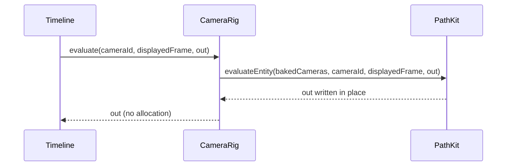
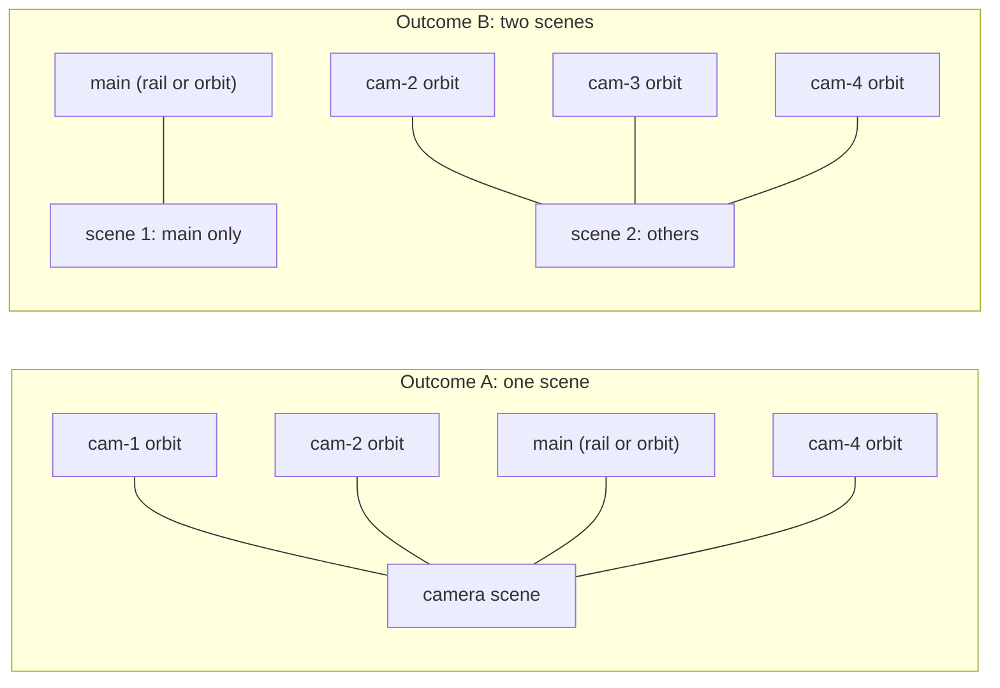

# Design Document: Shot Rail

## Overview

Shot Rail is a browser app that places up to six virtual cameras around a moving subject and shows what each sees. It uses PathKit for everything that is not a plain camera: the subject follows a closed road (`followPath` with `alignToPath`), cameras orbit and aim at the subject (`orbitAround`, `aimAt`), the main camera can follow its own rail (`followPath` without `alignToPath`), and `motionLinter` checks the main camera's move.

PathKit's `followPath` moves an entity at constant speed only. The app's "speeding up and slowing down" (Requirement 3.4) is produced entirely by app code: the subject is baked once, at a higher frame rate than is displayed, covering exactly one lap; a pure `Frame_Remap` function then picks, for each displayed frame, which baked frame to read. This document fixes the oversampled bake, the remap formula, the two-target camera arrangement, the `Fill_Fraction` function, the scene-arrangement spike (S6) and its two possible outcomes, the four shot builders, and every named constant, before any interface code is written.

This design treats PathKit's public surface as fixed and quotes it verbatim from `packages/pathkit/src/index.ts`, `scene.ts`, `bake.ts`, `evaluate.ts`, `linter.ts`, `curve.ts` and `arclength.ts`. Open question 17 is resolved below: the brief's names `followPath`, `alignToPath`, `orbitAround`, `aimAt` match PathKit's constraint `type` discriminants exactly (`FollowPathConstraint.type === 'followPath'` etc.); `alignToPath` is an optional boolean field of `FollowPathConstraint`, defaulting to `false`.

## Architecture

```mermaid
graph TB
  subgraph "src/logic (pure, no DOM, no Three.js)"
    constants[constants.ts]
    lens[lens.ts — Lens_Module]
    labels[labels.ts — Label_Module]
    fill[fill.ts — Fill_Fraction, bounding box, projection]
    frameMapper[frame-mapper.ts — Frame_Mapper]
    frameRemap[frame-remap.ts — Frame_Remap]
    targetConverter[target-converter.ts — Target_Converter]
    shotBuilders[shot-builders.ts — Shot_Builder x4]
    sceneSet[scene-set.ts — builds the Camera scene(s), Outcome A or B]
    findings[findings.ts — plain-words table]
    contrast[contrast.ts — contrast ratio]
    storage[storage.ts — localStorage wrapper]
  end
  subgraph "src/view (Three.js + DOM)"
    rig[CameraRig — orchestrates bake/evaluate/re-bake]
    mainView[Main camera view]
    grid[Coverage_Grid]
    stage[Stage_Overview]
    strip[Shot_Strip]
    capture[Capture]
    timeline[Timeline UI]
    panels[Controls, Readout, About_Panel]
  end
  pathkit["packages/pathkit/src/index.ts"]

  constants --> lens & labels & fill & frameRemap & shotBuilders
  frameRemap --> targetConverter
  targetConverter --> sceneSet
  shotBuilders --> sceneSet
  sceneSet --> rig
  rig --> pathkit
  rig --> mainView & grid & stage & strip & capture
  findings --> rig
  lens & labels & fill --> panels
  timeline --> rig
  storage --> panels
```

Two data flows run per re-bake:

```mermaid
sequenceDiagram
  participant UI as Settings UI
  participant Rig as CameraRig
  participant PK as PathKit

  UI->>Rig: subject or road changed
  Rig->>PK: bake(subjectScene)  (fps=240, 1 lap)
  PK-->>Rig: BakedData (subject)
  Rig->>Rig: for f in 0..N-1: b = remap(f); evaluateEntity(subject, b) -> Target_Converter
  Rig->>Rig: build camera scene(s) via scene-set.ts
  Rig->>PK: bake(cameraScene...)
  PK-->>Rig: BakedData (cameras)
  Rig->>PK: motionLinter(cameraScene, bakedCameras)
  PK-->>Rig: Finding[]
  Rig-->>UI: ready, Timeline stays paused
```



## Components and Interfaces

All signatures below are exact; function bodies are not part of this document.

### constants.ts

See "Named constants" below. No logic, only exported `const` values and the derived ones computed at module load (e.g. `BAKE_FPS = FRAME_RATE * BAKE_OVERSAMPLE`).

### lens.ts — Lens_Module

```ts
export interface FieldOfView {
  horizontalDeg: number;
  verticalDeg: number;
}
export function fieldOfViewForFocalLengthMm(focalLengthMm: number): FieldOfView;
```
Pure. Throws `Error` naming the invalid value when `focalLengthMm` is not finite or `<= 0` (Requirement 4.6, 4.7). Internally uses radians (`Math.atan`), converts to degrees only in the returned object (Requirement 4.8).

### labels.ts — Label_Module

```ts
export type AngleLabel = 'low angle' | 'eye level' | 'high angle' | 'overhead';
export type FramingLabel = 'close-up' | 'medium' | 'wide';

export function angleLabel(elevationDeg: number): AngleLabel;
export function framingLabel(fillFractionPercent: number): FramingLabel;
```
Both pure. `angleLabel` is total over finite input (no documented error case in Requirement 5). `framingLabel` throws `Error` naming the invalid value when `fillFractionPercent` is not finite or outside `[0, 100]` (Requirement 6.8).

### fill.ts — Fill_Fraction and its inputs

```ts
// (a) 8 oriented-box corners in world space, written into a preallocated buffer.
export function subjectBoxCorners(
  position: Vec3, rotation: Quat, halfExtents: Vec3, out: Float64Array /* length 24 */
): Float64Array;

// (b) projects world points into NDC; returns false iff any point is behind the camera.
export function projectToNdc(
  worldPoints: Float64Array, count: number,
  cameraPosition: Vec3, cameraRotation: Quat,
  verticalFovRad: number, aspect: number,
  outNdc: Float64Array /* length 2 * count, x,y interleaved */
): boolean;

// (c) percentage fill of the frame, clipped to [0, 100].
export function fillFractionPercent(ndc: Float64Array, pointCount: number): number;
```
All pure, all write into caller-supplied buffers (no per-call allocation, matching Requirement 11.11 for the app's own evaluation path). Each throws `Error` naming the index and value for non-finite input coordinates or a `pointCount < 1`. `fillFractionPercent` never sees the in-front flag; the pure helper `framingPercent(...)` (also in `fill.ts`, signature below) calls `subjectBoxCorners`, `projectToNdc` and `fillFractionPercent`, and returns `100` when `projectToNdc` returns `false`; see "Fill_Fraction function" below for the exact contract between the three.

### frame-mapper.ts — Frame_Mapper

```ts
export function scrubToFrame(scrubValue: number, lastFrame: number): number;      // clamp, round, whole
export function frameToSeconds(frame: number, fps: number): number;
export function secondsToFrame(seconds: number, fps: number): number;             // inverse of frameToSeconds
```
`scrubToFrame` throws `Error` naming the value when `scrubValue` is not finite (Requirement 11.5); otherwise rounds to the nearest whole frame and clamps to `[0, lastFrame]` (Requirement 11.3, 11.4). `frameToSeconds`/`secondsToFrame` round-trip exactly for every whole frame in range (Requirement 11.6).

### frame-remap.ts — Frame_Remap

```ts
export function remapDisplayedFrame(
  displayedFrame: number,
  lapFrames: number,       // LAP_FRAMES
  bakedLapFrames: number,  // BAKED_LAP_FRAMES
  easeAmplitude: number,   // EASE_AMPLITUDE
): number; // whole baked frame in [0, bakedLapFrames - 1]
```
Pure (Requirement 3.5). Throws `Error` naming the invalid value when `displayedFrame` is not a whole number `>= 0` (Requirement 3.17, 23.16). See "Oversampled bake and Frame_Remap" below for the formula.

### target-converter.ts — Target_Converter

```ts
export function buildKeyframedTarget(
  bakedSubject: BakedData,
  subjectEntityId: string,
  displayedFrameCount: number,
  remap: (displayedFrame: number) => number,
  heightOffsetM: number,          // 0 for the true-subject target, h_i for a centre target
): { keyframes: { frame: number; position: Vec3 }[] };
```
Pure given its inputs. Produces exactly `displayedFrameCount` keyframes, one per displayed frame `0..N-1`, each equal to `evaluateEntity(bakedSubject, subjectEntityId, remap(f))`'s position, shifted by `(0, heightOffsetM, 0)` (Requirement 8.11, 8.14).

### shot-builders.ts — Shot_Builder

```ts
export type ShotType = 'push-in' | 'orbit' | 'tracking' | 'crane';

export interface CameraPlacement {
  bearingDeg: number;     // measured from +Z toward +X
  heightM: number;        // relative to subject centre
  horizontalDistanceM: number;
  lensMm: number;
}

export function buildCameraScene(
  shotType: ShotType,
  placement: CameraPlacement,
  shotLengthFrames: number,
  subjectTarget: Target,              // the true-subject keyframed target, shared
  centreTarget: Target,               // this camera's shifted centre target (ignored by push-in/crane rail position, used by their aimAt)
  cameraId: string,
  path: { points: Vec3[]; closed: boolean } | null, // null => PLACEHOLDER_PATH
): Scene;
```
Pure. Returns a one-entity `Scene` (`fps = FRAME_RATE`, `frameCount = shotLengthFrames`) that `validateScene` accepts (Requirement 8.6). Used both for the Main_Camera (any of the 4 types) and for every non-main camera, which is always built with `shotType = 'tracking'`, `speed = 0` (Angle mode default, per decision 6 of the brief and Requirement 7.7).

### scene-set.ts — scene arrangement (Outcome A / B)

```ts
export interface SceneSet {
  scenes: { scene: Scene; cameraIds: string[] }[]; // 1 entry for Outcome A, 2 for Outcome B
  mainCameraId: string;
}
export function buildSceneSet(
  mainCameraId: string,
  cameras: Map<string, { shotType: ShotType; placement: CameraPlacement }>,
  shotLengthFrames: number,
  subjectTarget: Target,
  centreTargets: Map<string, Target>,
  roadPoints: { points: Vec3[]; closed: boolean } | null,
  outcome: 'A' | 'B', // fixed at build time from the recorded S6 result, not re-tested at runtime
): SceneSet;
```
This is the only module whose code differs between Outcome A and Outcome B (see "Camera scene arrangement" below). Everything above and below it is outcome-agnostic: it consumes/produces `SceneSet`, not a fixed scene count.

### CameraRig (src/view)

```ts
export interface CameraRig {
  bake(settings: RigSettings, subjectBaked: BakedData): void; // re-bakes camera scene(s); never auto-plays
  evaluate(cameraId: string, displayedFrame: number, out: OutBuffer): OutBuffer; // no allocation
  findingsForMain(): Finding[];
  placementOf(cameraId: string): { bakedScene: BakedData; sceneIndexInSet: number };
}
```
`bake` also triggers a subject re-bake first when the subject or road changed (cached otherwise), then rebuilds the `SceneSet` and bakes each scene in it, then runs `motionLinter` once per scene that contains the main camera and keeps only findings whose `entityId === mainCameraId` (Requirement 8.10, 9.1, 7.13/8.13 cross-reference).

## Data Models

```mermaid
classDiagram
  class Scene { fps: number; frameCount: number; path; targets; entities }
  class Entity { id: string; forwardAxis: AxisToken; upAxis: AxisToken; constraints: Constraint[] }
  class CameraSetting { id: string; shotType: ShotType; bearingDeg; heightM; horizontalDistanceM; lensMm }
  class RigSettings { shotLengthFrames: number; mainCameraId: string; cameras: CameraSetting[]; road: RoadSetting; subjectKind: "car" }
  class RoadSetting { points: Vec3[]; closed: true }
  class SceneSet { scenes: { scene: Scene; cameraIds: string[] }[]; mainCameraId: string }
  RigSettings --> CameraSetting
  RigSettings --> RoadSetting
```

Camera ids are fixed strings `cam-1` .. `cam-6`, one per Coverage_Grid slot; the subject entity id is the fixed string `subject`. Target names: `subject` (true position, shared by every camera's `aimAt` and by the Stage_Overview) and `centre-cam-1` .. `centre-cam-6` (one per camera, each shifted by that camera's current height). A camera that changes height only needs its own `centre-<id>` target rebuilt; `subject` is unaffected, but because `Target_Converter` output feeds directly into the `Scene.targets` record that is handed to `bake`, in practice the whole camera scene is still re-baked on any setting change (Requirement 8.12), it is only the *re-derivation* of the unaffected target that is skippable, which is left as an internal optimisation, not a correctness requirement.

## Oversampled bake and Frame_Remap

**Subject bake.** One lap only, not the whole shot:

- `fps = BAKE_FPS = FRAME_RATE * BAKE_OVERSAMPLE = 30 * 8 = 240` (a positive integer; `validateScene` requires this).
- `frameCount = BAKED_LAP_FRAMES = LAP_FRAMES * BAKE_OVERSAMPLE = 240 * 8 = 1920`.
- `path = Road` (closed).
- One entity `subject` with one constraint: `followPath { order: 0, influence: 1, speed: roadLength / LAP_SECONDS, startOffset: 0, alignToPath: true }`, where `LAP_SECONDS = LAP_FRAMES / FRAME_RATE = 240 / 30 = 8` and `roadLength = createArcLengthTable(createCurve(points, true)).length`, computed once in app setup code with the same inputs `bake` uses internally (`bake` always calls `createCurve`/`createArcLengthTable` itself from `scene.path`; the app duplicates that one computation to get `roadLength` as a number it can divide by, not to replace PathKit's own baking).

Travelled distance at baked frame `b` (from `applyFollowPath`, `travelled = startOffset + speed * frame / fps`): `travelled(b) = (roadLength / 8) * b / 240 = roadLength * b / 1920`. So `travelled(1920) = roadLength`, i.e. baked frame 1920 would complete exactly one lap and the closed-path table wraps it to the same point as `travelled(0) = 0`. Baked frames `0..1919` are the lap; frame `1920` is never requested.

**Frame_Remap.** Displayed frame `f` (whole, `>= 0`) maps to a baked frame `b` in `[0, 1919]`:

1. `u = (f mod LAP_FRAMES) / LAP_FRAMES` — integer remainder first, then divide, so `u` is always one of the 240 exact fractions `0/240 .. 239/240`.
2. `s = u + EASE_AMPLITUDE * sin(2*pi*u) / (2*pi)`, `EASE_AMPLITUDE = 0.5` (default for the user to confirm).
3. `b = min(round(s * BAKED_LAP_FRAMES), BAKED_LAP_FRAMES - 1)`.

**Why this satisfies Requirements 3.5–3.9:**

- `s(0) = 0` and `s(1) = 1 + 0.5*sin(2*pi)/(2*pi) = 1 + 0 = 1`, so the lap boundary maps `u=0` to `b=0` and (in the limit) `u=1` to `b=1920`, which the modulo in step 1 turns into `remap(LAP_FRAMES) = remap(0) = 0` (Requirement 3.6, 3.7): at `f = LAP_FRAMES = 240`, `u = 0` again, exactly as required — the "start of the next lap" is baked frame 0 of the same one-lap bake, read again.
- `s'(u) = 1 + EASE_AMPLITUDE * cos(2*pi*u)` ranges over `[1 - 0.5, 1 + 0.5] = [0.5, 1.5]`, strictly positive everywhere, so `s` is strictly increasing on `[0,1]`; composed with the non-decreasing floor/round in steps 1 and 3, `b` never decreases as `f` increases within a lap (Requirement 3.8). Note "never decrease" (not "always increase") is satisfied even though the final `round` can repeat a baked frame for two adjacent `u` values near the slowest point.
- Because `s'` varies with `u`, the baked-frame step per displayed frame varies too, giving different speeds at different displayed frames (Requirement 3.9): near `u = 0.5` (`cos = -1`), `s' = 0.5`, so one displayed frame advances about `0.5 * (1920/240) = 4` baked frames; near `u = 0` or `u = 1` (`cos = 1`), `s' = 1.5`, advancing about `12` baked frames.
- `b` is always `round(...)`, an integer, and the `min(..., 1919)` guards the one place floating-point rounding at `u` just below 1 could otherwise produce `1920` (out of PathKit's valid frame range for `evaluateEntity`).

**Error magnitude.** The baked step length is `roadLength / BAKED_LAP_FRAMES = roadLength / 1920`; for the default 120 m road that is `0.0625` m. Picking a single nearest baked frame instead of interpolating between two gives a worst-case position error of half a baked step: `L / (2 * BAKE_OVERSAMPLE * LAP_FRAMES) = 120 / (2*8*240) = 120/3840 = 0.03125` m, about 3 cm. The per-displayed-frame *step size* itself can be off by up to one baked frame from the ideal (non-integer) value `s'(u) * 8`; at the slowest point (ideal step 4) a one-frame error is 25% of that step, at the fastest point (ideal step 12) it is about 8%.

**Alternative rejected.** Reading the two baked frames nearest the ideal (non-integer) `s*BAKED_LAP_FRAMES` and blending position/rotation was rejected: rotation needs `slerp`, which the app would have to re-implement or import from PathKit's math exports, and — more importantly — the subject's position, orientation and the camera's keyframed target would no longer all come from the *same* baked frame, breaking the invariant Requirement 3.4 states explicitly ("the Shot_Rail_App SHALL read the Subject's position and orientation, and the keyframed target for the Cameras, from that same baked frame"). Doubling `BAKE_OVERSAMPLE` to 16 halves the position error to about 1.5 cm at the cost of a bigger one-off bake: the subject bake holds `1920*2 = 3840` frames (for `BAKE_OVERSAMPLE=16`, `BAKED_LAP_FRAMES = 3840`) times 7 `Float64Array` numbers times 8 bytes, about 215 KB; at the current `BAKE_OVERSAMPLE = 8` (1920 frames) that figure is `1920 * 7 * 8 = 107,520` bytes, about 107 KB, one-off and not per frame.

**Interaction with the 1024-entry arc-length table.** The table (`packages/pathkit/src/arclength.ts`) is built once per `bake` call from `scene.path`, independent of `frameCount`; it always has 1024 entries, 1023 chord intervals. For the 120 m default road its mean chord length is about `120/1023 ≈ 0.117` m, larger than the 0.0625 m baked step, so several consecutive baked frames fall inside one table chord interval. This is not a problem: `parameterAtDistance` interpolates `t` from distance with a monotone cubic Hermite spline (continuous, not piecewise-chord), and `pointAtDistance` then calls `curve.pointAt(t)`, which evaluates the exact Catmull-Rom curve at that `t` — baked positions always lie exactly on the curve, never on a chord approximation. Oversampling the bake does not need a bigger table, and the table's accuracy note (degraded accuracy above ~100 points, `1024/100 ≈ 10.2` samples per segment) is orthogonal to `BAKE_OVERSAMPLE`: it is about table resolution relative to the road's *own* point count, not about how many baked frames are read from it. Spike S1 should not assert a specific spacing-deviation number; it should measure the deviation once, print it, and assert against a tolerance chosen after seeing that first measurement (a self-referential "it equals what we observed" assertion defeats the point of a regression test).

**Whole-frame rule.** `evaluateEntity` (`packages/pathkit/src/evaluate.ts`) throws unless `frame` is `Number.isInteger(frame) && frame >= 0 && frame < baked.frameCount`. There is no sub-frame interpolation anywhere in PathKit's public surface. Consequently: the subject is read only at integer baked frames produced by `Frame_Remap`; cameras are read only at integer displayed frames (`0..shotLengthFrames-1`); the Timeline's scrub value is rounded to a whole frame by `Frame_Mapper.scrubToFrame` and clamped to `[0, lastFrame]`. Forced edge cases for `scrubToFrame`: input `-0` must clamp/round to `0` (not `-0`, since `Object.is(-0, 0)` is false but `-0 === 0` is true — the function must return a value that prints as `"0"`, achieved by adding `0` after rounding, e.g. `Math.round(x) + 0`, or equivalently relying on `Math.max(0, ...)` which already never yields `-0` for non-negative clamped results); input exactly `lastFrame + 0.5` must round to `lastFrame` after clamping (clamp before round, or round then clamp — both must agree at this boundary, so the design fixes the order as clamp-then-round: clamp to `[0, lastFrame]` first using the unrounded value, then round); input `NaN` or `Infinity` must throw, not clamp.

Camera scenes run at `fps = FRAME_RATE = 30` with `frameCount = Shot_Length` (the user-chosen shot length), unrelated to the subject's internal 240 fps bake.

**Worked values** (`LAP_FRAMES = 240`, `BAKED_LAP_FRAMES = 1920`, `EASE_AMPLITUDE = 0.5`, `s(u) = u + 0.5*sin(2*pi*u)/(2*pi)`):

| f | u = (f mod 240)/240 | s(u) | b = min(round(s*1920), 1919) |
| --- | --- | --- | --- |
| 0 | 0 | 0 | 0 |
| 1 | 1/240 ≈ 0.0041667 | 2π·u = 0.0261799, sin = 0.0261769; s = 0.0041667 + 0.5·0.0261769/6.283185 = 0.0041667 + 0.0020831 = 0.0062498 | round(0.0062498·1920) = round(11.9996) = 12 |
| 60 | 60/240 = 0.25 | 0.25 + 0.5·sin(π/2)/(2π) = 0.25 + 0.5·1/6.283185 ≈ 0.25 + 0.0795775 ≈ 0.3295775 | round(0.3295775·1920) = round(632.79) = 633 |
| 120 | 0.5 | 0.5 + 0.5·sin(π)/(2π) = 0.5 + 0 = 0.5 | round(0.5·1920) = 960 |
| 239 | 239/240 ≈ 0.9958333 | By symmetry s(1 − u) = 1 − s(u) (sin is odd), so s = 1 − 0.0062498 = 0.9937502 | round(0.9937502·1920) = round(1908.0004) = 1908; quick hand check: b(239) = 1920 − b(1) = 1908 |
| 240 | (240 mod 240)/240 = 0 | 0 | 0 |
| 241 | 1/240 (same as f=1) | same as f=1 | 12 |
| 599 | 599 mod 240 = 119; 119/240 ≈ 0.4958333 | 2π·u = π − 0.0261799 = 3.115413, sin = 0.0261769; s = 0.4958333 + 0.0020831 = 0.4979164 | round(0.4979164·1920) = round(955.9995) = 956 |

`f = 240` reproduces `f = 0`'s baked frame (`0`), and `f = 241` reproduces `f = 1`'s (`12`), confirming periodicity across the lap boundary (Requirement 3.7, and the continuity claim used by the orientation-continuity property below).

## Target_Converter and the two-target arrangement

For each displayed frame `f` in `0..Shot_Length-1`:

1. `b = remapDisplayedFrame(f, ...)`.
2. Read the subject's baked pose at baked frame `b` via `evaluateEntity(bakedSubject, 'subject', b, out)`. This is the position of the entity origin, defined to sit at the centre of the subject's oriented bounding box (`SUBJECT_CENTRE_HEIGHT` above the ground the Road is drawn at, so the Road's constant `y` equals `SUBJECT_CENTRE_HEIGHT`, and the car mesh is drawn offset downward from the entity origin by that amount).
3. Keyframe `f` of target `subject` = that position, unchanged (this is the "true Subject position" used by every `aimAt` and by the Label_Module's Elevation calculation, Requirement 5.9).
4. For each camera slot `i` with current height `h_i`, keyframe `f` of target `centre-<id>` = the same position shifted by `(0, h_i, 0)`.

Camera entity constraints, in fixed order: `orbitAround { order: 0, influence: 1, target: 'centre-<id>', radius: horizontalDistanceM, axis: '+Y', speed, startAngle: bearingDeg }`, then `aimAt { order: 1, influence: 1, target: 'subject' }` (Requirement 7.6, 7.7, 8.14).

From `applyOrbitAround`'s documented position formula for axis `+Y` (`a = {0,1,0}`, so `a.x+a.y+a.z = 1 > 0`, the "positive axis" branch): `p.x = centre.x + r*(cos·a.z + sin·a.y) = centre.x + r·sin(angle)`, `p.y = centre.y + r*(cos·a.x + sin·a.z) = centre.y`, `p.z = centre.z + r*(cos·a.y + sin·a.x) = centre.z + r·cos(angle)`, where `angle = startAngle + speed·frame/fps` in degrees, converted once to radians. So position = `centre + radius·(sin(angle), 0, cos(angle))`: bearing is measured from `+Z` toward `+X`, and the camera's `y` always equals the orbit centre's `y` — never the true subject's `y` — which is exactly why the centre target must be the *shifted* one: if `orbitAround` used the unshifted `subject` target directly, every camera would sit at the subject's own height regardless of the configured camera height.

Conversely `aimAt` must use the unshifted `subject` target, not `centre-<id>`: `aimAt`'s direction is `target position − entity position` (`applyAimAt` / `targetPositionAt`), and if it aimed at the shifted centre, a camera above or below the subject would aim level with its own height band rather than down or up at the actual subject, defeating the purpose of a high or low angle shot.

With this arrangement, exactly and in closed form at every baked/evaluated frame:

- Camera `y` = `centre.y` = `subject.y + h_i` (since `centre-<id>` was built as `subject + (0, h_i, 0)`).
- Horizontal distance from the subject = `radius` exactly (the orbit keeps `(x - centre.x)^2 + (z - centre.z)^2 = radius^2`, and `centre.x = subject.x`, `centre.z = subject.z`).
- `Elevation = atan2(h_i, radius)` in degrees (Requirement 5.9's "from the true Subject centre"; note `atan2`, not `atan`, so it is well-defined and signed for `h_i` of either sign, including `radius = 0` giving `±90°`, though `CAMERA_RADIUS_MIN` below prevents `radius = 0` in practice).
- `Straight_Line_Distance = sqrt(radius^2 + h_i^2)`.

Height `h_i` is defined relative to the subject centre and may be negative (a camera below subject-centre height, still above `CAMERA_HEIGHT_MIN` which itself encodes a ground-clearance floor for the car — see "Named constants"). Bearing is measured from `+Z` toward `+X` in degrees and wraps (any real value is reduced mod 360 by the trigonometric functions themselves; no explicit wrap code is needed because `sin`/`cos` are already periodic).

For the Main_Camera when its Shot_Type is `push-in` or `crane` (a `followPath` camera, not an orbiting one), the same `aimAt { target: 'subject' }` constraint is used (order 1, after the `followPath` at order 0); `Elevation` and `Straight_Line_Distance` for display purposes are then computed per displayed frame directly from the evaluated camera position and the evaluated true subject position (`atan2` and Euclidean distance on the two evaluated `Vec3`s), not from a closed form, because a rail camera's position is not expressed as `centre + radius·(...)`.

Spike S4 checks the orbiting-camera closed forms (height, horizontal distance, aim direction) against `evaluateEntity` output for a representative keyframed centre target and a handful of frames.

## Fill_Fraction function

Three pure functions, composed by the view layer:

```ts
subjectBoxCorners(position, rotation, halfExtents, out: Float64Array(24)): Float64Array
```
Writes 8 world-space corners. Local corner `i` (for `i` in `0..7`, bit pattern over `x,y,z`) is `(±hx, ±hy, ±hz)`; world corner = `rotateVec(rotation, localCorner) + position`.

```ts
projectToNdc(worldPoints, count, cameraPosition, cameraRotation, verticalFovRad, aspect, outNdc): boolean
```
For each point: `local = inverseRotate(cameraRotation, worldPoint - cameraPosition)` (camera looks down `-Z`, consistent with the camera entity's fixed `forwardAxis: '-Z'`, `upAxis: '+Y'`). `depth = local.z`. A point is in front of the camera iff `depth <= -NEAR_EPSILON`. If any point fails this, the function still writes all NDC values it can (clamped/left as computed) but returns `false`; the caller (`framingPercent`) must treat a `false` return as "return 100" per Requirement 6.8's intent (a subject that surrounds or crosses the camera plane cannot be meaningfully measured as a fraction less than full-frame, and must never be reported as more than 100 either — reporting exactly 100 satisfies both). When `depth <= -NEAR_EPSILON`: `x_ndc = (local.x / -depth) / (tan(verticalFovRad/2) * aspect)`, `y_ndc = (local.y / -depth) / tan(verticalFovRad/2)`.

```ts
fillFractionPercent(ndc, pointCount): number
```
`minX, maxX, minY, maxY` over the `pointCount` NDC pairs. `w = max(0, min(maxX, 1) - max(minX, -1)) / 2`; `h = max(0, min(maxY, 1) - max(minY, -1)) / 2` (frame spans `-1..1` on each axis, width 2 and height 2, so dividing by 2 turns a clipped span into a `[0,1]` fraction). Result = `100 * max(w, h)`, which by construction is always in `[0, 100]` (Requirement 6.8: never above 100). This function never sees the in-front flag: `framingPercent` returns `100` directly, bypassing this function, whenever `projectToNdc` returned `false`.

All three throw `Error` naming the index and value for a non-finite input coordinate, and `fillFractionPercent`/`projectToNdc` throw for `count`/`pointCount < 1`.

Composing helper in `fill.ts` (pure, the only caller of the three):

```ts
framingPercent(position: Vec3, rotation: Quat, halfExtents: Vec3, cameraPosition: Vec3, cameraRotation: Quat, verticalFovRad: number, aspect: number, scratchCorners: Float64Array /* 24 */, scratchNdc: Float64Array /* 16 */): number
```
It calls `subjectBoxCorners`, then `projectToNdc`; if `projectToNdc` returns `false` it returns `100`, otherwise it returns `fillFractionPercent(scratchNdc, 8)`.

**Hand-computed examples** (NDC values, frame `[-1,1] x [-1,1]`):

| Case | x range | y range | w | h | max(w,h) | Fill % | Label (framingLabel) |
| --- | --- | --- | --- | --- | --- | --- | --- |
| Height decides | [-0.2, 0.2] | [-0.5, 0.5] | (0.2-(-0.2))/2 = 0.2 | (0.5-(-0.5))/2 = 0.5 | 0.5 | 50 | medium (35–70 incl.) |
| Width decides | [-0.9, 0.9] | [-0.1, 0.1] | (0.9-(-0.9))/2 = 0.9 | (0.1-(-0.1))/2 = 0.1 | 0.9 | 90 | close-up (>70) |
| Partly outside | [-1.5, 0.5] | [-0.2, 0.2] | (min(0.5,1)-max(-1.5,-1))/2 = (0.5-(-1))/2 = 0.75 | (0.2-(-0.2))/2 = 0.2 | 0.75 | 75 | close-up (>70) |

**Realistic-pose sample** (all 8 corners, hand-computed; Requirement 23.19). Setup: camera at world `(0, 0, 10)` aimed at the origin, so with `forwardAxis '-Z'` and `upAxis '+Y'` its rotation is the identity and camera space is `world − (0, 0, 10)`. Box centred on the origin with identity rotation (car forward `+Z` along its length), half-extents `(0.9, 0.7, 2.2)` m, i.e. 1.8 m wide, 1.4 m high, 4.4 m long. Lens 50 mm, aspect 16:9: `tan(vfov/2) = 10.125 / 50 = 0.2025`, `tan(vfov/2) × aspect = 0.2025 × 16/9 = 0.36`. Formulas: `depth = z_world − 10`, `x_ndc = (x / −depth) / 0.36`, `y_ndc = (y / −depth) / 0.2025`.

| Corner | World (x, y, z) | depth (m) | x_ndc | y_ndc |
| --- | --- | --- | --- | --- |
| 1 | (−0.9, −0.7, +2.2) | −7.8 | −0.9 / 2.808 = −0.320513 | −0.7 / 1.5795 = −0.443178 |
| 2 | (+0.9, −0.7, +2.2) | −7.8 | +0.320513 | −0.443178 |
| 3 | (−0.9, +0.7, +2.2) | −7.8 | −0.320513 | +0.443178 |
| 4 | (+0.9, +0.7, +2.2) | −7.8 | +0.320513 | +0.443178 |
| 5 | (−0.9, −0.7, −2.2) | −12.2 | −0.9 / 4.392 = −0.204918 | −0.7 / 2.4705 = −0.283344 |
| 6 | (+0.9, −0.7, −2.2) | −12.2 | +0.204918 | −0.283344 |
| 7 | (−0.9, +0.7, −2.2) | −12.2 | −0.204918 | +0.283344 |
| 8 | (+0.9, +0.7, −2.2) | −12.2 | +0.204918 | +0.283344 |

(Denominators: `7.8 × 0.36 = 2.808`, `7.8 × 0.2025 = 1.5795`, `12.2 × 0.36 = 4.392`, `12.2 × 0.2025 = 2.4705`.) Every depth is at most `−NEAR_EPSILON`, so all corners are in front of the camera, and every `|x_ndc|` and `|y_ndc|` is below 1, so no clipping applies. Extremes come from the near corners: `minX = −0.320513`, `maxX = +0.320513`, `minY = −0.443178`, `maxY = +0.443178`. `w = (0.320513 − (−0.320513)) / 2 = 0.320513`; `h = (0.443178 − (−0.443178)) / 2 = 0.443178`. The height decides: `Fill = 100 × max(w, h) = 100 × 0.7 / 1.5795 = 44.3178`, i.e. **44.3 %** to 1 decimal place, label **"medium"** (35 to 70 inclusive). The test uses 44.3 to 1 decimal place as its hand-written expected value; it is not read from the code under test.

## Camera scene arrangement and spike S6

Interface consumed by the rest of the app, independent of outcome:

```ts
export interface CameraRig {
  bake(settings: RigSettings, subjectKeys: { subjectTarget: Target; centreTargets: Map<string, Target> }): void;
  evaluate(cameraId: string, frame: number, out: OutBuffer): OutBuffer;
  findingsForMain(): Finding[];
  placementMap(): Map<string, { scene: Scene; baked: BakedData }>; // which baked scene serves each cameraId
}
```

**Outcome A** (expected from reading `bake.ts`: `bake` builds exactly one `PathFrameContext`/arc-length table per call from `scene.path`, and nothing in `bakeEntity` restricts which entities may use `followPath` versus `orbitAround` within the same scene — orbit/aim entities simply never reference the path at all, since only `followPath` constraints read `path`). One camera scene: `path` = the Main_Camera's rail (`push-in`/`crane`) when applicable, otherwise `PLACEHOLDER_PATH`; entities `cam-1..cam-6` in fixed slot order (only existing cameras included); each orbiting/tracking camera has exactly `[orbitAround (order 0), aimAt (order 1)]`; the rail camera has exactly `[followPath (order 0, alignToPath: false, influence: 1), aimAt (order 1)]`; `motionLinter` runs on the whole scene, and `findingsForMain()` filters to `finding.entityId === mainCameraId`.

**Outcome B** (used only if S6 disproves Outcome A): scene 1 = the Main_Camera alone with its rail or `PLACEHOLDER_PATH`; scene 2 = every other camera, with `PLACEHOLDER_PATH`. Selecting a different camera as main re-bakes both scenes (the old main camera moves from scene 1 to scene 2 and vice versa). The main camera's Coverage_Grid tile and the main view are both drawn from scene 1's baked data. `motionLinter` runs on scene 1 only (it already contains only the main camera, so no filtering by `entityId` is needed).



**S6 pass rule.** Bake the combined scene once and bake each camera alone (or each non-main camera together in an orbit-only scene) separately; Outcome A passes iff, for every camera, every baked position and rotation component (all 7 values per frame) in the combined scene matches the corresponding solo/orbit-only bake within `1e-9` absolute tolerance, for every frame. Any mismatch (e.g. one camera's `orbitAround` or `aimAt` picking up another camera's target by name collision, or any cross-entity leakage) fails S6 and selects Outcome B. The chosen outcome and the measured result go into `docs/build-notes.md` (Requirement 22.11); the user is not asked (Requirement 8.13, 22.10). The only module that differs between outcomes is `scene-set.ts`'s `buildSceneSet`; `CameraRig`, the Coverage_Grid, the Stage_Overview and the Readout all consume the outcome-agnostic `SceneSet`/`placementMap()` interface above.

## Shot builders

| Shot_Type | Entities & constraints (order) | Targets used | Path used |
| --- | --- | --- | --- |
| tracking (default for every non-main camera, and selectable for the Main_Camera) | `orbitAround(0)` speed 0, fixed offset; `aimAt(1)` | `centre-<id>` (orbit), `subject` (aim) | `PLACEHOLDER_PATH` (never a `followPath`, so the path is unused but must still be valid) |
| orbit | `orbitAround(0)` speed = `ORBIT_SWEEP_DEG / (Shot_Length / FRAME_RATE)` deg/s, `startAngle = bearingDeg`; `aimAt(1)` | `centre-<id>`, `subject` | `PLACEHOLDER_PATH` |
| push-in | `followPath(0)` `alignToPath: false`, `influence: 1`; `aimAt(1)` | `subject` (aim only; no orbit target) | straight 2-point open rail, start → end per below |
| crane | `followPath(0)` `alignToPath: false`, `influence: 1`; `aimAt(1)` | `subject` | straight 2-point open rail, start → end per below |

All four pass `validateScene`; entity and constraint order is fixed with `orbitAround` (or `followPath`) always before `aimAt` (Requirement 8.7).

**Rail geometry** (design defaults, for the user to confirm):

- Push-in: start = true subject position at displayed frame 0, offset by `(bearingDeg, horizontalDistanceM, heightM)` using the same `centre + radius·(sin,0,cos)` convention as orbiting cameras, i.e. start `= subjectPos(0) + (radius·sin(bearing), height, radius·cos(bearing))`. End = true subject position at the last displayed frame, offset by the same bearing with `horizontalDistanceM` and `heightM` both multiplied by `PUSH_IN_END_RATIO = 0.4` (camera ends closer and lower/higher proportionally).
- Crane: start = same as push-in's start. End = same horizontal position as start (`x, z` unchanged), `height + CRANE_RISE_M` (6 m risen), i.e. end `= start + (0, CRANE_RISE_M, 0)`.
- Both rails are straight 2-point open paths (`closed: false`), so `createCurve` accepts them (`n = 2 >= 2`, and start ≠ end is required — see "Decisions for the user to confirm" for the degenerate case where start equals end).
- The camera does not track the moving subject along the rail; only `aimAt` keeps it looking at the subject as the subject moves and the camera itself moves along its fixed rail. The About_Panel states this (two independent motions: rail position is a pure function of elapsed rail distance, aim direction is a pure function of current subject position).
- Rail speed = `railLength * FRAME_RATE / Shot_Length` m/s, so that `travelled(Shot_Length - 1) = railLength * (Shot_Length-1)/Shot_Length < railLength` — the camera reaches but never exceeds the rail on the very last evaluated frame, deliberately finishing one frame short of `travelled == railLength`, so `isHeld`/`path-end-reached` (which fires at the first frame where `travelled >= length`) never fires at a frame the user actually sees, avoiding a spurious finding on every push-in/crane shot.

**Re-bake scheduling.** Any setting change (`RigSettings` field, camera list, shot length, subject or road) marks the rig dirty. At most one re-bake happens per animation frame (changes within the same frame coalesce). The subject bake is cached and only redone when the subject kind or the road points change (not on camera-only changes, matching Requirement 8.10's separation of subject and camera scenes). Playback never auto-starts after a re-bake (Requirement 8.15, 11.14).

## Frame_Mapper, Lens_Module, Label_Module, Road validation, contrast, storage, findings, samples, keys, rendering, layout

### Road validation

The Road is a `{ points: Vec3[]; closed: true }` with all points sharing one `y` (Requirement 3.11). `createCurve` (`packages/pathkit/src/curve.ts`) throws a plain `Error` (not `SceneError`) for `< 2` points unconditionally, `< 3` points when closed, or any coincident consecutive points (including last-to-first when closed); `validateScene` does not check point count at all. The app therefore validates the Road itself, before calling `bake`, against `ROAD_POINT_LIMITS = { min: 3, max: 100 }` (Requirement 3.13), producing its own message naming the count and the range, and separately re-throws/wraps whatever `createCurve` throws for a flat/coincident-point defect so the user sees one consistent message style either way.

KI-11 (`.kiro/docs/known-issues.md`, not reproduced verbatim here) is unrelated to the 100-point cap: on a closed path with `alignToPath`, the rotation-minimising normal does not always return to its starting value after one lap on a twisted 3D loop — measured drift 0° for a flat circle, tilted circle, flat figure-8 and wavy circle, but 52.4° for a 3D figure-8 and 127.5° for a trefoil. A flat road (constant `y`, so the tangent is always horizontal) avoids this because with the Road's initial normal `(0,1,0)` and a horizontal tangent, every reflection used by the rotation-minimising frame keeps the normal pointing straight up; Requirement 3.11 (flat road) is what prevents KI-11 from ever being observed here, not the point-count cap. The 100-point maximum instead comes from the arc-length table's own accuracy note: above about 100 points the fixed 1024-entry table gives fewer than about 10 samples per segment and length/position accuracy degrades. **Requirement 3.13 currently cites "known issue KI-11" for the 3-to-100 point range; this attributes the upper bound to the wrong mechanism.** This design recommends the user reword 3.13 to cite the arc-length table's accuracy note for the upper bound and (optionally) KI-11 separately for why the road must stay flat; this document does not edit requirements.md.

### contrast.ts

```ts
export function contrastRatio(fg: RgbColor, bg: RgbColor): number; // WCAG relative-luminance ratio, >= 1
```
Pure. Tested over every text/background pair in the palette against `CONTRAST_MIN_RATIO = 4.5`.

### storage.ts

```ts
export function readSetting<T>(key: string, fallback: T): T;   // never throws
export function writeSetting<T>(key: string, value: T): void; // never throws
```
Both wrap every `localStorage` access in try/catch; on any thrown error (including a `localStorage` that does not exist), `readSetting` returns `fallback` and `writeSetting` silently does nothing (Requirement 20.2, 20.3).

### Plain-words findings table (findings.ts)

| `motionLinter` code | Severity | Plain wording | One-line explanation |
| --- | --- | --- | --- |
| `path-end-reached` | Note | "Camera reaches the end of its rail" | The rail camera has travelled its full length; it holds its final position for the rest of the shot. |
| `rotation-conflict` | Warning | "Two things are steering the camera's rotation" | More than one constraint (for example aim and an aligned rail) is trying to set the camera's facing at once. |
| `aim-vertical` | Warning | "Camera points almost straight up or down" | Looking nearly vertical makes the camera's "up" direction unstable from one frame to the next. |
| `speed-spike` | Warning | "Camera suddenly speeds up" | This frame's movement is more than three times the shot's typical speed. |
| `roll-change` | Warning | "Camera tilts sharply between frames" | The camera's horizon rotates by more than the comfortable per-frame limit. |

### Samples (starting values, to be tuned)

| Sample | Shot_Type | Bearing | Height | Horizontal distance | Lens |
| --- | --- | --- | --- | --- | --- |
| Orbit around the car | orbit | 0° | 1.5 m | 8 m | 35 mm |
| Push-in from a low camera | push-in | 30° | -0.3 m | 12 m (start) | 50 mm |
| Crane up | crane | 180° | 0.5 m (start) | 10 m | 35 mm |

### Keyboard map (proposed)

| Control | Key |
| --- | --- |
| Play / Pause | Space |
| Step back one frame | Left arrow |
| Step forward one frame | Right arrow |
| Go to first frame | Home |
| Go to last frame | End |
| Angle mode tab | A |
| Move mode tab | M |
| Select camera 1–6 | 1–6 |
| Cycle lens preset | L |
| Zoom lens in | + (and =) |
| Zoom lens out | - |
| Cycle shot type | S |
| Toggle thirds guide | T |
| Toggle safe-area guide | G |
| Capture current frame | C |
| Open About panel | ? |

Each action has exactly one primary key (= is an alias of +); none collides with a common browser shortcut (`Space`/arrows are standard for native `<video>`-like widgets and are safe when focus is inside the app's own controls, not the address bar) or a common screen-reader single-letter navigation key in browse mode (screen readers intercept single letters only in their own browse mode, not when a widget has focus and the app's own `keydown` handler is attached to that widget).

### Rendering layer

Two WebGL contexts total, not eight: one shared auxiliary `THREE.WebGLRenderer` used in turn for the Coverage_Grid tiles, the Shot_Strip and the Stage_Overview — after each of its renders, the result is copied into that view's own 2D `<canvas>` via `drawImage` immediately, before the shared renderer is reused for the next view — and one main `THREE.WebGLRenderer` for the main camera view and for Capture. The Coverage_Grid renders only while Angle_Mode is active, and only on a settings change or, while the Timeline is playing, at `PLAYBACK_RATE_GRID` (10 Hz), never every display frame (Requirement 7.9, 7.10). The playback loop advances whole frames using a time accumulator, capped by `PLAYBACK_MAX_CATCHUP_FRAMES` so a slow frame cannot cause a large jump (it drops the backlog instead of racing to catch up). `prefers-reduced-motion: reduce` removes interface transitions (mode switches, panel open/close) and replaces them with instant jumps, but leaves the subject's eased speed profile (`Frame_Remap`) untouched during playback, per Requirement 19.6's explicit carve-out — "motion" here means interface animation, not the simulated camera subject.

WHILE Move_Mode is active, the Coverage_Grid tile pictures are hidden and the line 'Camera views are shown in Angle mode (key A).' is shown in their place; the pictures are drawn again when Angle_Mode becomes active (Requirement 7.1). The tiles' DOM is kept, not rebuilt, on a mode change.

Controls by mode (Requirements 7.13, 7.14, 8.16): the controls have four panels. The cameras panel holds the camera list and Add camera. The placement panel holds bearing, height, Horizontal_Distance and the Straight_Line_Distance line. The lens panel holds the lens menu and slider. The shot panel holds Shot_Type, Shot_Length and the 'Main camera: <id>' line. The cameras, placement and lens panels are shown in Angle_Mode only, and the shot panel in Move_Mode only. The sample menu, the guides, the Timeline, the Readout and the Motion_Check are shown in both modes. A panel is hidden with the `hidden` attribute. The DOM is kept and rows are updated in place, not rebuilt. When a mode change hides the element that has focus, focus moves to the button of the mode that is now active (Requirement 7.14).

### Project layout

```
apps/shot-rail/
  package.json, package-lock.json, tsconfig.json, vite.config.ts, .gitignore, README.md, THIRD_PARTY.md
  docs/
    build-notes.md, sources.md
  src/
    logic/
      constants.ts, lens.ts, labels.ts, fill.ts, frame-mapper.ts, frame-remap.ts,
      target-converter.ts, shot-builders.ts, scene-set.ts, findings.ts, contrast.ts, storage.ts
    view/
      camera-rig.ts, main-view.ts, coverage-grid.ts, stage-overview.ts, shot-strip.ts,
      capture.ts, timeline.ts, controls.ts, readout.ts, about-panel.ts
  test/
    logic/  (mirrors src/logic/)
    view/   (mirrors src/view/, where testable without a real browser)
    spike/  (S1–S6)
```

`tsconfig.json` uses `"module": "NodeNext"` and `"type": "module"`; every relative import in `src/` and `test/` ends in `.js` (e.g. `import { FRAME_RATE } from '../logic/constants.js'`). `vite.config.ts` sets `base: '/PathKit/shot-rail/'` and `server.fs.allow` including the repository root, so the dev server may serve `packages/pathkit/src/index.ts` from outside `apps/shot-rail/` — **this must be verified in a real browser dev-server session by the user**, since Vite's `fs.allow` behaviour cannot be exercised by a Vitest run. PathKit is imported only via the relative specifier from `apps/shot-rail/src/logic/*.ts`: `../../../../packages/pathkit/src/index.js` (four `../`: out of `logic/`, out of `src/`, out of `shot-rail/`, out of `apps/`, landing at the repository root, then into `packages/pathkit/src/index.js`). This path depends on the exact depth of the proposed layout above (`apps/shot-rail/src/logic/x.ts` is 4 levels below the repository root); if any task implementation nests `logic/` more deeply, the specifier must grow by one `../` per extra level — this is flagged explicitly so the task that first writes such an import double-checks the count rather than copying this string unchecked.

## Named constants

All in `apps/shot-rail/src/logic/constants.ts`.

| Name | Value | Unit | Purpose | Derived / default |
| --- | --- | --- | --- | --- |
| `FRAME_RATE` | 30 | fps | Displayed frame rate | design default |
| `BAKE_OVERSAMPLE` | 8 | — | Baked frames per displayed frame | design default |
| `BAKE_FPS` | 240 | fps | Subject bake rate | derived: `FRAME_RATE * BAKE_OVERSAMPLE` |
| `LAP_FRAMES` | 240 | displayed frames | Frames per lap at `FRAME_RATE` | design default (Requirement glossary) |
| `BAKED_LAP_FRAMES` | 1920 | baked frames | Subject bake length (one lap) | derived: `LAP_FRAMES * BAKE_OVERSAMPLE` |
| `LAP_SECONDS` | 8 | s | Lap duration | derived: `LAP_FRAMES / FRAME_RATE` |
| `EASE_AMPLITUDE` | 0.5 | — | Frame_Remap ease strength | design default, user to confirm |
| `SHOT_LENGTH_MIN` | 60 | frames | Minimum shot length | requirement |
| `SHOT_LENGTH_MAX` | 600 | frames | Maximum shot length | requirement |
| `SHOT_LENGTH_DEFAULT` | 240 | frames | Default shot length | requirement |
| `ROAD_POINTS_MIN` | 3 | points | Minimum Road control points | requirement |
| `ROAD_POINTS_MAX` | 100 | points | Maximum Road control points | requirement (arc-table accuracy, not KI-11) |
| `DEFAULT_ROAD_POINT_COUNT` | 12 | points | Default Road point count | design default ("about 12") |
| `DEFAULT_ROAD_LENGTH_M` | 120 | m | Target default Road length | design default ("about 120"); actual length is computed from the points, not fixed |
| `SUBJECT_CENTRE_HEIGHT` | 0.7 | m | Car entity origin height above ground / Road y | design default |
| car half-extent x | 0.9 | m | Fill_Fraction box | design default |
| car half-extent y | 0.7 | m | Fill_Fraction box | design default |
| car half-extent z | 2.2 | m | Fill_Fraction box | design default |
| car `forwardAxis` | `'+Z'` | — | Entity declaration | design default |
| car `upAxis` | `'+Y'` | — | Entity declaration | design default |
| camera `forwardAxis` | `'-Z'` | — | Entity declaration (Three.js convention) | fixed by Three.js convention |
| camera `upAxis` | `'+Y'` | — | Entity declaration | fixed by Three.js convention |
| `SUBJECT_ENTITY_ID` | `'subject'` | — | Fixed entity id | design default |
| `CAMERA_IDS` | `['cam-1' .. 'cam-6']` | — | Fixed entity ids | design default |
| `MAX_CAMERAS` | 6 | — | Coverage_Grid limit | requirement |
| `LENS_PRESETS_MM` | `[24, 35, 50, 85]` | mm | Lens presets | requirement |
| `LENS_ZOOM_MIN_MM` | 24 | mm | Shortest lens the zoom reaches | requirement |
| `LENS_ZOOM_MAX_MM` | 85 | mm | Longest lens the zoom reaches | requirement |
| `LENS_WHEEL_STEP_RATIO` | 1.05 | — | Lens change per wheel event (5 percent) | design default |
| `LENS_KEY_STEP_RATIO` | 1.1 | — | Lens change per + or - key press (10 percent) | design default |
| `SENSOR_WIDTH_MM` | 36 | mm | Sensor width | requirement |
| `SENSOR_HEIGHT_MM` | 20.25 | mm | Sensor height | derived: `SENSOR_WIDTH_MM * 9/16` |
| `ASPECT_RATIO` | 16/9 | — | Frame aspect | requirement |
| `FILM_GAUGE` | 36 | mm | Three.js `filmGauge` | requirement |
| `CAMERA_RADIUS_MIN` | 3 | m | Minimum Horizontal_Distance | design default, user to confirm (car half-length 2.2 m) |
| `CAMERA_RADIUS_MAX` | 60 | m | Maximum Horizontal_Distance | design default, user to confirm |
| `CAMERA_HEIGHT_MIN` | -0.5 | m, relative to subject centre | Minimum camera height | design default, user to confirm; keeps the car's 0.2 m ground clearance |
| `CAMERA_HEIGHT_MAX` | 40 | m, relative to subject centre | Maximum camera height | design default, user to confirm |
| `ORBIT_SWEEP_DEG` | 180 | degrees | Orbit shot sweep over the whole shot | design default |
| `PUSH_IN_END_RATIO` | 0.4 | — | Push-in end offset scale | design default |
| `CRANE_RISE_M` | 6 | m | Crane rise | design default |
| `PLACEHOLDER_PATH` | `{ points: [(0,0,0), (1,0,0)], closed: false }` | — | Path for scenes with no rail camera | design default |
| `NEAR_EPSILON` | e.g. `1e-6` | m | In-front-of-camera test | design default |
| `ANGLE_LOW_MAX_DEG` | -10 | degrees | Low/eye-level boundary | requirement |
| `ANGLE_HIGH_MIN_DEG` | 10 | degrees | Eye-level/high boundary (exclusive lower) | requirement |
| `ANGLE_OVERHEAD_MIN_DEG` | 60 | degrees | High/overhead boundary (exclusive lower) | requirement |
| `FILL_WIDE_MAX_PERCENT` | 35 | percent | Wide/medium boundary | requirement |
| `FILL_CLOSEUP_MIN_PERCENT` | 70 | percent | Medium/close-up boundary | requirement |
| `PLAYBACK_RATE_GRID` | 10 | Hz | Coverage_Grid refresh while playing | requirement |
| `PLAYBACK_MAX_CATCHUP_FRAMES` | 5 | frames | Playback accumulator cap | design default |
| `FRAME_INTERVAL_MS` | 33.333... | ms | Display frame interval | derived: `1000 / FRAME_RATE` |
| `STRIP_PICTURE_COUNT` | 6 | — | Shot_Strip picture count | requirement |
| `TILE_SIZE_PX` | e.g. 160×90 | px | Coverage_Grid tile size | design default |
| `THUMBNAIL_SIZE_PX` | e.g. 96×54 | px | Shot_Strip thumbnail size | design default |
| `DEVICE_PIXEL_RATIO_CAP` | 2 | — | Renderer DPR cap | design default |
| `CONTRAST_MIN_RATIO` | 4.5 | — | Accessibility floor | requirement |
| `STORAGE_KEY_PREFIX` | `'shot-rail:'` | — | localStorage namespace | design default |
| `STORAGE_KEYS` | `hintSeenAngle`, `hintSeenMove`, `thirdsGuideOn`, `safeAreaGuideOn` | — | Stored settings | requirement |
| `S5_CAMERA_COUNT` | 6 | — | Spike S5 scenario size | requirement |
| `S5_TARGET_MS` | 100 | ms | Spike S5 printed target (not asserted) | requirement; machine-dependent |
| `VITE_BASE` | `'/PathKit/shot-rail/'` | — | Vite `base` | requirement |
| `ROAD_DRAW_SAMPLES` | e.g. 200 | — | Points sampled along the curve for drawing the Road mesh | design default |

**PathKit-owned values the app depends on but does not define** (not duplicated into `constants.ts`; referenced by comment where used): arc-length table entry count 1024 (`arclength.ts`); vertical-aim threshold `cos(3°)` (`VERTICAL_COS`, `bake.ts`, not exported — the app cannot read this value and must not hard-code an assumed one, only rely on the *behaviour* it causes, surfaced as the `aim-vertical` finding); `motionLinter`'s speed-spike multiplier of 3 (`linter.ts`); `motionLinter`'s default roll threshold of 15 degrees per frame (`LinterOptions.rollThresholdDegPerFrame`, used by passing no option, since the app has no stated need to override it — this is PathKit's default, not an app constant, and must not be redefined in `constants.ts` under a similar name that could drift from PathKit's actual default).

## Correctness Properties

*A property is a characteristic or behavior that should hold true across all valid executions of a system — a formal statement about what the system should do.* PBT applies to some of this feature's pure logic (frame mapping, remap, target conversion, geometry) but `fast-check` is **not** one of the app's five pinned dependencies (Requirement 2.1), so no PBT library is available. Every property below is therefore implemented as a **deterministic sweep or a hand-computed table inside Vitest**: a loop over a fixed, enumerable input set (every integer in a range, every table row, a small fixed set of generated-by-formula vectors) using plain `if`/`throw` checks inside the loop — never `expect` per iteration — each throwing an `Error` that names the check, the loop index and the offending value, per the testing-conventions steering file. This keeps each check's cost near-zero and keeps failures debuggable without a counterexample shrinker.

### Property 1: Lens table

Sweep the 4 presets; each check asserts `horizontalDeg`/`verticalDeg` equal the requirement table to 1 decimal place, using the unrounded 24 mm vertical value 45.747° (open question 18). Catches: a wrong sensor height constant, swapped horizontal/vertical formulas, or incorrect rounding.

**Validates: Requirements 4.1, 4.2, 4.3.**

### Property 2: Lens invalid input

Sweep `[0, -1, -0.001, NaN, Infinity]`; each must throw naming the value. Catches: a missing or wrong-direction guard in `fieldOfViewForFocalLengthMm`.

**Validates: Requirements 4.6, 4.7.**

### Property 3: Label boundaries

Hand table of elevation values `{-10.1, -10, -9.9, 9.9, 10, 10.1, 59.9, 60, 60.1}` and fill values `{34.9, 35, 35.1, 69.9, 70, 70.1}`, each checked against the exact expected label. Catches: an off-by-one comparison operator (`<` vs `<=`) at any threshold.

**Validates: Requirements 5.1, 5.2, 5.3, 5.4, 6.1, 6.2, 6.3, 6.4.**

### Property 4: Fill_Fraction examples

The three hand-computed NDC cases above, plus the behind-camera case (`projectToNdc` returns `false` for at least one point, caller reports 100). Catches: a sign error in the NDC clip/clamp formula, or a missed behind-camera short-circuit.

**Validates: Requirements 6.6, 6.7, 6.8, 23.19.**

### Property 5: Frame_Mapper whole, clamped, no -0, round trip

Sweep scrub values `{-5, -0.4, -0, 0, 0.4, lastFrame - 0.5, lastFrame, lastFrame + 5}` for clamping and wholeness, including an explicit `Object.is(result, -0) === false` check; sweep every whole frame `0..600` for `secondsToFrame(frameToSeconds(f, 30), 30) === f`. Catches: a clamp-before-round order bug, or an accumulated floating-point error in the seconds round trip.

**Validates: Requirements 11.3, 11.4, 11.6, 23.7.**

### Property 6: Frame_Remap contract

Sweep every displayed frame `0..599`: (a) purity, calling twice gives the same result; (b) result is a whole number; (c) result is in `[0, 1919]`; (d) `remap(0) === 0` and `remap(240) === 0`; (e) non-decreasing within each 240-frame lap window; (f) at least two distinct consecutive-frame step sizes occur across the sweep (speed varies); (g) `remap(-1)` and `remap(1.5)` both throw naming the value. Catches: a wrong modulo order, a wrong ease formula, a missing `min(..., BAKED_LAP_FRAMES - 1)` guard, or a missing input-validation branch.

**Validates: Requirements 3.5, 3.6, 3.7, 3.8, 3.9, 3.17, 23.16.**

### Property 7: Road validation boundaries

Sweep point counts `{2, 3, 100, 101}` on a flat, non-coincident, closed candidate road: 2 and 101 refused naming the count and range; 3 and 100 accepted. Separately, a flat road with one duplicated consecutive point, and a road with one point off the common `y`, are both refused. Catches: an off-by-one in the min/max check, or a missing flatness check.

**Validates: Requirements 3.11, 3.13, 23.17.**

### Property 8: Shot_Length boundaries

Sweep `{59, 60, 240, 600, 601}`: 59 and 601 refused naming the range 60–600; 60, 240, 600 accepted. Catches: an off-by-one in the shot-length guard.

**Validates: Requirements 8.9, 23.18.**

### Property 9: Target_Converter correctness

For a fixed small baked subject fixture and a fixed remap table, sweep every displayed frame `0..N-1`: exactly one keyframe exists at that frame index, its position equals `evaluateEntity(bakedSubject, 'subject', remap(f))`'s position (true-subject target), and the corresponding `centre-<id>` keyframe equals that position plus `(0, h, 0)` exactly (component-wise equality, since both are the same floating-point value shifted by an exact add). Catches: an off-by-one frame index, a forgotten height shift, or a target built from the wrong baked frame.

**Validates: Requirements 8.11, 8.14, 23.9.**

### Property 10: Shot_Builder scene shape

For each of the 4 shot types, assert `validateScene` does not throw, and assert the exact entity id list and the exact constraint-type-and-order list per entity (`['orbitAround','aimAt']` or `['followPath','aimAt']`, each with `order` strictly increasing in that sequence). Catches: a swapped constraint order, or a builder that silently adds or omits a constraint.

**Validates: Requirements 8.6, 8.7, 23.8.**

### Property 11: Two-target closed forms

For a fixed centre-target/subject-target fixture and a handful of frames, assert `evaluateEntity` position for an orbiting camera satisfies `camera.y === centre.y`, `hypot(camera.x - subject.x, camera.z - subject.z)` equals `radius` within `1e-9`, and the independently-computed `atan2(h, radius)` in degrees matches the Label_Module's Elevation input for that frame. Catches: a mixed-up target reference (aim using the shifted target, or orbit using the unshifted one).

**Validates: Requirements 5.9, 7.7, 8.14.**

### Property 12: S6 equivalence

Bake the combined `SceneSet` scene(s) and bake each camera alone (or each non-main camera together, orbit-only); sweep every frame of every camera and assert equality of all 7 baked values per frame (3 position and 4 rotation components) within `1e-9`, since `aimAt` output must also be unaffected by the other cameras in the scene. This is the spike itself, kept as a permanent regression test; its outcome (A or B) determines which code path `scene-set.ts` takes at runtime, fixed by the recorded result, not re-decided per run.

**Validates: Requirements 22.9, 22.10, 8.13.**

### Property 13: Subject orientation continuity across the lap boundary (KI-11 regression)

(a) *Default flat road.* Bake the default road's one-lap subject bake. The angular difference (PathKit `quatAngle` on the relative rotation `quatInverse(a) * b`) between baked frame 1919 and baked frame 0 is at most 2 degrees. Justification, stated as a design constraint on the default road points: the default road has no bend tighter than about 8 m radius, and one baked step is 0.0625 m, so the expected rotation per baked step is at most 0.0625 / 8 rad = 0.45 degrees.

(b) *Forced special case with teeth.* A deliberately twisted closed 3D loop (for example a 3D figure-8 like the one measured in KI-11), baked directly with `bake` and bypassing Road validation (test only), must show a seam difference (frame 1919 to frame 0) above 40 degrees. This proves the check can detect the snap.

(c) *What it catches:* the road becoming non-flat, or a change to the normal helper. A comparison against the largest step elsewhere is not used because the rotation per step is curvature times step length, so a seam on a tight bend could legitimately exceed other steps.

**Validates: Requirements 3.11, 3.4.**

### Property 14: Contrast ratio over the palette

Sweep every declared text/background colour pair in the palette; each must be `>= 4.5`. Catches: a palette colour changed without re-checking contrast.

**Validates: Requirements 19.1, 19.2.**

### Property 15: Storage never throws

Sweep `readSetting`/`writeSetting` calls against a mock `localStorage` whose `getItem`/`setItem` throw; assert no exception escapes and `readSetting` returns the supplied fallback. Catches: a missing try/catch, or a try/catch that swallows the read but still throws on write.

**Validates: Requirements 20.2, 20.3.**

## Error Handling

| Failure | Where | App behaviour |
| --- | --- | --- |
| `focalLengthMm <= 0` or non-finite | `lens.ts` | `Error` naming the value; UI shows the message and keeps the previous valid lens selected. |
| `fillFractionPercent` input out of `[0,100]` or non-finite | `labels.ts` call site | `Error` naming the value; this indicates a logic defect upstream (Fill_Fraction is defined never to exceed 100), so the UI treats it as an internal error message, not a user-input message. |
| Scrub value non-finite | `frame-mapper.ts` | `Error` naming the value; the Timeline ignores the scrub event rather than crashing. |
| `Frame_Remap` input not a whole number `>= 0` | `frame-remap.ts` | `Error` naming the value; indicates an internal caller defect (displayed frames are always produced as whole numbers by the Timeline), surfaced as an internal error. |
| Road point count outside `[3, 100]`, non-flat, or coincident points | app-level Road validation, before `bake` | Message naming the count/defect and the allowed range; Road is not baked; previous valid Road (if any) stays in effect. |
| `Shot_Length` outside `[60, 600]` or not whole | Move mode control | Message stating the range 60–600; previous valid value stays in effect. |
| `createCurve`/`validateScene`/`bake` throw for any other reason (e.g. a target referenced by `aimAt`/`orbitAround` does not exist) | `CameraRig.bake` | Caught, surfaced as "the camera move could not be built: `<message>`. Try a different setting."; Timeline stays paused on the last good frame. |
| `motionLinter` throws | `CameraRig.bake` | Caught, surfaced as "the motion check could not run: `<message>`."; the rest of the scene (camera views) still renders if baking itself succeeded. |
| `evaluateEntity` throws (unknown id or out-of-range frame) | any `evaluate` call | Treated as a programming defect (the app must never construct such a call from user input, since frames are always clamped first); logged, not shown as a user-facing message, and the frame is skipped (previous frame's drawn image is left on screen) rather than crashing the render loop. |
| `localStorage` throws or is unavailable | `storage.ts` | Caught internally; default settings are used; no error shown to the user (Requirement 20.3). |
| PNG blob creation fails (Capture) | `capture.ts` | Message stating what failed and that the user can try again or use the browser's own screenshot tool. |
| Seventh camera added | Angle mode control | Message stating the limit of 6 cameras; the add action is refused, existing cameras are unchanged. |

## Testing Strategy

**Unit tests** (Vitest, hand-computed expectations, no PBT library available):
- One example-based test file per logic module (`lens`, `labels`, `fill`, `frame-mapper`, `frame-remap`, `target-converter`, `shot-builders`, `scene-set`, `contrast`, `storage`), each under 5 seconds, each importing only via `.js`-suffixed relative paths.
- Each of the Correctness Properties above is one deterministic-sweep or hand-table test, implemented as plain `for` loops with `if (...) throw new Error('<check name> failed at index <i>, value <v>')`, per the testing-conventions steering file; `expect` is reserved for the single once-per-test final assertion (e.g. "no error was thrown" is implicit; where a thrown-error case is itself under test, `expect(() => fn()).toThrow(...)` is the once-per-case use, matching the steering file's "call `expect` only for once-per-run checks").
- Thrown-`SceneError` assertions use a `SceneError` instance with `toThrow`, never a plain `Error`, per the testing-conventions steering file.
- Spike tests S1–S6 (`test/spike/`) are permanent regression tests, not throwaway scripts; S1–S5 assert their claims (constant speed, correct keyframe round trip, fixed offset, height/aim closed forms) and fail the build if broken, while S5 only prints its timing (never asserts against `S5_TARGET_MS`) and S6's assertion is the equivalence check in Correctness Property 12, whose *result* (which outcome) is read once by a human and hard-coded into `scene-set.ts`, not re-branched on at runtime.

**Integration-style tests** (still Vitest, no real browser): building a full `RigSettings` → `SceneSet` → bake → `motionLinter` pipeline for each of the 3 sample shots and asserting `validateScene` acceptance end to end (Requirement 10.5); these are example tests (fixed sample data), not properties.

**Not covered by any automated test** (Requirement 25): visual appearance, actual WebGL rendering output, real-browser behaviour (including the Vite `fs.allow` dev-server configuration), PNG download completion, and the subjective feel of drag/keyboard controls. These are listed again in "What this design cannot verify" below.

## Decisions for the user to confirm

- `EASE_AMPLITUDE = 0.5` and the `u + A·sin(2πu)/(2π)` periodic ease shape (other shapes, e.g. a cosine ease, would also satisfy Requirements 3.5–3.9).
- Baking exactly one lap (`BAKED_LAP_FRAMES = 1920`) and reading it via modulo, rather than baking the whole shot length at the oversampled rate.
- The push-in and crane rail anchor formulas (start/end points and `PUSH_IN_END_RATIO = 0.4`, `CRANE_RISE_M = 6`).
- `ORBIT_SWEEP_DEG = 180` as the full sweep an orbit shot covers over its whole length.
- Fill_Fraction is clipped to `[0, 100]` so it can never exceed 100, which Requirement 6.8 requires; this means a subject larger than the frame and a subject exactly filling the frame both read 100.
- The subject's entity origin is defined as its oriented-bounding-box centre, and the Road's constant `y` is set to `SUBJECT_CENTRE_HEIGHT` so the car sits on the ground as drawn.
- The Coverage_Grid renders only in Angle_Mode (never pre-rendered while in Move_Mode).
- `CAMERA_RADIUS_MIN/MAX` (3 m, 60 m) and `CAMERA_HEIGHT_MIN/MAX` (-0.5 m, 40 m, relative to subject centre).
- The three sample shots' starting bearing/height/distance/lens values.
- The wording of Requirement 3.13: this design recommends citing the arc-length table's accuracy note (not KI-11) for the 100-point upper bound.
- The wording of Requirement 8.11 and the glossary's `Target_Converter` entry: "the baked position at that frame" should be understood as "the baked position at the baked frame selected by the Frame_Remap for that displayed frame", not the displayed frame read directly from a bake at `FRAME_RATE`.
- The Vite `server.fs.allow` setting allowing access to the repository root, to be confirmed by running the dev server in a real browser.
- The Spike S5 100 ms target is a printed observation, not an assertion, and depends on the machine it runs on.

## What this design cannot verify

Per Requirement 25: how the app looks; actual WebGL rendering output; behaviour in a real browser (including whether the Vite dev server actually serves `packages/pathkit/src/index.ts` given the proposed `fs.allow` setting); whether a captured PNG actually downloads correctly; and the subjective feel of drag, keyboard and scrub controls. These require the user to check by hand and the Reviewer to render screenshots in a clean copy.
