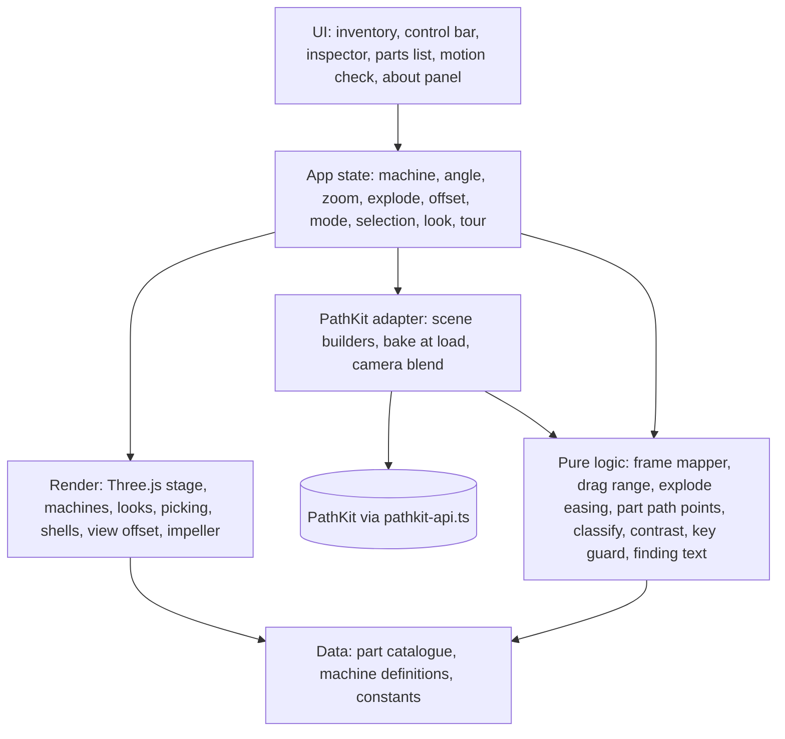

# Design Document

## Overview

Skeleton Bench is a browser workbench in `apps/skeleton-bench/`. A person turns one of three machines (a centrifugal pump, a shell-and-tube heat exchanger, a desk lamp), zooms, slides it across the screen, takes it apart and reads about each part. Mouse and keyboard come first. Webcam gestures are Tier B and only add another way to set the same values.

This design covers Tier A in full and Tier B at the level of pure logic. It follows the approved requirements and the brief. Tier B tasks wait for the User's "go" and for the Gesture_Lab result.

Main design choices:

- **Plain TypeScript and DOM, with Three.js for drawing.** No UI framework.
- **PathKit supplies baked camera and part motion.** Four orbit laps, 20 part paths and 3 tours are baked once at load. Nothing is baked while the User drags, zooms or moves the explode slider.
- **Everything that can be pure is pure.** Frame mapping, zoom selection, drag range, explode easing, click classification, contrast and shortcut guards are pure functions with hand-written test tables.
- **One shared stage envelope.** All three machines are modelled to fit one fixed box, so one set of camera laps serves all of them.
- **Recommended camera mechanism: option A** (four laps blended with PathKit `lerp` and `slerp`). Option A was approved by the User (decision 21).

### Property testing without fast-check

`fast-check` is not an app dependency (decision 2). The Correctness Properties in this design are therefore checked by exhaustive loops over finite domains (for example all 360 frames crossed with a 13-point zoom grid) and by hand-written tables. No random property tests are used in the app. This fits the domain: the inputs are small and finite, so a full sweep is stronger than random sampling. The workflow's generic property-test settings (100 random iterations, random generators) do not apply here, so the prework step for random properties is not used.

### Sources used for design facts

The PathKit facts below were read from the repository source (`packages/pathkit/src`). The Three.js behaviours (`setViewOffset`, `Raycaster`, `EdgesGeometry`, `InstancedMesh`) are standard Three.js 0.187.0 API. The sign of the view offset is confirmed by the manual Spike S4, not assumed.

## Facts about PathKit that this design relies on

These were verified in the repository.

- `orbitAround` places the entity at centre + radius * (cos(angle) * side1 + sin(angle) * side2). For axis +Y this gives x = cx + r * sin(angle), y = cy, z = cz + r * cos(angle). Angle 0 is on +Z and the angle grows toward +X. The Bearing is atan2(x, z) in degrees. With speed 30 degrees per second at 30 fps, frame f is exactly f degrees.
- The orbit centre is a Target. A static Target at (0, h, 0) puts the camera h metres above the point it aims at. `aimAt` (a second Target at the Machine centre) sets rotation only. The constraint `order` of `orbitAround` must be lower than that of `aimAt`.
- `followPath` moves along a centripetal Catmull-Rom curve made by `createCurve` (at least 2 points, no two consecutive points the same). Travelled distance = startOffset + speed * frame / fps. An open path clamps at its end. A closed path wraps.
- A scene always needs a path of at least 2 distinct points, even when no entity uses `followPath`. The laps use a dummy 2-point path.
- `evaluateEntity(baked, entityId, frame, outBuffer)` reads position and rotation into a caller buffer. `lerp(a, b, t, out?)` and `slerp(a, b, t, out?)` are exported. Without `out` they allocate, so the app always passes `out`. `slerp` falls back to a normalised lerp when the quaternions are nearly parallel, so identical inputs are safe.
- PathKit has no easing. Explode easing is app code (open question 8).
- `motionLinter(scene, baked, options?)` returns findings with codes `path-end-reached`, `rotation-conflict`, `aim-vertical`, `speed-spike`, `roll-change` and severities `info` or `warning`. The app maps each code to a plain sentence and uses the finding's own message for an unknown code.
- The app imports PathKit only through `packages/pathkit/src/index.ts`. One app file, `src/pathkit-api.ts`, re-exports from `../../../packages/pathkit/src/index.js`. The rest of the app imports PathKit only from that file.
- Because the app imports PathKit source, the app `tsconfig.json` type-checks that source. It must be at least as strict as `packages/pathkit/tsconfig.json` (strict, NodeNext, ES2023, noEmit) and add the DOM lib and `skipLibCheck`. Vite's dev server may refuse files outside the app root, so `vite.config.ts` needs `server.fs.allow` to include the repository root. **Risk:** confirm both at the first build.
- `localStorage` is per origin, not per path. Shot Rail is served from the same GitHub Pages origin, so every key is prefixed: `STORAGE_KEY_LOOK = "skeletonBench.look"` and `STORAGE_KEY_HINT_PREFIX = "skeletonBench.hintSeen."`.

## Architecture

### Layers

The lower three layers (data, pure logic, PathKit adapter) run in Vitest without a browser. Render and UI are not tested by Kiro (Requirement 37.1).

### Folder plan (inside `apps/skeleton-bench/`)

| Path | Content |
| --- | --- |
| `package.json`, `package-lock.json`, `tsconfig.json`, `vite.config.ts`, `.gitignore`, `index.html` | App set-up. Vite `base` is `/PathKit/skeleton-bench/`. |
| `README.md`, `THIRD_PARTY.md` | Existing README edited; licence list. |
| `docs/build-notes.md`, `docs/sources.md` | Build notes and the fact sources. |
| `src/constants.ts` | Every named constant (one file). |
| `src/pathkit-api.ts` | The only PathKit import point. |
| `src/logic/` | Pure functions. |
| `src/data/` | Part catalogue and machine definitions. |
| `src/pathkit/` | Scene builders for laps, part paths and tours; bake at load; camera blend. |
| `src/render/` | Three.js stage, machine models, looks, picking, shells, view offset. |
| `src/ui/` | DOM regions, theme, storage helpers. |
| `src/state.ts` | Small update functions for app state. |
| `test/` | Vitest files. |

### PathKit or not

| Feature | PathKit? | Which part |
| --- | --- | --- |
| Four orbit laps | Yes | `orbitAround` + `aimAt`, baked, read with `evaluateEntity` |
| Zoom blend | Yes (math) | `lerp` and `slerp` between two laps; the weight and distance table are app code |
| Part paths | Yes | `followPath`, one scene per Part |
| Tour | Yes | `followPath` + `aimAt` |
| Checks | Yes | `validateScene`, `motionLinter`, `createCurve`, `createArcLengthTable` (path length) |
| Explode easing | No | App code (smoothstep) |
| Zoom weights, distance table | No | App code |
| Drag, View_Offset, Drag_Range | No | App code and Three.js |
| Picking, selection shell | No | Three.js |
| Impeller spin | No | Three.js, plain rotation |
| Looks, storage | No | App code |

### State and render loop

App state is one plain object changed by small update functions (set machine, set orbit angle, set Zoom_Value, set Explode_Amount, set offset, set mode, set selected Part, set Look, tour state). Mouse, keyboard and (in Tier B) gestures all call the same setters. The loop draws when state changed, and draws continuously only while the impeller spins. Under reduced motion the impeller is still, so drawing is on demand only.

## Stage envelope and Exploded_Box

The Exploded_Box is one fixed envelope centred on the Machine centre (0, 0, 0), with half-extents x 1.2 m, y 0.6 m, z 0.4 m. Its corner radius is R = sqrt(1.2^2 + 0.6^2 + 0.4^2) = sqrt(1.96) = 1.4 m exactly.

Every Machine is modelled at "stage scale". All its Parts, at rest, at their end position and at every frame of their Part_Path, lie inside the envelope. A test checks this for every Part. The bench grid lies at y = -0.6.

**Consequence for the User:** the three Machines are not to scale with each other. The About_Panel should say so. This is a one-line addition to Requirement 24.1 (listed in the change list below).

**Alternative considered:** a per-Machine box with per-Machine laps. Rejected for now: it needs 12 laps instead of 4 and more constants.

**Clearance fact used throughout.** The box is convex and contains the origin. A camera at distance d from the centre is therefore at least d - R from every point of the box, corners included. Along any ray from the centre, the distance to the box never decreases as the camera moves outward.

## Camera mechanism: options A, B and C

### Common set-up

The camera always sits on a ray from the Machine centre at a constant elevation: sin(elevation) = 5/13 and cos(elevation) = 12/13 (about 22.62 degrees, defined by the ratio so no angle maths is needed). At bearing B and distance d the position is (d * (12/13) * sin B, d * (5/13), d * (12/13) * cos B). Vertical field of view is 35 degrees, near 0.1, far 100. Zoom_Value 0 is farthest and 1 is nearest. The camera entity declares `forwardAxis` -Z and `upAxis` +Y from named constants. Shared logic hard-codes neither.

### Option A (approved): four laps blended with `lerp` and `slerp`

- Laps are indexed 0 (farthest) to 3 (nearest).

| Lap | Distance d (m) | Horizontal radius r = d * 12/13 (m) | Height h = d * 5/13 (m) |
| --- | --- | --- | --- |
| 0 | 6.5 | 6.0 | 2.5 |
| 1 | 5.2 | 4.8 | 2.0 |
| 2 | 3.9 | 3.6 | 1.5 |
| 3 | 2.6 | 2.4 | 1.0 |

- Each lap is its own PathKit scene: fps 30, frameCount 360, one entity `cam`. Constraint 1 is `orbitAround` (order 0, influence 1, target `orbitCentre` = static (0, h, 0), radius r, axis +Y, speed 30 degrees per second, startAngle 0). Constraint 2 is `aimAt` (order 1, influence 1, target `machineCentre` = static (0, 0, 0)). The path is a dummy 2-point open path.
- All three Machines share the same four laps, because the envelope is common. That is 4 lap scenes in total, baked once at load.
- **Blend rule.** p = Zoom_Value * 3. i = min(floor(p), 2). w = p - i. Camera position = `lerp(lap i, lap i+1, w)` and rotation = `slerp(lap i, lap i+1, w)`. Both laps are read with `evaluateEntity` at the same whole frame (the frame from the angle). Only w is fractional. Frame numbers stay whole.
- **No per-frame allocation.** Two OutBuffers, one result position and one result rotation are allocated once. The result is copied into the Three.js camera with `position.set` and `quaternion.set`.
- At a segment joint (p is a whole number) either (i, w = 0) or (i - 1, w = 1) gives the same pose. Tests accept both.
- **Honest note.** All laps share the same elevation and the same bearing. The blended position therefore lies on the same ray, and the two rotations are identical, so `slerp` returns that same rotation. Option A gives exactly the same poses as option B today. A is still recommended for the reasons below. If each lap later gets its own elevation, the slerp would change the pitch linearly in w while the true pitch is atan(h / r). The aim at the centre would then differ slightly, and S2 check (c) would need a larger `AIM_TOLERANCE_DEG`. That is not done now.
- **Distance for any Zoom_Value:** d(Z) = 6.5 - 3.9 * Z (linear in Z).

| Z | d (m) | Image scale 6.5 / d |
| --- | --- | --- |
| 0 | 6.5 | 1.00 |
| 0.25 | 5.525 | 1.18 |
| 0.5 | 4.55 | 1.43 |
| 0.75 | 3.575 | 1.82 |
| 1 | 2.6 | 2.50 |

  Linear distance makes the image scale change faster near the end. This is acceptable for now (note for the User).

- **Clearance from the Exploded_Box.** The true minimum is the Euclidean distance from the camera to the nearest point of the box, minimised over all bearings. The worst bearing is atan2(1.2, 0.4), about 71.565 degrees (and 108.43, 251.57, 288.43). There the camera is above the box's top corner (+-1.2, 0.6, +-0.4).
  For the nearest lap (d = 2.6, r = 2.4, h = 1.0): the horizontal gap from the circle to the footprint corner is 2.4 - sqrt(1.2^2 + 0.4^2) = 2.4 - 1.264911 = 1.135089. The vertical gap is 1.0 - 0.6 = 0.4. The clearance is sqrt(1.135089^2 + 0.4^2) = sqrt(1.448426) = 1.2035 m. The guaranteed lower bound is d - R = 1.2 m.
  A check that looked only at the four side-on bearings (0, 90, 180, 270 degrees) would find at least 1.2649 m at 90 degrees and miss the true 1.2035 m. **The S2 test must therefore use all 360 bearings and measure to the box corners.**

| Z | d (m) | True minimum clearance (m) | Lower bound d - R (m) |
| --- | --- | --- | --- |
| 0 | 6.5 | 5.102 | 5.1 |
| 0.25 | 5.525 | 4.127 | 4.125 |
| 0.5 | 4.55 | 3.152 | 3.15 |
| 0.75 | 3.575 | 2.178 | 2.175 |
| 1 | 2.6 | 1.2035 | 1.2 |

  The test threshold is `CAMERA_MIN_CLEARANCE_M` = 1.0 m. The test also checks clearance >= d - R - 1e-9.

- **Scenes and cost (estimates, not measured).** 4 lap scenes at 360 frames. Assuming 3 to 12 ms per bake (the brief's figure) the total is 12 to 48 ms. The Spike records the real figures. Memory per lap scene: transforms 360 * 7 * 8 = 20,160 B, travelled distance 2,880 B, aim directions 8,640 B, total 31,680 B. Four laps: 126,720 B (about 124 KiB).

### Option B: one lap with app-side radius scaling

One lap at d = 6.5. Camera position = lap position * k(Z) about the Machine centre, with k = 1 - 0.6 * Z. Rotation is unchanged. The poses are the same as A. One scene: 31,680 B and an estimated 3 to 12 ms. The zoom is app arithmetic, not PathKit. A needs 3 more scenes (+95,040 B, an estimated +9 to +36 ms) and the blend step.

### Option C: zoom by lens only

One lap at d = 6.5, so the clearance is 5.102 m at every Z. The vertical field of view goes from 35 degrees at Z = 0 to about 14.37 degrees at Z = 1 (tan of half the field of view = tan(17.5 degrees) * (1 - 0.6 * Z); 0.31530 * 0.4 = 0.12612, half the field of view is 7.19 degrees). This gives the same framing as the nearest lap of A. There is no dolly, so no change in perspective or parallax (a flat, telephoto look). The zoom is app code (`camera.fov` and `updateProjectionMatrix`). Expected values need trigonometry, so they are less friendly to hand calculation.

### Comparison

| Criterion | A: four laps + blend | B: one lap + scaling | C: lens only |
| --- | --- | --- | --- |
| Bearing kept for every pair | Yes (same ray, same bearing) | Yes | Yes (camera never moves) |
| Outside the Exploded_Box for every pair | Yes, min 1.2035 m at Z = 1 | Yes, same poses as A | Yes, 5.102 m at every Z |
| Baked scenes | 4 | 1 | 1 |
| Bake time (estimate) | 12 to 48 ms | 3 to 12 ms | 3 to 12 ms |
| Memory | 126,720 B | 31,680 B | 31,680 B |
| PathKit part | Baked laps, `evaluateEntity`, `lerp`, `slerp` | One baked lap, `evaluateEntity` | One baked lap, `evaluateEntity` |
| App-code part | Weights, distance table, buffers | Radius scaling | Lens change |
| Per-frame allocation in our code | None (buffers preallocated) | None | None |
| Hand-written test values | Easy (positions on a circle) | Easy | Harder (trigonometry) |
| Simplicity | Medium | Simple | Simple |
| Look of the zoom | Dolly, perspective changes | Same as A | Flat, telephoto |

### Recommendation

Recommend **A**, for these reasons:

1. Every zoom pose is baked PathKit data read by `evaluateEntity` and combined with PathKit's `lerp` and `slerp`. The About_Panel can truthfully say the zoom comes from baked, checked paths. With B or C the zoom is app code, and the brief's claim would have to change.
2. S2 checks real baked samples for every View_Pair.
3. Each lap can later have its own elevation or look without new code.
4. The cost is small: about 93 KiB more memory and an estimated 9 to 36 ms more at load.

A and B produce identical poses today. B is the simpler choice if the User prefers fewer moving parts and accepts "zoom is app code". C is not recommended. **Option A was approved by the User (decision 21). The recommendation text above stays as the record of why. The rest of this design assumes A.**

### Worked value: Zoom_Value 0.5 with option A

p = 1.5, i = 1, w = 0.5. The laps are 1 (d 5.2, r 4.8, h 2.0) and 2 (d 3.9, r 3.6, h 1.5). Blended r = 4.2, h = 1.75, d = 4.55 (check: sqrt(4.2^2 + 1.75^2) = sqrt(20.7025) = 4.55).

| Frame | Bearing | Camera position (m) | Forward direction (camera -Z in world) |
| --- | --- | --- | --- |
| 0 | 0 | (0, 1.75, 4.2) | (0, -5/13, -12/13) = (0, -0.384615, -0.923077) |
| 45 | 45 | (2.9698, 1.75, 2.9698) (4.2 * 0.707107) | not tabulated |
| 90 | 90 | (4.2, 1.75, 0) | (-12/13, -5/13, 0) = (-0.923077, -0.384615, 0) |

The baked rotation at frame 0 is a pitch down about +X of atan(5/12), the quaternion (-0.196116, 0, 0, 0.980581) up to overall sign (sqrt(1/26) and sqrt(25/26)). Tests compare the rotated forward vector, not raw quaternion components, because q and -q are the same rotation. Clearance at Z = 0.5: true minimum 3.152 m (lower bound 3.15 m).

## Components and Interfaces

All pure functions below take plain values and return plain values. They throw `Error` with a message that names the bad value (Requirements 5.6, 6.6, 7.10, 8.6).

### Frame_Mapper (`src/logic/frame-mapper.ts`)

| Function | Inputs | Output | Rule |
| --- | --- | --- | --- |
| `angleToFrame` | angle in degrees | whole frame 0 to 359 | Wrap with ((a % 360) + 360) % 360, then floor(wrapped + 0.5), then % 360. Non-finite throws. Does not read Zoom_Value. |
| `zoomSelection` | Zoom_Value | `{lowerLap, upperLap, weight}` | Clamp to [0, 1]; p = Z * 3; i = min(floor(p), 2); lowerLap = i; upperLap = i + 1; weight = p - i. Non-finite throws. Does not read the angle. |
| `zoomDistance` | Zoom_Value | metres | 6.5 - 3.9 * clamp(Z). Used by tests and the zoom readout. |
| `roundHalfUp` | number | whole number | floor(x + 0.5). Shared with Explode_Easing. |

Angle table (hand-checked):

| Angle (deg) | 0 | 90 | 180 | 270 | -90 | 360 | 359.9 | 0.4 | 0.5 | 720 |
| --- | --- | --- | --- | --- | --- | --- | --- | --- | --- | --- |
| Frame | 0 | 90 | 180 | 270 | 270 | 0 | 0 | 0 | 1 | 0 |

Zoom selection table:

| Input Z | Clamped Z | lowerLap | upperLap | weight |
| --- | --- | --- | --- | --- |
| -0.2 | 0 | 0 | 1 | 0 |
| 0 | 0 | 0 | 1 | 0 |
| 0.25 | 0.25 | 0 | 1 | 0.75 |
| 0.5 | 0.5 | 1 | 2 | 0.5 |
| 0.75 | 0.75 | 2 | 3 | 0.25 |
| 1 | 1 | 2 | 3 | 1 |
| 1.5 | 1 | 2 | 3 | 1 |

### Drag_Range and Fraction_To_Pixels (`src/logic/drag-range.ts`)

| Function | Inputs | Output |
| --- | --- | --- |
| `benchLimit` | Explode_Amount in percent | L(e) = 0.25 - (0.25 - 0.10) * e / 100 |
| `clampOffset` | (fx, fy), Explode_Amount | each axis clamped to [-L, +L] independently |
| `fractionToPixels` | fraction, viewport size in pixels | fraction * size, no rounding |
| `resetOffset` | none | (0, 0) |

L(0) = 0.25, L(50) = 0.175, L(100) = 0.10. For a 1000 x 800 px viewport the limits are 250 and 200 px at 0 percent, 175 and 140 px at 50 percent, 100 and 80 px at 100 percent.

### Explode_Easing (`src/logic/explode-easing.ts`)

| Function | Inputs | Output | Rule |
| --- | --- | --- | --- |
| `explodeFrame` | Explode_Amount in percent | whole frame 0 to 59 | t = clamp(a, 0, 100) / 100; eased = 3t^2 - 2t^3; frame = roundHalfUp(eased * 59). Non-finite throws. |

| Amount | 0 | 25 | 50 | 75 | 100 |
| --- | --- | --- | --- | --- | --- |
| Eased | 0 | 0.15625 | 0.5 | 0.84375 | 1 |
| eased * 59 | 0 | 9.21875 | 29.5 | 49.78125 | 59 |
| Frame | 0 | 9 | 30 | 50 | 59 |

Easing is app code, not PathKit. All Parts use the same frame (no stagger now).

### Part path points (`src/logic/part-path.ts`)

Given a Part's rest position P0 and explode vector v (length at least `PART_MIN_EXPLODE_M` = 0.1 m), the function returns four points.

- P1 = P0 + v / 3 + b, P2 = P0 + 2v / 3 + b, P3 = P0 + v.
- b = `PART_PATH_BOW_FRACTION` (0.15) * |v| * u. u is the unit vector perpendicular to v that is closest to +Y.
- If v is nearly vertical (|unit(v) x Y| < `PART_PATH_VERTICAL_SIN` = 0.1, about 5.7 degrees) the reference is +Z instead of +Y.
- The Catmull-Rom curve passes through all four points.

### Click classification (`src/logic/pointer.ts`)

`classifyPointer(maxDistancePx)` returns `click` if the largest distance from the press position never exceeded `CLICK_THRESHOLD_PX` (5), otherwise `drag`. A gesture becomes a drag as soon as the distance exceeds 5 and stays a drag until release (out to 6 px and back to 2 px is still a drag). Table: 5 px is a click, 5.1 px is a drag, 6 px is a drag.

### Other pure helpers

| Function | Purpose |
| --- | --- |
| `contrastRatio(colourA, colourB)` | WCAG contrast ratio of two sRGB colours (Requirement 22.2). |
| `shouldHandleShortcut(activeElementKind)` | False when focus is in a text field, select or range slider (Requirement 12.9). |
| `findingToPlainText(finding)` | Maps each linter code to a plain sentence; falls back to the finding's message. |
| `orbitAngleFromDrag(startAngle, dxPx)` | startAngle - dxPx * `ORBIT_DEG_PER_PIXEL`. Dragging right makes the Bearing decrease, so the Machine seems to turn with the pointer. |
| `stepZoom(z, direction, step)` | Clamped step for wheel and keys. |

### PathKit adapter (`src/pathkit/`)

| Function | Inputs | Output |
| --- | --- | --- |
| `buildLapScene` | lap index | PathKit scene for that lap (see option A) |
| `buildPartScene` | Part | PathKit scene with one `followPath` entity named by the Part id |
| `buildTourScene` | Machine | PathKit scene with the ring path and a keyframed aim target |
| `bakeAll` | none | Baked laps, part scenes and tours; runs `validateScene` on each; runs `motionLinter` on each tour |
| `readCamera` | angle, Zoom_Value, preallocated buffers | Writes the blended position and rotation into the buffers |
| `readPart` | Part id, Explode_Amount, buffer | Writes the part position for the eased frame |

### Part scenes

Each Part gets one scene: fps 30, frameCount `EXPLODE_FRAMES` = 60, one entity (id = Part id) with a single `followPath` (order 0, influence 1, `alignToPath` false, startOffset 0, speed = pathLength * 30 / 59 so the last frame reaches the end). The path length is read with `createCurve` and `createArcLengthTable` from PathKit's public API. There is no `aimAt` and no targets. The app applies position only. Parts never rotate. Part entities declare `PART_FORWARD_AXIS` +Z and `PART_UP_AXIS` +Y.

There are 20 scenes (Pump 8, Heat_Exchanger 6, Desk_Lamp 6). Each is 5,280 B (transforms 3,360 + travelled 480 + aim 1,440), 105,600 B in total. At Explode_Amount 50 the travelled fraction of every path is 30 / 59.

**No Part stays fixed.** `createCurve` rejects zero-length paths, and Requirement 13.3 wants a path for every Part. Every Part therefore moves at least 0.1 m.

### Tour scenes

- **Camera path.** A closed ring of `TOUR_RING_POINTS` = 12 points at bearings 0, 30, ..., 330 degrees, radius `TOUR_RING_RADIUS` = 3.6 m, height `TOUR_RING_HEIGHT` = 1.5 m (the same circle as lap 2, d = 3.9 m). `followPath` runs on that closed path at constant speed, one full turn over the whole tour. `aimAt` targets a keyframed Target that holds each Part's rest position during the middle of that Part's slot.
- **Length.** `TOUR_FRAMES_PER_PART` = 90 (3 s). Pump 720 frames, Heat_Exchanger and Desk_Lamp 540 frames each. Speed = ring length * 30 / frameCount.
- **Memory** (88 bytes per frame): 63,360 + 47,520 + 47,520 = 158,400 B. Estimated bake 6 to 24 ms each (estimate, not measured).
- **Start.** Set Explode_Amount 0 and offset 0 (decision 16). Save the User's orbit angle and Zoom_Value. Cut (jump) to the tour pose. A lerp between two arbitrary bearings could pass through the box, so no blend is used.
- **Stop or end.** Jump back to the saved angle and Zoom_Value (decision 23).
- **Playback** uses whole frames from elapsed time at 30 fps.
- **While the Tour plays**, the orbit, zoom, explode and move controls are disabled with a visible label: "Stop the tour to use this".
- **Reduced motion.** Jump to the middle frame of each Part's slot and hold `TOUR_REDUCED_MOTION_HOLD_MS` = 3000.
- **Clearance.** Every baked tour frame must satisfy `CAMERA_MIN_CLEARANCE_M` against the envelope. The ring keeps at least 3.6 * cos(15 degrees) = 3.477 m horizontal radius, so it passes by a wide margin. The test checks all frames anyway.
- **Linter.** `motionLinter(scene, baked)` runs at load for each tour. Findings go to the Motion_Check in plain words. With no findings the Motion_Check says "No findings reported."
- **Limits to state.** The tour looks at each Part from the ring distance, so small Parts look small and a Part can be hidden behind others. Zoom-to-part rails are out of Tier A (decision 10).

### Move across the screen

- Offset state is a fraction pair (fx, fy) of the viewport width and height. Positive is right and down.
- A pointer drag in Move mode converts pixel movement to a fraction (dx / width, dy / height). Arrow keys in Move mode step `MOVE_KEY_STEP_FRACTION` = 0.02. Key R and the Reset position button set (0, 0). When the Explode_Amount changes the offset is re-clamped.
- **Applying it:** `camera.setViewOffset(W, H, -fx * W, -fy * H, W, H)` then `updateProjectionMatrix`. Reset with `clearView`. The sign (shifting the sub-window by -dx moves the picture by +dx) is the expected Three.js behaviour. The manual Spike S4 confirms it.
- **Fallback if S4 fails (Requirement 4.8):** move the Machine group in world space and re-bake the camera data when the drag ends.
- **Non-drag path:** arrow keys in Move mode and the Reset button (Requirements 12.8, 22.7). The orbit scrub and the zoom slider are the non-drag alternatives for orbit and zoom.
- **Note on Requirement 7's story:** the on-screen guarantee is Requirement 7.13: Zoom_Value 0, a viewport at least as wide as tall, and Explode_Amount 100 percent. Below about 50 percent explode the fixed box may leave the screen at zoom 0 (acceptable, see the risk list). A rough check: at d = 6.5 the half height seen at the centre is 6.5 * tan(17.5 degrees) = 2.05 m, against R = 1.4 m plus an offset of at most 0.10 of the height at 100 percent explode. At higher zoom the Machine is bigger than the screen anyway. Reset position and key R recover the view. The story wording should be softened (change list).

### Picking and the Parts list

- Every Part is a named Three.js Group or Mesh (`part:<id>`) with `userData.partId`. The Heat_Exchanger tube bundle is one `InstancedMesh` with that tag. Edge lines (`EdgesGeometry`) and the selection shell are excluded from picking (only meshes are tested).
- On a click, the pointer position is converted to normalised device coordinates from the canvas rectangle. A Three.js `Raycaster` picks the first mesh hit that has a `partId`. Because `setViewOffset` changes the projection matrix, the same conversion should still give the right ray. This is part of the manual S4 check ("clicking a Part").
- **Keyboard path.** A visible Parts list (buttons in catalogue order, in the Inspector area) is the Tab and Enter path (Requirements 14.2 and 14.8). Focus on a button highlights that Part in 3D with a small shell. Enter or Space selects it. The list takes the place of tabbing to objects inside the canvas (change list).
- **Selection cue besides colour (decision 18).** An inverted-hull "shell" (a back-face clone of each mesh of the Part, scaled `SELECT_SHELL_SCALE` = 1.05, in the accent colour of the Look), because Three.js line width is not reliable. Focus uses `FOCUS_SHELL_SCALE` = 1.03. The Inspector also shows the name.
- **Shortcuts** (M, E, R, +, -, arrow keys) are handled in one place and ignored when focus is in a text field, select or range slider (Requirement 12.9).
- **Input steps.** `ORBIT_DEG_PER_PIXEL` = 0.5 (720 px is one lap). Arrow keys in Rotate mode step `ORBIT_KEY_STEP_FRAMES` = 5. A wheel event steps `ZOOM_WHEEL_STEP` = 0.05 (sign of `deltaY`). Keys + and - step `ZOOM_KEY_STEP` = 0.1.
- **Explode input.** The slider is direct. Key E toggles 0 and 100 with a short app-time animation (`EXPLODE_TOGGLE_MS` = 600), or a jump under reduced motion. The impeller spin is ordinary Three.js (`IMPELLER_SPIN_RAD_PER_S` = pi) and stops under reduced motion.

### Pump model

THE Skeleton_Bench_App SHALL draw each Part so that a person can recognise the real part, using only Three.js shapes (no model file), and no shape of a Part SHALL reach outside that Part's extents box at any impeller spin angle. (Requirement 18.6. A test measures every Pump Part's exact box against its catalogue extents at spin angles 0, 0.3 and 1 rad.)

### Looks and theme

Two palette objects and two material sets share one layout. X_Ray_Skeleton uses a near-black background, bone-ivory translucent fills, thin cyan `EdgesGeometry` lines and one orange accent. Clean_Engineering uses a light neutral background, solid matte Parts and one blue accent. The exact hex values are chosen when the Looks are built. They must pass the Contrast_Function tests (at least 4.5 to 1 for every text and background pair). No hex values are fixed in this design. The Look is stored with `STORAGE_KEY_LOOK` inside try/catch (Requirements 17.5 to 17.7). Hint flags use `STORAGE_KEY_HINT_PREFIX`.

### UI regions

| Region | Content |
| --- | --- |
| Stage | Machine on a faint bench grid at y = -0.6 |
| Inventory | Three cards with project-drawn SVG thumbnails |
| Inspector | Name, job, material, position text, "sample data" label; the Parts list; empty state "Pick a part to read about it" |
| Control_Bar | Rotate / Move toggle, explode slider, orbit scrub, zoom slider, Tour, Pause, Stop, Reset position, Look toggle, About button, Gestures toggle (absent or disabled in Tier A) |
| Motion_Check | Linter findings in plain words |
| About_Panel | Honest limits (Requirement 24), including "machines are not to scale with each other" |

Every control has a visible label and a key hint. Every single-letter shortcut has a visible button (decision 17).

## Data Models

### Part_Catalogue entry

| Field | Type | Note |
| --- | --- | --- |
| `id` | string | Unique across all Machines. |
| `name`, `job`, `material`, `positionText` | string | Checked against `docs/sources.md` (Requirement 19). |
| `sourceId` | string | Must exist in `docs/sources.md`. |
| `restPosition` | vector (m) | Inside the envelope. |
| `explodeVector` | vector (m) | Length at least 0.1 m; end position inside the envelope. |
| `extents` | vector (m) | Full box sizes, not half sizes. Used by the envelope check and the clearance check. |

Machine definition: id, display name, the ordered Part ids (keyboard order), the model builder, and the tour keyframe order (same as keyboard order). The catalogue is the single source for explode paths, the Inspector and the keyboard order (Requirement 9.6).

### Sources file

`docs/sources.md` records for each fact: part, claim, source, date checked, and a source id. The catalogue test reads this file with `node:fs`.

### App state

| Field | Type | Initial |
| --- | --- | --- |
| machine | id | Pump |
| orbitAngleDeg | number | `INITIAL_ORBIT_ANGLE_DEG` = 30 |
| zoom | number 0 to 1 | `INITIAL_ZOOM` = 0.25 |
| explode | number 0 to 100 | `INITIAL_EXPLODE` = 0 |
| offset | (fx, fy) | (0, 0) |
| mode | rotate or move | rotate |
| selectedPart | id or none | none |
| look | X_Ray_Skeleton or Clean_Engineering | stored value, else X_Ray_Skeleton |
| tour | idle, playing, paused plus saved angle and zoom | idle |

Switching Machine sets explode 0, offset (0, 0) and no selection (Requirement 15.3).

### Constants

All live in `src/constants.ts`. "Derived" values are checked by a consistency test.

**Fixed by the requirements**

| Name | Value | Unit |
| --- | --- | --- |
| `FPS` | 30 | frames per second |
| `ORBIT_LAP_FRAMES` | 360 | frames |
| `CLICK_THRESHOLD_PX` | 5 | px |
| `BENCH_MAX_FRACTION_AT_0` | 0.25 | fraction |
| `BENCH_MIN_FRACTION_AT_100` | 0.10 | fraction |
| `HOLD_MS` | 300 | ms |

**Chosen here: space and camera**

| Name | Value | Note |
| --- | --- | --- |
| `EXPLODED_BOX_HALF_X`, `_Y`, `_Z` | 1.2, 0.6, 0.4 m | |
| `EXPLODED_BOX_RADIUS` | 1.4 m | Derived; test checks the square root of the sum of squares. |
| `MACHINE_CENTRE` | (0, 0, 0) | |
| `ORBIT_AXIS` | +Y | |
| `ORBIT_SPEED_DEG_PER_S` | 30 | Derived: 360 * FPS / ORBIT_LAP_FRAMES. |
| `ORBIT_START_ANGLE_DEG` | 0 | |
| `CAMERA_FORWARD_AXIS`, `CAMERA_UP_AXIS` | -Z, +Y | |
| `PART_FORWARD_AXIS`, `PART_UP_AXIS` | +Z, +Y | |
| `CAMERA_ELEVATION_SIN`, `_COS` | 5/13, 12/13 | |
| `LAP_DISTANCES` | [6.5, 5.2, 3.9, 2.6] m | r and h are derived from these; a test checks them. |
| `LAP_COUNT` | 4 | |
| `CAMERA_FOV_DEG` | 35 | Degrees at the Three.js boundary only. |
| `CAMERA_NEAR`, `CAMERA_FAR` | 0.1, 100 | |
| `INITIAL_ORBIT_ANGLE_DEG`, `INITIAL_ZOOM`, `INITIAL_EXPLODE` | 30, 0.25, 0 | |

**Chosen here: tolerances and tests**

| Name | Value |
| --- | --- |
| `BEARING_TOLERANCE_DEG` | 0.001 |
| `AIM_TOLERANCE_DEG` | 0.001 |
| `DISTANCE_TOLERANCE_M` | 1e-9 |
| `CAMERA_MIN_CLEARANCE_M` | 1.0 m |
| `S2_ZOOM_GRID_STEPS` | 12 (Z = k / 12, k = 0 to 12, which includes the segment joints at 1/3 and 2/3) |
| `END_POSITION_TOLERANCE_M` | 1e-6 m |
| `CONTRAST_MIN` | 4.5 |

**Chosen here: input and motion**

| Name | Value |
| --- | --- |
| `ORBIT_KEY_STEP_FRAMES` | 5 |
| `ORBIT_DEG_PER_PIXEL` | 0.5 |
| `ZOOM_KEY_STEP` | 0.1 |
| `ZOOM_WHEEL_STEP` | 0.05 |
| `MOVE_KEY_STEP_FRACTION` | 0.02 |
| `EXPLODE_FRAMES` | 60 |
| `PART_PATH_BOW_FRACTION` | 0.15 |
| `PART_MIN_EXPLODE_M` | 0.1 m |
| `PART_MIN_CLEARANCE_M` | 0.08 m |
| `PART_PATH_VERTICAL_SIN` | 0.1 |
| `EXPLODE_TOGGLE_MS` | 600 |
| `IMPELLER_SPIN_RAD_PER_S` | pi |
| `TOUR_FRAMES_PER_PART` | 90 |
| `TOUR_RING_POINTS` | 12 |
| `TOUR_RING_RADIUS` | 3.6 m |
| `TOUR_RING_HEIGHT` | 1.5 m |
| `TOUR_REDUCED_MOTION_HOLD_MS` | 3000 |
| `SELECT_SHELL_SCALE` | 1.05 |
| `FOCUS_SHELL_SCALE` | 1.03 |
| `STORAGE_KEY_LOOK`, `STORAGE_KEY_HINT_PREFIX` | as given in the PathKit facts section |

**Tier B initial values (proposals, tuned in the Gesture_Lab, not final)**

| Name | Value |
| --- | --- |
| `FIST_OPENNESS_MAX` | 0.15 |
| `OPEN_DEAD_ZONE` | 0.10 |
| `PINCH_RATIO_MAX` | 0.25 (thumb-to-index distance divided by palm size) |
| `SMOOTHING_ALPHA` | 0.4 |
| `ZOOM_GESTURE_GAIN` | 1.0 |
| `ROTATE_GESTURE_DEG_PER_FRACTION` | 360 |
| `NO_HAND_DISARM_MS` | open (Gesture_Lab) |

## Correctness Properties

*A property is a characteristic or behavior that should hold true across all valid executions of a system. Properties serve as the bridge between human-readable specifications and machine-verifiable correctness guarantees.*

In this app each property is checked by an exhaustive loop over a finite domain or by a hand-written table, not by random generation (see Overview). Each property names a "source line to break": a line of app code that, if changed, the check should catch.

| # | Property | Check | Source line to break | Validates |
| --- | --- | --- | --- | --- |
| 1 | For all angles in the table, `angleToFrame` returns the table frame, and for any finite angle the result is a whole number from 0 to 359. | Table of 10 angles plus a loop over -720 to 720 in steps of 0.25 degrees. | The `+ 0.5` in the rounding, or the `% 360` after it. | 5.2 to 5.5, 35.2 |
| 2 | For all non-finite values (NaN, Infinity, -Infinity), `angleToFrame`, `zoomSelection`, `explodeFrame`, `clampOffset` throw an Error whose message contains the value. | Four-by-three table. | The finite check at the top of each function. | 5.6, 6.6, 7.10, 8.6 |
| 3 | For all Zoom_Values, `zoomSelection` matches the table, clamps outside [0, 1], and `zoomDistance` never increases as Z increases. | Table plus a loop over Z from -0.5 to 1.5 in steps of 1/120. | The `min(floor(p), 2)`, or the clamp. | 6.1 to 6.5, 6.7, 35.3 |
| 4 | For all angles, the frame does not depend on Zoom_Value, and for all Zoom_Values the selection does not depend on the angle. | Loop over the 13-point grid and 360 angles; compare function results. | Any read of the other argument inside either function. | 5.8, 6.8, 35.15 |
| 5 | For all 360 frames and all 13 zoom grid points, the blended camera has: Bearing within `BEARING_TOLERANCE_DEG` of the frame angle; aim at the Machine centre within `AIM_TOLERANCE_DEG`; distance equal to 6.5 - 3.9 * Z within 1e-9; clearance at least `CAMERA_MIN_CLEARANCE_M` and at least d - R - 1e-9. | Full sweep (4,680 poses) using the real baked laps and the corner-distance measure. | `LAP_DISTANCES`, the blend weight, or the elevation ratio. | 4.3, 11.2, 11.3, 11.4, 35.15 |
| 6 | For all 360 bearings and any two Zoom_Values Z1 < Z2, the camera distance at Z2 is less than or equal to the distance at Z1. | Sweep over the grid at each bearing. | The sign in `6.5 - 3.9 * Z`. | 4.3(d), 6.4 |
| 7 | For all four laps, the scene passes `validateScene`, `orbitAround` has a lower `order` than `aimAt`, and `forwardAxis` and `upAxis` lie on different axes. | Loop over laps, tours and part scenes. | The `order` fields in the scene builders. | 10.4, 2.10, 35.7 |
| 8 | (Spike S1) For all frames 0, 90, 180, 270 the lap camera is at (0, h, r), (r, h, 0), (0, h, -r), (-r, h, 0) within 1e-9, and for all 360 frames the Bearing equals the frame number in degrees. | Four-frame table, then a full sweep over each lap. | The `speed` or `startAngle` of the lap scenes. | 4.2, 5.1, 10.4 |
| 9 | (Spike S2) For all baked samples above, the camera is outside the Exploded_Box. | Included in property 5. A bearing set of only 0, 90, 180, 270 is not accepted. | `CAMERA_MIN_CLEARANCE_M`, the box half-extents. | 4.3, 4.4 |
| 10 | (Spike S3) For each tour, `motionLinter` does not throw and returns a list. | One call per Machine. | The tour scene builder (an invalid scene). | 4.5, 16.7 |
| 11 | The envelope radius equals the square root of the sum of the squared half-extents, and for all Parts the rest position, the end position and every one of the 60 frames lie inside the envelope. | Loop over the catalogue and 60 frames. | A Part's `explodeVector` or the model size. | 1 (stage envelope), 11.3, 13.3 |
| 12 | For all Explode_Amounts the frame is whole, within 0 to 59, and never decreases as the amount increases. The table gives frames 0, 9, 30, 50, 59 at 0, 25, 50, 75, 100. | Table plus a loop from -10 to 110 in steps of 0.5. | The smoothstep coefficients, the `59`. | 8.1 to 8.5, 35.5 |
| 13 | For all Parts, frame 0 equals the rest position within 1e-9 m, the last frame equals rest + explode vector within `END_POSITION_TOLERANCE_M`, and no frame is outside the baked range. | Loop over 20 Parts. | The path speed formula (`pathLength * 30 / 59`). | 8.1, 8.2, 13.2 to 13.4 |
| 14 | For all offsets, `clampOffset` returns the offset unchanged inside and on the edge, and the nearest edge value outside. The limits are 0.25, 0.175, 0.10 at 0, 50, 100 percent. The Bench_Area at 100 percent is no larger than at 0 percent. | Table plus a loop over amounts 0 to 100 and offsets -0.5 to 0.5. | The `0.25 - 0.15 * e / 100` expression. | 7.1 to 7.9 |
| 15 | `fractionToPixels` gives 250 and 200, 175 and 140, 100 and 80 at 0, 50, 100 percent for 1000 x 800 px. | Hand-written table. | The use of width for x and height for y. | 7.11 |
| 16 | `classifyPointer` returns click at 5 px and drag at 6 px and 5.1 px. Moving out to 6 px and back to 2 px stays a drag. | Table. | The `>` against `CLICK_THRESHOLD_PX`. | 14.6, 35.16 |
| 17 | `contrastRatio` gives 21 for black on white, 1 for the same colour, about 4.54 for #767676 on white. For all text and background pairs of both Looks, the ratio is at least 4.5. | Table plus a loop over the palette pairs. | A palette colour value. | 22.1, 22.2 |
| 18 | For all Parts, all fields are present, ids are unique across Machines, every source id exists in `docs/sources.md`, and each Machine's keyboard order lists every Part exactly once. A failing check names the Part. | Loop over the catalogue; read the sources file with `node:fs`. | A missing catalogue field or a source id. | 9.1 to 9.5, 35.6 |
| 19 | Starting the Tour sets Explode_Amount and offset to 0. Stopping it restores the saved angle and Zoom_Value. | State-function test over a table of start states. | The reset in the tour-start function. | 16.2, 16.6, 35.17 |
| 20 | For all storage failures (read throws, write throws, value missing, value invalid), the storage helpers never throw and fall back to the default Look. | Loop over four failure modes with a fake storage object. | The try/catch in the helpers. | 17.6, 21.4, 23.3 |
| 21 | For all linter codes, `findingToPlainText` returns a non-empty sentence, and an unknown code returns the finding's own message. | Table of the five codes plus one unknown. | The code-to-sentence table. | 16.7, 16.8 |
| 22 | For all focus kinds (text field, select, range slider, button, none), `shouldHandleShortcut` is false for the first three and true otherwise. | Table. | The kinds list in the guard. | 12.9 |

### Property 1: Angle to frame

For any finite angle, `angleToFrame` returns a whole frame from 0 to 359 that matches the table. **Validates: Requirements 5.2, 5.3, 5.4, 5.5, 35.2**

### Property 2: Non-finite inputs throw

For any non-finite input, each pure mapping function throws an Error that names the value. **Validates: Requirements 5.6, 6.6, 7.10, 8.6**

### Property 3: Zoom selection and distance

For any Zoom_Value, `zoomSelection` matches the table, clamps outside [0, 1], and the distance never increases as Z increases. **Validates: Requirements 6.1, 6.2, 6.3, 6.4, 6.5, 6.7, 35.3**

### Property 4: Independence of angle and zoom

For any angle and any Zoom_Value, the frame does not depend on Z and the zoom selection does not depend on the angle. **Validates: Requirements 5.8, 6.8, 35.15**

### Property 5: View_Pair validity

For any of the 360 frames and any of the 13 zoom grid points, the camera keeps the Bearing, aims at the centre, has distance 6.5 - 3.9 * Z and stays outside the Exploded_Box. **Validates: Requirements 4.3, 11.2, 11.3, 11.4, 35.15**

### Property 6: Monotone distance per bearing

For any bearing and any Z1 < Z2, the camera distance at Z2 is at most the distance at Z1. **Validates: Requirements 4.3, 6.4**

### Property 7: Scene validity and axes

For any lap, part or tour scene, `validateScene` passes, `orbitAround` has a lower order than `aimAt`, and the entity axes lie on different coordinate axes. **Validates: Requirements 2.10, 10.4, 35.7**

### Property 8: Lap frame equals degrees (Spike S1)

For any frame f of any lap, the Bearing equals f degrees. **Validates: Requirements 4.2, 5.1**

### Property 9: Clearance over all bearings (Spike S2)

For any sampled pose, the camera is outside the Exploded_Box, measured to the box corners over all 360 bearings. **Validates: Requirements 4.3, 4.4**

### Property 10: Linter runs on tours (Spike S3)

For any Machine's tour, `motionLinter` does not throw and returns a list. **Validates: Requirements 4.5, 16.7**

### Property 11: Parts stay inside the envelope

For any Part and any of its 60 path frames, the position lies inside the stage envelope. **Validates: Requirements 11.3, 13.3**

### Property 12: Explode easing

For any Explode_Amount, the frame is whole, within 0 to 59 and never decreases as the amount increases. **Validates: Requirements 8.1, 8.2, 8.3, 8.4, 8.5, 35.5**

### Property 13: Part path ends

For any Part, frame 0 is the rest position and the last frame is rest + explode vector. **Validates: Requirements 8.1, 8.2, 13.2, 13.3, 13.4**

### Property 14: Drag range

For any offset and Explode_Amount, `clampOffset` leaves inside and edge values unchanged and clamps outside values to the nearest edge. **Validates: Requirements 7.1, 7.2, 7.4, 7.5, 7.6, 7.8, 7.9**

### Property 15: Fraction to pixels

For any fraction and viewport size, `fractionToPixels` returns fraction * size, and the 1000 x 800 table holds. **Validates: Requirements 7.11**

### Property 16: Click classification

For any pointer path, a maximum distance of 5 px or less is a click and more than 5 px is a drag. **Validates: Requirements 14.6, 35.16**

### Property 17: Contrast

For any text and background pair of either Look, the contrast ratio is at least 4.5. **Validates: Requirements 22.1, 22.2**

### Property 18: Catalogue checks

For any Part, all fields are present, ids are unique, the source id exists and the keyboard order lists every Part once. For any two Parts of the same Machine, the gap at Explode_Amount 100 is at least `PART_MIN_CLEARANCE_M`. The gap is the largest, over x, y and z, of |centre A - centre B| - (extents A + extents B) / 2, where centre = restPosition + explodeVector. The check `checkExplodedClearance(catalogue, minGap)` fails a pair when the gap is below minGap - 1e-9 and names both Parts and the gap. Parts of different Machines are never compared. **Validates: Requirements 9.1, 9.2, 9.3, 9.4, 9.5, 9.7, 13.8, 35.6**

### Property 19: Tour reset and restore

For any start state, starting the Tour resets explode and offset to 0, and stopping restores the saved angle and Zoom_Value. **Validates: Requirements 16.2, 16.6, 35.17**

### Property 20: Storage never throws

For any storage failure mode, the helpers do not throw and fall back to the default. **Validates: Requirements 17.6, 21.4, 23.3**

### Property 21: Finding text

For any linter code, `findingToPlainText` returns a non-empty sentence, and an unknown code returns the finding's message. **Validates: Requirements 16.7, 16.8**

### Property 22: Shortcut guard

For any focus kind, shortcuts are ignored in a text field, select or range slider and handled otherwise. **Validates: Requirements 12.9**

**Tier B properties (added when Tier B starts, all with hand-written fixtures and given timestamps):**

| # | Property | Validates |
| --- | --- | --- |
| 23 | A fist held 299 ms does not arm; 300 ms arms. | 28.1, 28.2, 34.9 |
| 24 | While not armed, Openness 1, 0.5, 1 leaves Explode_Amount unchanged. | 28.3, 34.10 |
| 25 | After arming, Openness changes the Explode_Amount (0 maps to 0 percent, 1 to 100 percent, with the dead zone). | 28.4 to 28.6, 34.11 |
| 26 | Each disarm case of open question 24 returns the state to disarmed. | 28.8, 34.12 |
| 27 | One hand picks rotate or explode, two hands pick zoom, a pinch must be held 300 ms before rotate starts, and a frame with no hand changes nothing. | 26.1 to 26.4, 27.1, 30.3, 34.3, 34.6, 34.7 |
| 28 | The two-hand ratio converts to a Zoom_Value and then to the camera selection of Requirement 6, with the orbit angle unchanged. | 29.1 to 29.4, 34.4 |
| 29 | The classifier names a fist, an open palm and a pinch for fixtures; Openness runs from 0 to 1; smoothing moves toward the input by the alpha. | 26.5, 26.6, 34.1, 34.2, 34.5 |

The 5 second limit per test file and the other `testing-conventions` rules apply (Requirement 35.10). Each task in the later `tasks.md` names its source line.

## Error Handling

| Situation | Behaviour |
| --- | --- |
| Non-finite input to a pure function | Throw an Error that names the value. The UI never passes such values; the throw catches code bugs. |
| Out-of-range Zoom_Value, Explode_Amount or offset | Clamp (not an error), as the requirements say. |
| `validateScene` fails at load | Show a message that says which scene failed and that the page can be reloaded; the rest of the app keeps working if the failing scene is not a lap. |
| Lap bake fails | The camera cannot work. Show a message with what failed and a reload step. |
| Tour bake or `motionLinter` fails | Show a message that says what failed. Disable the Tour button. Orbit, zoom, explode and inspect still work (Requirement 16.9). |
| `localStorage` unavailable or invalid | Continue with defaults, no message (Requirement 17.6). |
| WebGL unavailable | Show a message that WebGL is needed and what to try next (another browser or enabling hardware acceleration). |
| Unknown linter code | Show the finding's own message. |
| Part click hits no Part | Keep the current selection. Click on empty bench keeps the selection (clear with Escape or a "Clear selection" control). |
| Tier B: camera denied, no webcam, model load fails | Show what failed and that mouse and keyboard still work (Requirements 32.7, 33.4). |

If the S4 manual check fails, the move fallback re-bakes the camera data when the drag ends (Requirement 4.8).

## Testing Strategy

Vitest runs from `apps/skeleton-bench` with `npm.cmd test`. It needs no browser, no network and no webcam. Expected values are hand-written and never computed by the code under test.

**Approach.** Kiro writes the checks above as exhaustive loops and tables. The correctness properties apply to pure functions, so exhaustive sweeps are possible. No random property library is used. The checks use plain assertions inside loops, force the edge cases, check `SceneError` instances in thrown-error assertions (for PathKit failures) and keep each file under 5 seconds.

**Test files (planned).**

| File | Covers |
| --- | --- |
| `frame-mapper.test.ts` | Properties 1 to 4 |
| `camera.test.ts` | Properties 5 to 9 (bake the four laps once per file) |
| `scenes.test.ts` | Properties 7, 10, 13 |
| `envelope.test.ts` | Property 11 |
| `explode-easing.test.ts` | Property 12 |
| `drag-range.test.ts` | Properties 14, 15 |
| `pointer.test.ts` | Properties 16, 22 |
| `contrast.test.ts` | Property 17 |
| `catalogue.test.ts` | Property 18 |
| `tour.test.ts` | Property 19 |
| `storage.test.ts` | Property 20 |
| `findings.test.ts` | Property 21 |
| `constants.test.ts` | The derived constants (R, speed, r and h from d, grid includes joints) |

**Not tested by Kiro (Requirement 37).** How the app looks, the WebGL output, the View_Offset, clicking a Part, the webcam, real gestures and load time. The User checks these. The Reviewer renders screenshots in a clean copy. Spike S4 and S5 are manual.

**Spike order.** S1 to S3 run first as tests. S4 is a manual check by the User. Results go to `docs/build-notes.md`. A failed check stops work and Kiro asks the User (Requirement 4.11).

**Estimates are checked.** Bake times and memory in this design are estimates. The Spike records measured values.

## Tier B design (logic level)

Tier B waits for the User's "go" and the Gesture_Lab result. The same setters serve mouse, keyboard and gestures (set orbit angle, set Zoom_Value, set Explode_Amount), so a gesture is another input and not another system.

**Pure modules**, each with hand-written landmark fixtures: pose classifier (fist, open palm, pinch) with Openness; smoothing; mode picker by hand count; explode arming state machine; two-hand ratio to Zoom_Value.

**Arming state machine.** Each frame has a timestamp in ms (given as input, never read from a clock), the hand count, the pose and the Openness. States: disarmed, arming (since t), armed.

- A fist (Openness at or below `FIST_OPENNESS_MAX`) held for `HOLD_MS` = 300 ms arms. 299 ms does not.
- While not armed, Openness changes nothing.
- Disarm per open question 24: a pinch starts, two hands appear, gestures are turned off, or no hand for `NO_HAND_DISARM_MS` (open).
- While armed, Explode_Amount follows the smoothed Openness with `OPEN_DEAD_ZONE` at both ends and linear mapping between. On arming there is no jump beyond what the smoothing allows (a fist reads 0).

**Two-hand zoom.** Zoom_Value = clamp(Z_start + (ratio - 1) * `ZOOM_GESTURE_GAIN`, 0, 1). The orbit angle is untouched.

**Rotate.** A pinch held `HOLD_MS`, then hand movement as a fraction of the image width times `ROTATE_GESTURE_DEG_PER_FRACTION` gives an angle. The direction is mirrored so it matches the view. The angle then goes through `angleToFrame`.

**Loading and privacy.** The wasm and model load only after the notice is accepted, self-hosted from the app folder. Camera tracks stop on exit. The notice text follows Requirement 32. Finding out whether the MediaPipe metrics can be switched off is the first Tier B task. Moving the Machine has no gesture. Initial values are listed in the constants table and are proposals.

## Risks and items for the User

1. **Option choice.** Done: option A was approved by the User (decision 21).
2. **Estimates are not measured.** The total bake is about 30 to 180 ms across 27 scenes (4 laps, 20 part paths, 3 tours). If the measured total exceeds about 250 ms, bake the non-current Machines lazily.
3. **Common stage envelope.** The three Machines are not to scale with each other. The About_Panel should say so.
4. **Requirement 7 story wording.** Done: the requirement edits were made. Exploded Parts cannot always stay on screen at high zoom.
5. **No fixed Part.** Every Part moves at least 0.1 m.
6. **Vite `server.fs.allow` and tsconfig strictness.** Confirm at the first build.
7. **Narrow viewports.** An aspect ratio below about 3:4 may crop the Machine at Zoom_Value 0.
8. **Linear distance zoom.** The image scale changes faster near the end.
9. **Tour entry and exit are cuts.** No blend is used.
10. **Open question 24** waits for the Gesture_Lab.
11. **fast-check is not used.** Properties are checked by exhaustive loops and tables.
12. **Fixed box below about 50 percent explode.** At Zoom_Value 0, below about 50 percent explode, the offset limit is larger (up to 0.25 of the viewport at 0 percent) and the fixed Exploded_Box may leave the screen at the largest offsets. This is acceptable because the Parts are smaller (closer to the Machine centre) at low explode amounts. Requirement 7.13 guarantees the whole box on screen only at 100 percent explode.

## Requirement wording that needs a change

The design does not change the requirements. These items should be changed by the User or Reviewer:

| Requirement | Issue | Suggested change |
| --- | --- | --- |
| 24.1 | The three Machines share one stage envelope and are not to scale with each other. | Add: the About_Panel and the README state that the Machines are not to scale with each other. |
| 7 (user story) | "Exploded Parts cannot leave the screen" is true only at Zoom_Value 0 on a viewport at least as wide as tall and 100 percent explode. | Reword the story, for example: "so that the Machine and its exploded Parts stay within a bounded area, and Reset position brings them back". |
| 14.2 | "Press Tab to focus a Part" implies tabbing to objects in the canvas. The design uses a Parts list of buttons. | Reword: "WHEN the User presses Tab to focus a Part in the Parts list and then presses Enter or Space, THE Skeleton_Bench_App SHALL select it". |
| 35.13 | Mentions a failing "property test" and a seed and counterexample. The app has no random property tests. | Reword: "IF a check fails, Kiro SHALL say whether the code or the check is wrong, make at most 3 fix attempts, then stop and report the failing inputs". |
| 11.6 and 4.3 | Fine as written, but the intermediate test points are now fixed by design (`S2_ZOOM_GRID_STEPS` = 12). | Optional: add a reference to the 13-point grid. |
| 13.3 | "A short, curved path" for every Part means no Part stays fixed. | Optional: add that every Part moves at least 0.1 m. |
| 16.6, 16.2 | Tour start and stop are cuts. | Optional: add "by an immediate jump". |

## Requirements traceability

| Requirement | Where it is covered |
| --- | --- |
| 1 | Architecture (folder plan); PathKit facts (adapter, Vite `fs.allow`, `base`) |
| 2 | PathKit facts; Constants (axes, fps, tolerances); Testing Strategy |
| 3 | Looks and theme (hex values by tests); Tier B (licences listed in `THIRD_PARTY.md`) |
| 4 | Properties 8 to 10; Testing Strategy (Spike order); Move across the screen (S4 fallback) |
| 5 | Frame_Mapper; Properties 1, 2, 4 |
| 6 | Frame_Mapper; Properties 3, 4, 6; Worked value |
| 7 | Drag_Range; Move across the screen; Properties 14, 15 |
| 8 | Explode_Easing; Part scenes; Properties 12, 13 |
| 9 | Data Models (Part_Catalogue); Property 18 |
| 10 | Option A; Picking and the Parts list (input steps); Property 7 |
| 11 | Camera mechanism (A, B, C, comparison, recommendation); Properties 5, 9 |
| 12 | Move across the screen; Picking and the Parts list (shortcuts); Properties 14, 22 |
| 13 | Part scenes; Picking and the Parts list (explode input); Properties 11, 13 |
| 14 | Picking and the Parts list; Click classification; Property 16 |
| 15 | UI regions; App state (switching Machine) |
| 16 | Tour scenes; Properties 10, 19, 21 |
| 17 | Looks and theme; Property 20 |
| 18 | Data Models; Stage envelope and Exploded_Box |
| 19 | Data Models (Sources file); Property 18 |
| 20 | UI regions |
| 21 | UI regions; Error Handling; Property 20 |
| 22 | Looks and theme; Move across the screen (non-drag path); Properties 17, 22 |
| 23 | PathKit facts (storage keys); Properties 20 |
| 24 | UI regions (About_Panel); change list (24.1) |
| 25 | Tier B design |
| 26 | Tier B design; Property 27, 29 |
| 27 | Tier B design (Rotate); Property 27 |
| 28 | Tier B design (arming); Properties 23 to 26 |
| 29 | Tier B design (two-hand zoom); Property 28 |
| 30 | Tier B design; Property 27 |
| 31 | Tier B design (status overlay uses words and a drawn skeleton) |
| 32 | Tier B design (loading and privacy); Error Handling |
| 33 | Tier B design (loading and privacy); Error Handling |
| 34 | Tier B properties 23 to 29 |
| 35 | Testing Strategy; Correctness Properties |
| 36 | Architecture (folder plan: `docs/`) |
| 37 | Testing Strategy (not tested by Kiro) |
| 38 | Overview (scope); Tier B design (no Move gesture, no pinch-to-explode) |
